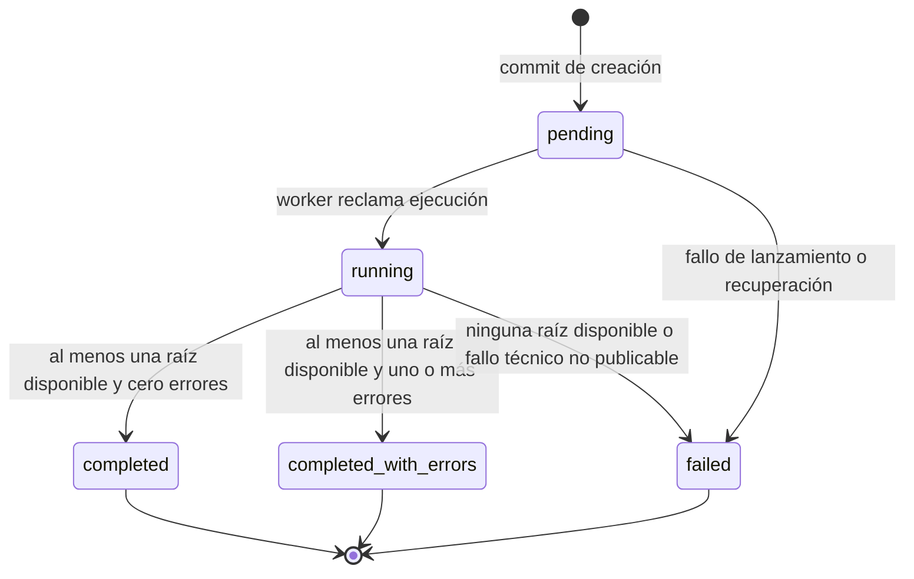
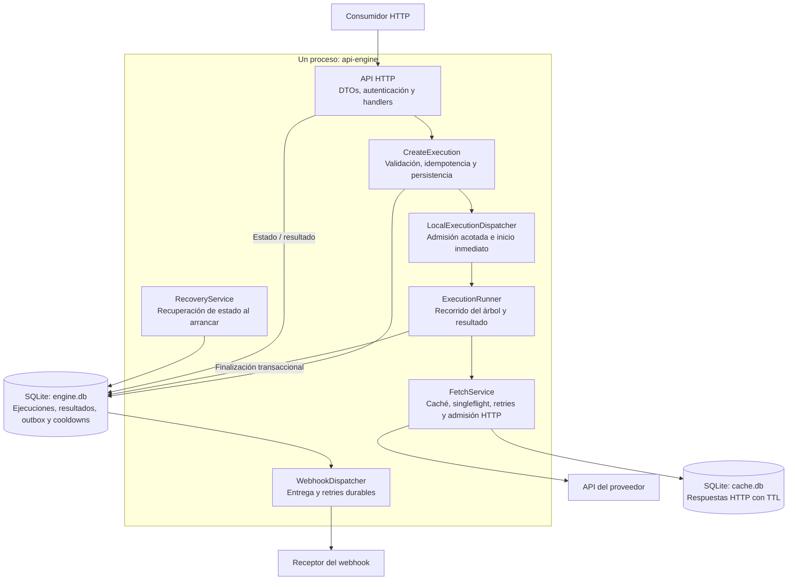
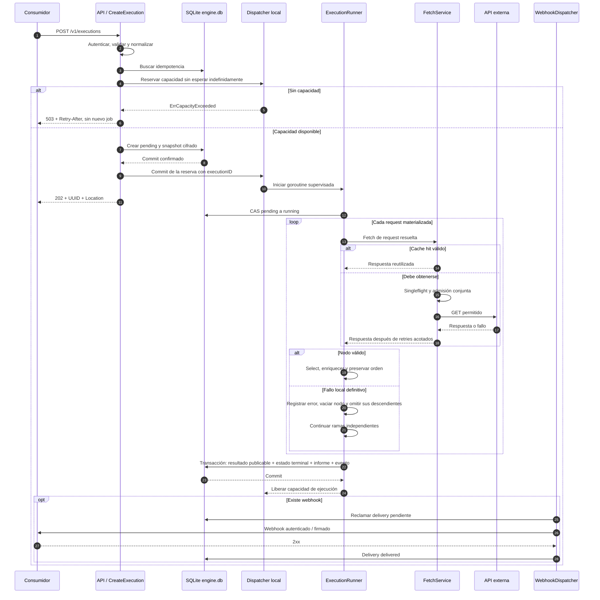
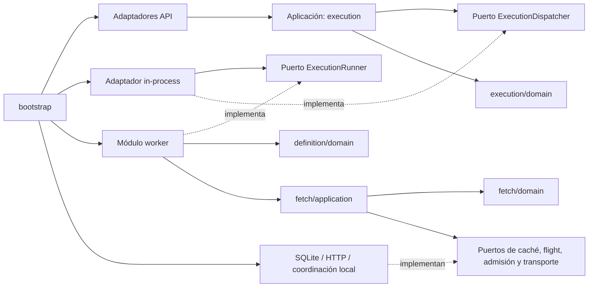
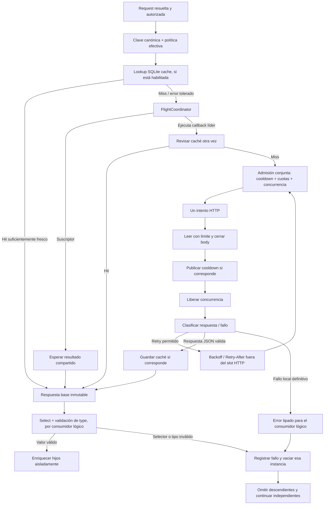
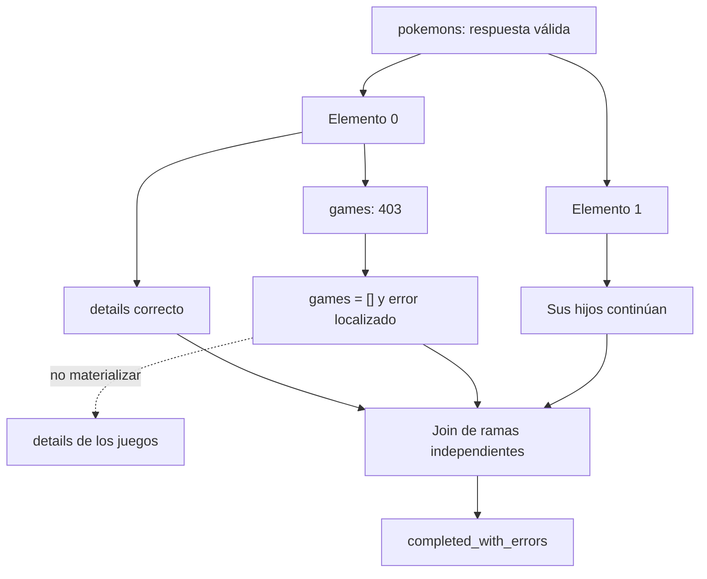
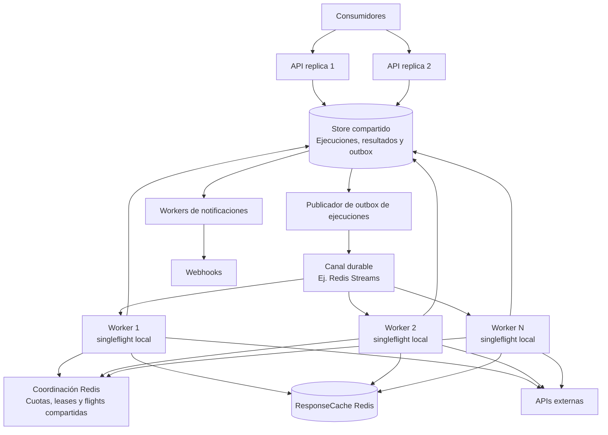

# Especificación de implementación — API Execution Engine en Go

**Versión del documento:** 1.1 — resultados parciales y errores por nodo  
**Versión del contrato público:** 1  
**Fecha:** 18 de septiembre de 2026  
**Estado:** especificación normativa para construir el MVP; no es una implementación ya ejecutada.  
**Nombre técnico provisional:** `api-engine`.

> Un servicio asíncrono que recibe un árbol declarativo de llamadas HTTP, obtiene y enriquece sus datos respetando cuotas, evita llamadas redundantes y entrega un documento JSON cuya estructura deriva de ese árbol.

El consumidor declara la API y las relaciones. El engine no descubre endpoints, no interpreta lógica de negocio y no escribe en las bases de datos de los consumidores.

**Revisión normativa 1.1:** sustituye el fail-fast global por aislamiento de fallos por instancia de nodo. Se conservan datos válidos, se omiten descendientes dependientes de un nodo fallido y se publican `errors` y `completed_with_errors`. Se admite una raíz o varias raíces independientes. El modelo completo de fallos está en la sección 17.

**Compatibilidad:** se mantiene `definition.version: 1` porque este contrato está todavía en diseño previo a su implementación. El nuevo envelope de `/result` sí cambia el output del borrador 1.0; no es compatible con un cliente que ya esperara el documento sin envoltura. Si ese contrato ya se hubiera publicado, este cambio exigiría una nueva versión de API o negociación explícita, no un despliegue silencioso.

## Cómo utilizar este documento

Las palabras **DEBE**, **NO DEBE** y **PUEDE** expresan requisitos, prohibiciones y opciones. Las decisiones señaladas como **Futuro** son fronteras de extensión, no funcionalidades que haya que implementar en el MVP. Los ejemplos de parámetros, dominios y credenciales son ilustrativos.

El documento contiene contratos públicos, decisiones de ejecución, interfaces Go, esquema SQL, configuración, diagramas Mermaid, estrategia de pruebas y secuencia de commits. El anexo de JSON Schema es parte del contrato. Las validaciones semánticas complementan al schema: no se deben sustituir por el schema ni viceversa.

Las referencias `[Rxx]` remiten a documentación primaria al final. Las políticas particulares del engine son decisiones de diseño de este documento, no comportamientos que las bibliotecas implementen automáticamente.

---

## Contenido

1. [Objetivo y alcance](#section-1)
2. [Decisiones que cierran ambigüedades anteriores](#section-2)
3. [Contrato de creación de ejecuciones](#section-3)
4. [Selección, contextos y composición del resultado](#section-4)
5. [Construcción de requests y autenticación del proveedor](#section-5)
6. [Paginación sin total de páginas](#section-6)
7. [Contrato público de seguimiento y resultados](#section-7)
8. [Arquitectura de componentes](#section-8)
9. [Estructura DDD y organización Go](#section-9)
10. [Puertos internos y contratos Go](#section-10)
11. [Flujo de aceptación e inicio inmediato](#section-11)
12. [Worker sin scheduler de sincronizaciones](#section-12)
13. [Pipeline de obtención HTTP](#section-13)
14. [Throttling: núcleo obligatorio del engine](#section-14)
15. [Caché HTTP sobre SQLite](#section-15)
16. [Deduplicación y futura coordinación Redis](#section-16)
17. [Modelo de fallos, retries y resultados parciales](#section-17)
18. [Persistencia SQLite](#section-18)
19. [Webhook: contrato, autenticación y entrega](#section-19)
20. [Seguridad y manejo de secretos](#section-20)
21. [Configuración operativa del servicio](#section-21)
22. [Arranque, caída y apagado](#section-22)
23. [Observabilidad](#section-23)
24. [Stack, CLI y despliegue](#section-24)
25. [Evolución a API y workers separados](#section-25)
26. [Matriz de pruebas obligatoria](#section-26)
27. [Estrategia de implementación y commits](#section-27)
28. [Criterios de aceptación del MVP](#section-28)
29. [Catálogo inicial de errores](#section-29)
30. [Anexo A — JSON Schema del input v1](#section-30)
31. [Anexo B — Reglas de serialización y defaults](#section-31)
32. [Referencias técnicas primarias](#section-32)
33. [Resumen de la decisión de implementación](#section-33)
34. [Anexo C — Schema de resultados terminales](#section-34)
35. [Cambios respecto del borrador 1.0](#section-35)

---

<a id="section-1"></a>

## 1. Objetivo y alcance

### 1.1. Objetivo

Permitir que cualquier aplicación envíe una definición JSON y reciba inmediatamente un identificador consultable. Un worker local procesa la definición, obtiene los datos y registra el resultado. Opcionalmente notifica la terminación a un webhook configurado por el consumidor.

La optimización prioriza, en este orden:

1. No realizar llamadas que pueden resolverse mediante caché válida.
2. Unificar consultas idénticas que están en curso.
3. Respetar todas las restricciones de la API y del servicio.
4. Solapar operaciones independientes mediante concurrencia acotada.
5. Mantener resultados deterministas y evitar consumo ilimitado de memoria o disco.

**No se promete eliminar todos los `429`**: las cuotas pueden ser desconocidas, compartirse con aplicaciones externas o cambiar en el proveedor. Sí se exige respetar las políticas conocidas y reaccionar correctamente cuando el servidor limite el tráfico.

### 1.2. Incluido en el MVP

| Área | Decisión |
|---|---|
| Distribución | Un binario Go, un proceso y una instancia activa por directorio de datos. |
| API | `net/http`, JSON, ejecución completamente asíncrona. |
| Inicio | Inmediato después de validar y persistir; sin cron ni scheduler de sincronizaciones. |
| Persistencia | SQLite para ejecuciones, resultados, notificaciones y cooldowns. |
| Caché HTTP | SQLite independiente detrás de `ResponseCache`. |
| Deduplicación | Local al proceso, detrás de `FlightCoordinator`; adaptador basado en `singleflight`. |
| Lectura de proveedores | HTTP `GET`, respuestas JSON. |
| Composición | Árbol `calls` / `children`, selección mediante dot notation. |
| Paginación | Páginas numéricas incrementales, sin consultar totales ni metadatos de continuación. |
| Límites | Cuotas globales de proveedor, cuotas de endpoint, concurrencia y presupuestos de recursos. |
| Fallos | Reintentos acotados, aislamiento por nodo, descendientes omitidos, `errors`, resultados parciales terminales y estado persistido. |
| Webhook | Opcional; `POST`, `PUT` o `PATCH`, autenticación, firma opcional y reintentos persistidos. |
| Evolución | Puertos que permitan sustituir caché, coordinación, despacho y almacenamiento. |

`request.method` permanece explícito para estabilizar el contrato. En **v1 solo se admite `GET` para los proveedores**. Los métodos con efectos secundarios y los `POST` de búsqueda requerirán una política explícita de idempotencia en otra versión; no se habilitan simplemente agregándolos a una lista.

### 1.3. Fuera del MVP

No implementar descubrimiento de APIs, OpenAPI importado, GraphQL, código evaluable, filtros o expresiones en `select`, OAuth con refresh automático, transacciones en sistemas externos, sincronización de negocio, deducción de eliminaciones, envío progresivo de resultados mientras el job corre, reanudación a nivel de nodo, planificaciones recurrentes, cola de ejecuciones ilimitada, múltiples réplicas de SQLite compartido ni adaptadores Redis funcionales.

No construir una UI, SDKs Laravel/Python, infraestructura Kubernetes ni un framework general de workflows. La especificación se centra exclusivamente en el servicio Go.

### 1.4. Qué significa «preparado para crecer»

Significa tener contratos internos y dependencias orientadas correctamente. **No significa que el MVP ya sea distribuido**.

`singleflight` coordina llamadas dentro de un `Group` del mismo proceso. Un Redis usado solamente como caché no coordina automáticamente esos grupos ni las cuotas de varios procesos. La futura ejecución distribuida requiere, adicionalmente, coordinación compartida, entrega durable de trabajos y almacenamiento común de ejecuciones. [R03][R10]

---

<a id="section-2"></a>

## 2. Decisiones que cierran ambigüedades anteriores

| Tema | Regla normativa |
|---|---|
| Scheduler | No existe un componente para programar sincronizaciones. Los timers de retries, expiración y mantenimiento no son un scheduler de negocio. |
| Saturación | Se rechazan nuevas ejecuciones con `503`; no se crean infinitas goroutines esperando un semáforo. |
| Reinicio | El MVP conserva los registros, pero no reanuda el árbol. Los jobs pendientes o activos de un proceso anterior terminan como `failed / PROCESS_INTERRUPTED`. |
| `select` | Omisión o `null` selecciona el body completo. No es JSONPath ni la implementación completa de Laravel. |
| `single` | Un valor no-array: objeto, escalar o `null`. No implica necesariamente un objeto. |
| `collection` | Un array. La colección vacía es `[]`, nunca `null`. |
| `pages: N` | **Como máximo N páginas**, deteniéndose antes si la página está incompleta o vacía. No obliga a consultar páginas posteriores al final. |
| Paginación «all» | Se basa en la cantidad seleccionada, no en `totalPages` ni en un cursor opaco. |
| Caché | Caché de respuestas HTTP, no de árboles enriquecidos. No congela automáticamente los hijos. |
| Cuota de API | Compartida entre ejecuciones que usan el mismo ámbito real de cuota; nunca por UUID de ejecución. |
| Cuota de nodo | Aplica a las requests de ese endpoint; no se propaga automáticamente a todos sus descendientes. |
| Resultado | Se publica un envelope terminal con `result`, `errors` y estado, solo después de ensamblar y persistir. |
| Nodo fallido | `single -> null`; `collection -> []` cuando no hay datos válidos previos. Se conserva el nombre del nodo. |
| Aislamiento | Un fallo local no cancela hermanos, otras instancias ni otras raíces; sus descendientes no se materializan. |
| Estado con datos y errores | `completed_with_errors`, sin umbral por porcentaje. |
| Raíces | `calls` es un array no vacío de raíces independientes de la misma API. |
| Fracaso de obtención | `failed` si ninguna raíz pudo aceptar su respuesta inicial/página; una colección vacía válida sí cuenta como éxito. |
| Excepción técnica | Pérdida de estado, corrupción o imposibilidad de construir/persistir un resultado confiable pueden causar `failed` aunque hubo requests exitosas. |
| Fallo del webhook | No cambia una ejecución ya completada a `failed`. |
| Entrega | Los webhooks pueden repetirse. No hay garantía de entrega exactamente una vez. |
| Tamaño | El resultado se ensambla en memoria con límites explícitos; no se afirma soporte ilimitado o streaming en v1. |

Estas decisiones son deliberadas para que una implementación no tenga que adivinar comportamientos.

---

<a id="section-3"></a>

## 3. Contrato de creación de ejecuciones

### 3.1. Endpoint y envoltura

```http
POST /v1/executions
Authorization: Bearer <token-del-consumidor-en-el-engine>
Content-Type: application/json
Idempotency-Key: <opcional>
```

La autenticación de esta request identifica al consumidor del engine. Es distinta de `definition.api.auth`, que autentica al engine ante el proveedor, y de `webhook.auth`, que autentica la notificación ante su receptor.

```json
{
  "definition": {
    "version": 1,
    "api": {
      "baseUrl": "https://example.com/api/v1",
      "auth": {
        "type": "bearer",
        "token": "REEMPLAZAR_CON_TOKEN_DEL_PROVEEDOR"
      },
      "headers": {
        "Accept": "application/json"
      },
      "limits": {
        "requests": 100,
        "per": "1m",
        "concurrency": 10
      },
      "cache": {
        "ttl": "1h"
      }
    },
    "calls": [
      {
      "name": "pokemons",
      "type": "collection",
      "select": "data",
      "request": {
        "method": "GET",
        "path": "/pokemons",
        "query": {
          "perPage": 100
        }
      },
      "pagination": {
        "page": "page",
        "pageSize": "perPage",
        "start": 1,
        "pages": "all"
      },
      "cache": false,
      "children": [
        {
          "name": "details",
          "type": "single",
          "select": "data",
          "request": {
            "method": "GET",
            "path": "/pokemons/{parent.id}"
          },
          "cache": {
            "ttl": "24h"
          }
        },
        {
          "name": "games",
          "type": "collection",
          "select": "data",
          "request": {
            "method": "GET",
            "path": "/pokemons/{pokemons.id}/games"
          },
          "cache": false,
          "children": [
            {
              "name": "details",
              "type": "single",
              "select": "data",
              "request": {
                "method": "GET",
                "path": "/games/{parent.id}"
              },
              "limits": {
                "requests": 50,
                "per": "1m"
              },
              "cache": {
                "ttl": "7d"
              }
            }
          ]
        }
      ]
      }
    ]
  },
  "webhook": {
    "url": "https://consumer.example.com/webhooks/api-engine",
    "method": "POST",
    "headers": {
      "X-Integration": "pokemon-import"
    },
    "auth": {
      "type": "bearer",
      "token": "REEMPLAZAR_CON_TOKEN_DEL_WEBHOOK"
    },
    "payload": "status"
  }
}
```

El ejemplo deshabilita la caché para descubrir la lista raíz y sus relaciones, pero reutiliza los detalles. No prescribe estos TTL para todas las APIs: el consumidor debe decidir la frescura aceptable.

`webhook` es opcional y acepta `null`. `calls` siempre es un array no vacío de raíces independientes, incluso cuando existe una sola raíz. Una API por ejecución. No existe un registro previo obligatorio de proveedores.

### 3.2. Compatibilidad y validación estructural

Todos los objetos de configuración son estrictos: propiedades desconocidas se rechazan con `422`. Se rechaza JSON inválido, claves duplicadas, bytes posteriores al documento y profundidad JSON superior al límite del servidor. Rechazar duplicados evita que dos decodificadores interpreten de manera diferente el mismo contrato.

`version` es obligatorio y debe ser `1`. Los defaults se aplican explícitamente en un normalizador; JSON Schema describe defaults, pero **no se debe asumir que los inserta**.

El HTTP handler transforma DTOs de transporte a objetos de aplicación. Los tipos de dominio no deben implementar detalles del body HTTP público ni depender de una librería de JSON Schema.

### 3.3. Una o varias raíces

`definition.calls` siempre acepta un array no vacío de objetos. Una ejecución con una sola raíz también debe contener un array de un elemento. Esto mantiene una forma de contrato uniforme y pointers de validación estables.

Ejemplo completo de varias raíces:

```json
{
  "definition": {
    "version": 1,
    "api": {
      "baseUrl": "https://example.com/api/v1",
      "limits": { "requests": 100, "per": "1m" }
    },
    "calls": [
      {
        "name": "pokemons",
        "type": "collection",
        "select": "data",
        "request": { "method": "GET", "path": "/pokemons" }
      },
      {
        "name": "games",
        "type": "collection",
        "select": "data",
        "request": { "method": "GET", "path": "/games" }
      }
    ]
  }
}
```

Ambas raíces utilizan la misma conexión, credenciales y cuotas compartidas de `api`. Sus nombres son únicos entre sí. Una raíz no puede leer los resultados de otra mediante plantillas; no son ancestros. Diferentes APIs por raíz siguen fuera de v1.

El compilador asigna a cada raíz un índice estable y preserva su JSON Pointer de origen: `/definition/calls/0`, `/definition/calls/1`, etc. No perder este dato al decodificar: los errores deben apuntar al input que realmente envió el consumidor.

Se valida `executions.maxRootCalls` antes de aceptar el job. Las raíces se procesan con el mismo presupuesto de ramas, HTTP y memoria de la ejecución, no con un pool ilimitado por raíz.

### 3.4. Definición de un nodo

| Campo | Requerido | Semántica |
|---|---:|---|
| `name` | Sí | Nombre de la propiedad de salida. Identificador válido y único entre hermanos. |
| `type` | Sí | `single` o `collection`. |
| `select` | No | Ruta relativa al body JSON; omisión o `null` usa el body completo. |
| `request` | Sí | Método, path, query y headers estáticos opcionales. |
| `pagination` | No | Solo válido para `collection`. |
| `children` | No | Array de nodos que enriquecen cada valor seleccionado. Default `[]`. |
| `limits` | No | Restricción del endpoint, adicional a las de API y del servidor. |
| `cache` | No | `false` o un objeto con `ttl`. Hereda la política efectiva de su ancestro más cercano. |

`name` cumple `^[A-Za-z_][A-Za-z0-9_]*$`, máximo 64 caracteres. `parent` se reserva como nombre de contexto y no se acepta como nombre de nodo.

La omisión de caché en todo el árbol equivale a caché deshabilitada. Un `cache: false` afecta al nodo y se hereda por sus descendientes hasta que otro nodo declare un TTL.

---

<a id="section-4"></a>

## 4. Selección, contextos y composición del resultado

### 4.1. Dot notation de `select`

Se implementa un selector pequeño, determinista y sin evaluación de código.

| Selección | Significado |
|---|---|
| `data` | Propiedad `data` del body. |
| `data.results` | Propiedad `results` dentro de `data`. |
| `data.1.attr` | Segundo elemento de `data`, después su propiedad `attr`. |
| `null` u omitido | Body completo. |

Los índices son base cero. Ante un objeto, un segmento numérico se busca como nombre de propiedad; ante un array se interpreta como índice decimal no negativo. No se convierte un objeto en array ni se ordenan keys para simular una colección.

No se admiten `*`, filtros, funciones, operadores, `[]`, segmentos vacíos o acceso a propiedades cuyo nombre contenga un punto literal. No se interpreta `$`. Estos casos necesitan una extensión futura, no heurísticas ocultas.

La selección se ejecuta **antes** de calcular el tamaño de una página y **antes** de construir contextos para los hijos.

Una ruta ausente causa `SELECT_PATH_NOT_FOUND`; un `null` existente sigue siendo `null`. El nodo se vacía según su tipo y registra el error, pero **no** se presenta como una respuesta vacía exitosa. En paginación, el resultado del selector debe representarse como éxito o fallo tipado antes de examinar su cantidad; un selector fallido nunca activa la condición normal de fin.

### 4.2. Tipos de valores y normalización

`collection` exige un array después de `select`. `single` exige un valor no-array. No hay conversión implícita de un objeto único a una colección de un elemento.

Sin `children`, se conserva el valor seleccionado, incluyendo escalares y `null`. Con `children`:

- Un objeto se copia y se enriquece con propiedades nombradas como sus hijos.
- Un escalar `string`, `number` o `boolean` se normaliza a `{ "value": <escalar> }` antes de enriquecerlo.
- `null` y arrays anidados no son contextos enriquecibles en v1: producen `PARENT_NOT_ENRICHABLE` para esa instancia. Si es un elemento de colección, conservar su posición como `null`, omitir sus hijos y continuar los demás elementos. No convertir un elemento defectuoso en fallo de toda la colección.

Esta regla permite manejar APIs que devuelven solamente IDs sin agregar un lenguaje de mapping:

```json
{
  "name": "games",
  "type": "collection",
  "request": {
    "method": "GET",
    "path": "/pokemons/{parent.id}/games"
  },
  "children": [
    {
      "name": "details",
      "type": "single",
      "request": {
        "method": "GET",
        "path": "/games/{parent.value}"
      }
    }
  ]
}
```

Si la respuesta es `[10, 20]`, el nodo produce:

```json
{
  "games": [
    {
      "value": 10,
      "details": { "id": 10, "title": "Red" }
    },
    {
      "value": 20,
      "details": { "id": 20, "title": "Blue" }
    }
  ]
}
```

**No se agrega `value` a objetos normales.** Esta normalización es una decisión explícita del contrato y debe tener pruebas propias. Sin hijos, la misma colección seguiría siendo `[10, 20]`.

### 4.3. Referencias a ancestros

Las plantillas solo se admiten en `request.path` y en valores string de `request.query`.

```text
{parent.id}
{parent.value}
{pokemons.id}
{companies.id}
{users.id}
```

`parent` es el objeto seleccionado/normalizado que origina esa llamada, no el body HTTP completo ni la colección entera. Un ancestro por nombre significa **su instancia concreta en la rama actual**, no una búsqueda global por ID.

Solo se pueden leer ancestros. No se permite leer hermanos, otros jobs ni los resultados enriquecidos por hijos. Los contextos se congelan antes de enriquecer; así, ejecutar dos hermanos en otro orden no cambia sus parámetros.

Si dos ancestros de la misma rama comparten nombre, una referencia nominal a ese nombre es ambigua y se rechaza al compilar. `parent` sigue siendo válido. Repetir `details` en ramas distintas, como en el ejemplo principal, sí es válido.

En el nodo raíz no se permiten referencias a `parent` ni a ancestros inexistentes. Una propiedad necesaria que falta en los datos produce `BINDING_PATH_NOT_FOUND`; nunca se sustituye por string vacío.

### 4.4. Codificación y tipos

Los objetos, arrays y `null` no se convierten automáticamente a parámetros URL. Se admiten strings, números y booleanos. Los números JSON se leen con `json.Decoder.UseNumber`, preservando IDs grandes; no convertir todos los números a `float64`.

Las variables se resuelven primero y se codifican con reglas de `net/url`: segmentos de path y valores de query por separado. No concatenar una variable sin escapar a una URL completa. No hacer sustitución textual sobre el JSON serializado.

Se rechazan controles, CR/LF y sustituciones que formen segmentos `.` o `..`. La URL final no puede cambiar de origen, agregar userinfo, escapar del prefijo base mediante traversal ni introducir fragmentos.

### 4.5. Colisiones y orden

Si el objeto seleccionado ya tiene una propiedad con el mismo nombre que un hijo, esa **instancia de objeto** falla con `OUTPUT_FIELD_COLLISION`. Verificar todas sus colisiones antes de lanzar hijos. Representar la instancia como `null`, registrar su ubicación y omitir sus hijos; los demás elementos y ramas continúan. Para un `single` es el nodo completo; para una colección es únicamente el elemento afectado. No sobrescribir silenciosamente el atributo original con un placeholder del hijo ni construir un objeto ambiguo. El consumidor debe cambiar `name` del hijo.

Los fallos de enriquecimiento no invalidan retroactivamente una respuesta raíz que ya pasó HTTP, JSON, `select` y `type`. Esta distinción se utiliza en el cálculo de disponibilidad de raíces de la sección 17; el diagnóstico hace explícito cuándo un objeto no se pudo representar.

Los arrays conservan el orden recibido de cada página y el orden numérico de las páginas. Las respuestas HTTP pueden finalizar fuera de orden sin alterar el orden del resultado. Los objetos JSON no tienen un orden semántico de propiedades; no se promete orden de keys.

La deduplicación de requests **no elimina elementos del resultado**. Si dos Pokémon usan el mismo juego, ambos conservan su relación y reciben su propio subárbol, aunque el JSON HTTP base se haya descargado una sola vez.

### 4.6. Documento de datos del ejemplo

```json
{
  "pokemons": [
    {
      "id": 1,
      "name": "Bulbasaur",
      "details": {
        "id": 1,
        "height": 7,
        "weight": 69
      },
      "games": [
        {
          "id": 10,
          "details": {
            "id": 10,
            "title": "Pokemon Red",
            "console": "Game Boy"
          }
        }
      ]
    }
  ]
}
```

El JSON anterior es **el valor de `result`**, no el body HTTP completo de `/result`. La envoltura pública añade estado y errores sin insertar metadata dentro de los Pokémon.

No se necesitan `map`, `relations`, `foreach` ni un schema separado de mapping. El árbol define la estructura, pero **no verifica los tipos de cada atributo de negocio** que devuelve el proveedor.

---

<a id="section-5"></a>

## 5. Construcción de requests y autenticación del proveedor

### 5.1. `api.baseUrl` y `request.path`

`baseUrl` es HTTPS, absoluta, sin query, fragmento ni userinfo. Puede incluir un prefijo como `/api/v1`. El path de un nodo comienza con `/`, no puede ser una URL absoluta, y se concatena lógicamente **dentro del prefijo base**.

```text
baseUrl = https://example.com/api/v1
path    = /pokemons/1
final   = https://example.com/api/v1/pokemons/1
```

No usar `ResolveReference` ingenuamente con un path absoluto, porque podría descartar `/api/v1`. Implementar y probar un `RequestURLBuilder` específico que preserve este contrato.

`path` no contiene `?` ni `#`: los parámetros pertenecen a `query`. No se siguen redirects en v1. Un `3xx` se trata como error de proveedor; esta restricción también evita enviar credenciales automáticamente a otro destino.

### 5.2. `query` y `headers`

`query` acepta valores escalares JSON: string, número o booleano. No admite arrays, objetos ni `null` en v1. Se usa `url.Values` para codificación. El parámetro de página es administrado exclusivamente por `pagination` y no puede declararse también en `query`.

Los headers pueden declararse en `api.headers` y `request.headers`; un header del nodo reemplaza al de API por nombre case-insensitive. Son estáticos: no se interpolan secretos ni datos de ancestros en headers en v1.

Se prohíbe configurar headers hop-by-hop y controlados por el transporte: `Host`, `Connection`, `Content-Length`, `Transfer-Encoding`, entre otros. El mecanismo de `auth` es dueño de su header: declarar además otro valor para el mismo header es un error de validación.

El transporte agrega `Accept: application/json` cuando no se proporcionó, y un `User-Agent` estable del engine. No usar un cookie jar compartido entre proveedores o consumidores.

### 5.3. Formas de autenticación

La misma estructura conceptual se reutiliza entre proveedor y webhook; el proveedor no admite `hmac` en v1 porque su esquema de firma depende de cada API.

```json
{ "type": "none" }
```

```json
{ "type": "bearer", "token": "secret" }
```

```json
{ "type": "basic", "username": "engine", "password": "secret" }
```

```json
{ "type": "header", "name": "X-API-Key", "value": "secret" }
```

Omitir `auth` equivale a `none`. No se deducen tipos de autenticación a partir de headers arbitrarios. No se implementa refresh de tokens ni un retry especial para `401`.

Las credenciales recibidas se cifran al persistir. Strings como `${API_TOKEN}` **no leen variables de entorno del servidor**; se tratan como valores literales. Los clientes resuelven sus secretos antes de enviar el JSON. Una futura referencia a un secret store debe tener contrato y autorización propios.

---

<a id="section-6"></a>

## 6. Paginación sin total de páginas

### 6.1. Contrato

```json
{
  "pagination": {
    "page": "page",
    "pageSize": "perPage",
    "start": 1,
    "pages": "all"
  }
}
```

| Campo | Default | Regla |
|---|---|---|
| `page` | Sin default | Nombre del parámetro query que recibe el número de página. Obligatorio. |
| `pageSize` | Omitido | Nombre del parámetro query que representa el tamaño pedido. |
| `start` | `1` | Entero >= 0; permite APIs con base cero. |
| `pages` | `"all"` | `"all"` o entero positivo que limita cuántas páginas consultar. |

Si `pageSize` existe, `request.query[pageSize]` debe existir y ser un entero positivo **estático**. `page` y `pageSize` deben tener nombres diferentes. No se deduce el tamaño a partir de nombres convencionales como `limit` o `perPage`.

Sin `pagination`, se hace una sola llamada aunque la respuesta tenga exactamente 100 elementos.

### 6.2. Algoritmo normativo

```text
expectedSize = query[pageSize] si existe; de lo contrario desconocido
pageNumber = start
acceptedPages = 0
output = []

repetir:
    verificar presupuesto local de páginas y contexto global
    obtener página mediante FetchService, con retry acotado
    aplicar select y exigir array

    si fetch/select/type falla definitivamente:
        registrar un NodeFailure con page = pageNumber
        terminar ESTA paginación como incompleta
        conservar output de las páginas previamente aceptadas
        no solicitar pageNumber + 1

    n = longitud del array seleccionado, ANTES de enriquecer
    si expectedSize es desconocido y n > 0:
        expectedSize = n
    si expectedSize es conocido y n > expectedSize:
        registrar PAGINATION_SIZE_INCONSISTENT
        descartar esta página no aceptada; conservar las anteriores
        terminar ESTA paginación como incompleta

    acceptedPages += 1
    marcar OwnDataAvailable = true, incluso si n == 0
    enriquecer elementos aisladamente y conservar sus índices
    agregar página al resultado; no filtrar elementos fallidos

    si n == 0 o n < expectedSize:
        terminar normalmente
    si pages es entero y acceptedPages == pages:
        terminar normalmente por límite solicitado
    si se agotaría maxPagesPerCall del servidor:
        registrar PAGINATION_LIMIT_REACHED y terminar incompleta
    pageNumber += 1
```

La primera página también puede ser parcial cuando se configuró tamaño explícito. Un error HTTP, un `select` ausente o un tipo incorrecto no son una página vacía. Si no hubo ninguna página aceptada, el valor es `[]` con error y `OwnDataAvailable = false`; si ya hubo alguna, se conserva su prefijo y `OwnDataAvailable = true`.

Un fallo de un hijo dentro de una página **no interrumpe la paginación de su padre**. Solo fallar al obtener/interpretar la propia página, su guard local o una interrupción global detiene ese paginador. No contar únicamente elementos enriquecidos con éxito para decidir si hay otra página.

### 6.3. Sin `pageSize`

La primera respuesta no vacía establece el tamaño esperado para esa invocación. Por ejemplo: `75, 75, 20` produce tres páginas y termina. Si la primera respuesta está vacía, produce `[]` y no intenta inferir un tamaño cero.

Cada colección paginada de cada padre tiene su propio estado. La página 1 de `games` para un Pokémon no comparte contador con la página 1 de otro Pokémon.

### 6.4. Casos importantes

| Respuestas, tamaño 100 | Comportamiento |
|---|---|
| `100, 100, 37` | Incluye 237 elementos y termina. |
| `100, 100, 0` | Incluye 200 elementos; la última request es necesaria para descubrir el final. |
| `0` | Colección vacía. |
| `50` con `perPage=100` | Termina; esta estrategia asume que una página parcial indica final. |
| `100, 120` | Conserva los primeros 100; descarta la página inconsistente y registra `PAGINATION_SIZE_INCONSISTENT`. |
| `100, 100, ...` y límite del servidor alcanzado | Conserva el prefijo, registra `PAGINATION_LIMIT_REACHED` y termina incompleta, nunca como `completed`. |
| `pages=2`, respuestas `100, 100` | Completa lo solicitado: como máximo dos páginas. |
| `pages=5`, respuestas `100, 12` | Termina después de dos páginas. |

**Límite de compatibilidad:** algunas APIs devuelven páginas cortas sin haber terminado, limitan silenciosamente `perPage`, o tienen resultados cambiantes durante el recorrido. Con este contrato no se puede garantizar un barrido completo de esas APIs. Es una limitación elegida, no algo que el engine deba «resolver» leyendo totales a escondidas.

No existe una instantánea consistente del proveedor salvo que él la garantice. No se eliminan duplicados de datos para compensar cambios durante la paginación.

### 6.5. Protección contra loops

Aplicar `maxPagesPerCall`, `maxLogicalRequests`, `maxHTTPAttempts`, deadline y límites de resultado. Opcionalmente, mediante configuración del servidor, detectar dos páginas completas consecutivas con hash idéntico, descartar la página repetida antes de aceptar/enriquecer sus datos y terminar ese paginador con `PAGINATION_NO_PROGRESS`, conservando el prefijo previo.

La detección por hash puede rechazar APIs con páginas legítimamente idénticas: es una protección, no una demostración matemática de falta de avance. Puede deshabilitarse por el operador; los límites duros permanecen activos.

En el MVP las páginas de una misma colección se consultan secuencialmente y la siguiente se pide después de enriquecer la actual. No se especulan páginas que posiblemente no existan. Dentro de la página sí hay concurrencia entre elementos y ramas.

---

<a id="section-7"></a>

## 7. Contrato público de seguimiento y resultados

### 7.1. Creación aceptada

Solo se responde `202` después de confirmar la persistencia y transferir la responsabilidad al despachador local.

```http
HTTP/1.1 202 Accepted
Content-Type: application/json
Location: /v1/executions/0199570c-8a60-7c8c-8f93-ae3c7a7f301e
Cache-Control: no-store
```

```json
{
  "id": "0199570c-8a60-7c8c-8f93-ae3c7a7f301e",
  "status": "pending",
  "links": {
    "self": "/v1/executions/0199570c-8a60-7c8c-8f93-ae3c7a7f301e",
    "result": "/v1/executions/0199570c-8a60-7c8c-8f93-ae3c7a7f301e/result"
  }
}
```

`202` significa aceptación, no finalización. [R08] Se utiliza UUIDv7 mediante un generador abstraído. No es un secreto ni un mecanismo de autorización; además, su componente temporal no debe considerarse confidencial. [R13]

El estado de la respuesta es una instantánea: el worker puede haber avanzado cuando el cliente la reciba. No se garantiza que el callback llegue después de que el consumidor haya procesado su `202`.

### 7.2. Consulta de estado

```http
GET /v1/executions/{id}
Authorization: Bearer <token-del-consumidor>
```

```json
{
  "id": "0199570c-8a60-7c8c-8f93-ae3c7a7f301e",
  "status": "running",
  "createdAt": "2026-09-18T08:00:00Z",
  "startedAt": "2026-09-18T08:00:00.010Z",
  "finishedAt": null,
  "progress": {
    "logicalRequests": 120,
    "httpAttempts": 83,
    "cacheHits": 25,
    "coalescedRequests": 14,
    "retries": 2,
    "completedRootItems": 20,
    "nodeFailures": 0,
    "skippedSubtrees": 0
  },
  "webhook": {
    "status": "not_ready",
    "attempts": 0
  },
  "error": null,
  "errors": [],
  "errorSummary": { "total": 0, "returned": 0, "truncated": false },
  "roots": [],
  "links": {
    "self": "/v1/executions/0199570c-8a60-7c8c-8f93-ae3c7a7f301e",
    "result": "/v1/executions/0199570c-8a60-7c8c-8f93-ae3c7a7f301e/result"
  }
}
```

Sin webhook, `webhook` es `null`. No exponer la definición, secretos, URLs con query sensible ni tokens en esta respuesta. Los contadores son una instantánea aproximada mientras el job corre; las unidades y actualizaciones se detallan en observabilidad.

No publicar un porcentaje inventado: el número final de llamadas puede ser desconocido hasta expandir el árbol.

`GET /executions/{id}` devuelve `200` cuando la consulta es válida, también para `completed_with_errors` y `failed`; no propaga el status HTTP del proveedor como status de nuestra API. `error` es el fallo global, normalmente `null`; `errors` contiene diagnósticos por nodo al finalizar y está acotado. En `running`, `errors: []` y `roots: []` no garantizan ausencia de errores: la lista terminal todavía no se publica; consultar el contador aproximado `progress.nodeFailures`. La disponibilidad de diagnósticos progresivos queda fuera del MVP.

### 7.3. Obtención del resultado

```http
GET /v1/executions/{id}/result
Authorization: Bearer <token-del-consumidor>
```

En `completed` y `completed_with_errors` devuelve `200 application/json` con un **envelope estable**. El árbol definido por el consumidor permanece intacto dentro de `result`. No usar `206` o `207` para señalar incompletitud de negocio ni mezclar propiedades `errors` dentro de los datos del proveedor.

```json
{
  "id": "0199570c-8a60-7c8c-8f93-ae3c7a7f301e",
  "status": "completed_with_errors",
  "result": {
    "pokemons": [
      {
        "id": 1,
        "details": {
          "id": 1,
          "name": "Bulbasaur"
        },
        "games": []
      },
      {
        "id": 2,
        "details": null,
        "games": [
          {
            "id": 10,
            "details": {
              "id": 10,
              "title": "Red"
            }
          }
        ]
      }
    ]
  },
  "errors": [
    {
      "code": "UPSTREAM_FORBIDDEN",
      "message": "El proveedor rechazó el acceso a este recurso.",
      "nodePath": "pokemons[0].games",
      "definitionPath": "/definition/calls/children/1",
      "stage": "fetch",
      "upstreamStatus": 403,
      "attempts": 1,
      "retryable": false,
      "retryExhausted": false,
      "descendantsSkipped": true,
      "request": {
        "method": "GET",
        "pathTemplate": "/pokemons/{pokemons.id}/games"
      },
      "scope": "node"
    },
    {
      "code": "UPSTREAM_NOT_FOUND",
      "message": "El proveedor no encontró el recurso solicitado.",
      "nodePath": "pokemons[1].details",
      "definitionPath": "/definition/calls/children/0",
      "stage": "fetch",
      "upstreamStatus": 404,
      "attempts": 1,
      "retryable": false,
      "retryExhausted": false,
      "descendantsSkipped": false,
      "request": {
        "method": "GET",
        "pathTemplate": "/pokemons/{parent.id}"
      },
      "scope": "node"
    }
  ],
  "errorSummary": {
    "total": 2,
    "returned": 2,
    "truncated": false
  },
  "roots": [
    {
      "name": "pokemons",
      "status": "completed_with_errors",
      "dataAvailable": true
    }
  ],
  "error": null
}
```

`null` y `[]` también pueden ser valores legítimos del proveedor; la presencia de un error con ese `nodePath` distingue el placeholder de un dato vacío válido. Nunca deducir éxito contando elementos del array.

| Situación | Respuesta |
|---|---|
| `completed` | `200`, envelope con `result`, `errors: []`, `error: null`. |
| `completed_with_errors` | `200`, mismo envelope con resultados conservados y errores. |
| Pendiente o activa | `409 RESULT_NOT_READY`; no streaming en v1. |
| `failed` | `409 EXECUTION_FAILED`; consultar `GET /executions/{id}` para `error`, `errors` y resumen. |
| Resultado expirado y metadata aún existente | `410 RESULT_EXPIRED`. |
| ID inexistente o no pertenece al consumidor | `404 EXECUTION_NOT_FOUND`. |

En una ejecución fallida por ausencia total de raíces válidas no se publica un objeto compuesto solo de placeholders como resultado útil. Los errores sí están disponibles en el estado. Una avería de almacenamiento puede impedir actualizar incluso el fallo: en ese caso no anunciar éxito; la reconciliación posterior sigue siendo necesaria.

Todos estos endpoints responden `Cache-Control: no-store`. El endpoint de resultado no usa la caché de proveedores. Su límite de bytes comprende todo el envelope, no solo `result`.

### 7.4. Estados



Los estados terminales son inmutables. No cambiar provisionalmente el job a `completed_with_errors` mientras aún hay ramas activas: sigue `running`. Un reintento del webhook no cambia el resultado del job. Un nuevo intento del consumidor crea otra ejecución.

La disponibilidad de una raíz se decide por su propia respuesta aceptada, no por el éxito de todos sus descendientes ni por la presencia de elementos. Una raíz que devuelve `[]` correctamente está disponible. La tabla y el algoritmo normativos están en 17.5.

### 7.5. Errores públicos

```json
{
  "error": {
    "code": "INVALID_DEFINITION",
    "message": "La definición no es válida.",
    "details": [
      {
        "path": "/definition/calls/pagination/pageSize",
        "code": "PAGE_SIZE_QUERY_REQUIRED",
        "message": "El parámetro indicado no existe en request.query."
      }
    ]
  },
  "requestId": "req_01"
}
```

No confundir el error HTTP de este endpoint con el informe de una ejecución. Los fallos globales usan `error`; los fallos locales usan `errors[]` y el contrato de 17.6, con `nodePath` y `upstreamStatus` cuando corresponde. Se utiliza JSON Pointer para localizar campos del input y rutas lógicas separadas para el resultado, como `pokemons[0].games[2].details`.

`400`: sintaxis JSON inválida. `401`: autenticación inválida. `403`: operación no autorizada. `413`: body demasiado grande. `415`: content type no admitido. `422`: contrato o semántica inválidos. `409`: conflicto de idempotencia o estado. `503`: capacidad o dependencia durable no disponible. `500`: error interno inesperado sin detalles sensibles.

### 7.6. Idempotencia de creación

`Idempotency-Key` es opcional, entre 1 y 128 caracteres del conjunto `[A-Za-z0-9._:-]`. Se identifica junto con el `ownerID` autenticado; nunca globalmente entre consumidores.

Misma key y mismo request normalizado devuelve el mismo UUID. Si ya terminó, responder `200`; si sigue pendiente/activo, `202`. Misma key con otro contenido devuelve `409 IDEMPOTENCY_CONFLICT`.

El fingerprint cubre definición, webhook y defaults normalizados, incluyendo los valores de credenciales mediante una representación protegida. Diferente orden de propiedades JSON no genera un conflicto. Diferente orden en arrays sí puede hacerlo.

La restricción única vive en SQLite, no solo en un mutex. Resolver carreras con transacciones cortas. En un replay no reservar capacidad ni iniciar otro job. Si dos requests concurrentes compiten, la perdedora libera su reserva y devuelve el registro ganador cuando el fingerprint coincida.

Retener la key mientras se retenga la metadata. Tras expirar el registro, reutilizar la key puede crear una nueva ejecución; debe documentarse al consumidor.

---

<a id="section-8"></a>

## 8. Arquitectura de componentes

### 8.1. Despliegue del MVP



No existe una cola durable de ejecuciones en v1. El registro SQLite hace durable la identidad y el estado, no el progreso interno de cada request.

Se usan dos archivos SQLite para no mezclar el tráfico prescindible de caché con las transacciones críticas de estado. No es obligatorio mantenerlos en discos diferentes. No hay transacciones distribuidas entre ambos archivos: no son necesarias.

### 8.2. Secuencia principal



La posición relativa del `202` y del inicio efectivo del worker puede variar por concurrencia. La garantía importante es que ningún job se inicia antes del commit de creación.

### 8.3. Dependencias lógicas



La API no importa el worker concreto. El worker no importa handlers, routers ni DTOs HTTP. `bootstrap` es el único lugar que conoce simultáneamente las implementaciones y las conecta mediante constructores.

### 8.4. Reparto de responsabilidades

| Componente | Responsabilidad | No debe hacer |
|---|---|---|
| `CreateExecutionHandler` | Traducir HTTP a caso de uso y mapear errores. | Ejecutar el árbol, iniciar goroutines directamente, abrir SQLite. |
| `CreateExecution` | Validar semántica, idempotencia, reserva y creación. | Conocer Redis, el transporte HTTP del proveedor o el algoritmo de recorrido. |
| `DefinitionCompiler` | Preparar selector, plantillas y políticas inmutables. | Hacer requests o acceder a secretos ambientales. |
| `LocalExecutionDispatcher` | Supervisar goroutines y limitar ejecuciones activas. | Interpretar `calls` o programar recurrencias. |
| `ExecutionRunner` | Ciclo de vida del job y finalización. | Implementar TTL, HMAC del webhook o SQL de caché. |
| `CallProcessor` | Obtener, seleccionar, componer y convertir fallos locales en `NodeOutcome`. | Cancelar el contexto global por un fallo del proveedor. |
| `ExecutionOutcomeResolver` | Calcular estado terminal a partir de raíces, informe y fallo técnico. | Inferir utilidad de negocio o porcentajes de tolerancia. |
| `BoundedFailureCollector` | Acumular errores sanitizados, contarlos y acotar los detalles retenidos. | Modificar el árbol o almacenar una fila SQL por request. |
| `PaginationReader` | Estado de páginas por invocación. | Leer `totalPages` o inferir cursores no declarados. |
| `FetchService` | Pipeline de obtención de una respuesta. | Agregar hijos a datos cacheados. |
| `AdmissionGate` | Aprobar conjuntamente cuotas, cooldown y concurrencia. | Cobrar requests resueltas en caché. |
| `ExecutionFinalizer` | Hacer atómica la transición terminal y su evento. | Entregar el webhook dentro de la transacción. |
| `WebhookDispatcher` | Entregar notificaciones con retries. | Cambiar el estado de negocio de una ejecución completada. |

---

<a id="section-9"></a>

## 9. Estructura DDD y organización Go

### 9.1. Estructura base

La organización agrupa primero por capacidad del dominio del engine y después por capa. Las carpetas vacías de futuros adaptadores no deben crearse. El árbol siguiente es una guía de archivos primarios, no una invitación a acumular tipos nuevos en esos archivos.

```text
cmd/
  api-engine/
    main.go

internal/
  bootstrap/
    application.go
    execution_module.go
    fetch_module.go
    notification_module.go
    build_application.go

  api/
    http/
      server.go
      router.go
      create_execution_handler.go
      get_execution_handler.go
      get_result_handler.go
      health_handler.go
      authentication_middleware.go
      request_id_middleware.go
      recovery_middleware.go
      error_presenter.go
      dto/
        create_execution_request.go
        create_execution_response.go
        execution_response.go
        execution_result_response.go
        node_error_response.go
        error_summary_response.go
        root_outcome_response.go
        execution_links.go
        progress_response.go
        webhook_status_response.go
        error_response.go
        error_detail.go
        definition_dto.go
        api_definition_dto.go
        call_dto.go
        root_calls_dto.go
        request_dto.go
        pagination_dto.go
        limits_dto.go
        cache_policy_dto.go
        webhook_dto.go
        authentication_dto.go
      mapper/
        definition_mapper.go
        execution_mapper.go

  definition/
    domain/
      definition.go
      api_connection.go
      call.go
      call_type.go
      request_template.go
      pagination.go
      page_selection.go
      dot_path.go
      template.go
      template_reference.go
      cache_policy.go
      rate_policy.go
      compiled_definition.go
      compiled_call.go
    application/
      definition_validator.go
      definition_normalizer.go
      definition_compiler.go
    infrastructure/
      schema/
        schema_validator.go
        embedded_schema.go
        create_execution_v1.schema.json

  execution/
    domain/
      execution.go
      execution_id.go
      execution_status.go
      execution_failure.go
      node_failure.go
      failure_stage.go
      failure_code.go
      execution_error_report.go
      error_summary.go
      root_outcome.go
      root_status.go
      execution_outcome_resolver.go
      execution_progress.go
      execution_snapshot.go
      execution_completion.go
      execution_started.go
      execution_finished.go
    application/
      create_execution.go
      get_execution.go
      get_result.go
      finalize_execution.go
      recover_executions.go
      create_execution_command.go
      creation_result.go
      ports/
        execution_store.go
        execution_reader.go
        execution_finalizer.go
        result_reader.go
        execution_dispatcher.go
        dispatch_reservation.go
        execution_runner.go
    infrastructure/
      inprocess/
        local_execution_dispatcher.go
        local_dispatch_reservation.go
        active_execution_registry.go
      sqlite/
        execution_store.go
        execution_reader.go
        execution_finalizer.go
        result_reader.go
        execution_row.go
        execution_mapper.go

  worker/
    execution_runner.go
    call_processor.go
    pagination_reader.go
    pagination_state.go
    node_context.go
    context_frame.go
    branch_executor.go
    result_assembler.go
    execution_budget.go
    progress_recorder.go
    node_outcome.go
    empty_node_factory.go
    bounded_failure_collector.go
    failure_order_key.go
    node_failure_mapper.go
    root_call_runner.go
    ports/
      failure_recorder.go

  fetch/
    domain/
      outbound_request.go
      raw_response.go
      request_identity.go
      fetch_policy.go
      fetch_result.go
      flight_result.go
      cache_entry.go
      admission_request.go
      quota_rule.go
      quota_scope.go
      retry_decision.go
      upstream_failure.go
    application/
      fetch_service.go
      request_builder.go
      request_key_builder.go
      fetch_retry_executor.go
      upstream_error_classifier.go
      cache_eligibility.go
      quota_scope_resolver.go
      ports/
        response_cache.go
        flight_coordinator.go
        admission_gate.go
        admission_permit.go
        outbound_transport.go
        quota_cooldown_store.go
    infrastructure/
      http/
        net_http_transport.go
        response_reader.go
        safe_dialer.go
      sqlite/
        sqlite_response_cache.go
        cache_row.go
        cache_janitor.go
        sqlite_quota_cooldown_store.go
      local/
        local_flight_coordinator.go
        flight_state.go
        flight_subscription.go
        local_admission_gate.go
        local_admission_permit.go
        quota_state.go

  notification/
    domain/
      webhook.go
      webhook_event.go
      webhook_delivery.go
      webhook_status.go
      webhook_payload_mode.go
    application/
      webhook_dispatcher.go
      webhook_payload_builder.go
      webhook_retry_policy.go
      ports/
        webhook_outbox.go
        webhook_sender.go
    infrastructure/
      http/
        http_webhook_sender.go
        hmac_signer.go
      sqlite/
        sqlite_webhook_outbox.go
        webhook_delivery_row.go

  security/
    domain/
      principal.go
      authentication.go
      authentication_type.go
      protected_blob.go
      egress_target.go
    application/
      authentication_applier.go
      egress_validator.go
      ports/
        secret_protector.go
        principal_authenticator.go
        egress_policy.go
    infrastructure/
      aes_gcm_protector.go
      token_authenticator.go
      hostname_allowlist.go

  platform/
    config/
      config.go
      http_config.go
      execution_config.go
      error_report_config.go
      fetch_config.go
      cache_config.go
      storage_config.go
      webhook_config.go
      security_config.go
      config_loader.go
    sqlite/
      database.go
      migrator.go
      instance_lock.go
    lifecycle/
      supervisor.go
      shutdown_manager.go
    observability/
      logger.go
      metrics.go
    clock/
      clock.go
      timer.go
      real_clock.go
      real_timer.go
    identifier/
      generator.go
      uuid_generator.go

migrations/
  engine/
    000001_initial.up.sql
    000001_initial.down.sql
  cache/
    000001_initial.up.sql
    000001_initial.down.sql

contracts/
  create_execution_v1.schema.json
  examples/
    pokemon_full.json
    collection_without_page_size.json
    scalar_ids.json
    webhook_hmac.json

config/
  config.example.yml

docs/
  specs/
    001-api-execution-engine.md
  adr/
    001-single-process-sqlite.md
    002-public-tree-contract.md
    003-local-admission-and-pacing.md
    004-distributed-boundaries.md

test/
  integration/
  contract/
  architecture/
  testkit/

tools/
  architecture-check/
    main.go
    checker.go

Dockerfile
compose.yaml
Makefile
go.mod
go.sum
README.md
```

Los DTOs y configuraciones adicionales que aparezcan al implementar se colocan en sus propios archivos. No se exige un archivo vacío por cada nombre del árbol desde el primer commit.

### 9.2. Regla de un tipo por archivo

**Cada archivo Go declara como máximo un tipo nombrado**, sea `struct`, `interface`, alias o enum definido con un tipo base. No usar bloques `type (...)` para agrupar tipos.

El archivo puede contener el constructor, métodos y constantes estrictamente asociados a ese tipo. Por ejemplo, `execution_status.go` contiene `type ExecutionStatus string` y sus constantes; `execution.go` contiene únicamente el struct `Execution`, su constructor y sus operaciones.

Una interfaz se declara en un archivo propio. Un mock, fake o DTO también cuenta como tipo. No esconder structs anónimos con responsabilidades propias dentro de structs mayores: darles nombre y archivo. El marcador `struct{}` usado en canales o sets es una excepción técnica, no un modelo de negocio.

Los métodos de un struct permanecen junto con su definición. Si un archivo supera el límite acordado, extraer un colaborador cohesivo; no repartir arbitrariamente los métodos del mismo tipo en cinco archivos para ocultar una responsabilidad demasiado grande.

Los archivos sin tipo pueden contener una función cohesiva —por ejemplo `main`, una función pura o una prueba— y sus helpers privados pequeños. La regla no significa «una única función por archivo».

### 9.3. Tamaño y estilo

Objetivo: archivos de producción de hasta 220 líneas lógicas; límite de revisión de 300. Funciones idealmente de hasta 40 líneas lógicas, y límite de revisión de 60. Excepciones requieren justificación concreta en la revisión, no desactivar la validación para todo el proyecto.

Preferir early return, constructores explícitos, composición, DI manual y errores envueltos con `%w`. No utilizar ORM, service locator, contenedores de dependencias, globales mutables, `panic` para validaciones esperables ni un paquete `utils` que agrupe funciones sin cohesión.

No crear `models.go`, `types.go`, `interfaces.go` o `helpers.go` como cajones de sastre. Los nombres indican la responsabilidad real.

El dominio depende de biblioteca estándar y valores propios; no conoce SQL, Redis, handlers HTTP ni implementaciones de transporte. Las interfaces se ubican cerca del caso de uso que las consume, no en el adaptador que las implementa.

### 9.4. Reglas comprobables de arquitectura

Implementar una comprobación basada en `go/parser` y `go/ast`, no solo en expresiones regulares. Debe detectar múltiples `TypeSpec` por archivo, tipos locales ocultos, structs anónimos de modelo y dependencias prohibidas.

Prohibiciones mínimas:

```text
api/**                       -> worker/** concreto
*/domain/**                  -> */infrastructure/**
*/domain/**                  -> database/sql o net/http
*/domain/**                  -> modernc.org/sqlite, redis, singleflight
*/application/**             -> su infraestructura concreta
worker/**                    -> api/**
fetch/**                     -> notification/**
```

Se permite `context`, `time`, `encoding/json` y tipos de valor estándar donde tengan sentido. No forzar una copia propia de cada tipo estándar por seguir una arquitectura purista.

---

<a id="section-10"></a>

## 10. Puertos internos y contratos Go

Los fragmentos siguientes definen fronteras, no una implementación completa. En el repositorio, **cada fragmento corresponde a su archivo indicado**. Los paquetes de dominio mencionados deben tener los valores descritos en las tablas posteriores.

### 10.1. Caché intercambiable

Archivo: `internal/fetch/application/ports/response_cache.go`.

```go
package ports

import (
    "context"

    fetchdomain "example.com/api-engine/internal/fetch/domain"
)

type ResponseCache interface {
    Get(ctx context.Context, key string) (fetchdomain.CacheEntry, bool, error)
    Put(ctx context.Context, entry fetchdomain.CacheEntry) error
    Delete(ctx context.Context, key string) error
}
```

`false, nil` significa miss; un fallo de infraestructura es `error`. El puerto no expone SQL, comandos Redis ni `*http.Response`. `Get` no renueva TTL y devuelve miss para entradas expiradas según el reloj del adaptador. La comprobación del TTL particular del nodo permanece en `FetchService`. `Put` recibe expiración absoluta y datos inmutables.

Archivo: `internal/fetch/domain/cache_entry.go`.

```go
package domain

import "time"

type CacheEntry struct {
    Key             string
    Response        RawResponse
    FetchedAt       time.Time
    ExpiresAt       time.Time
    InitialAge      time.Duration
    SchemaVersion   int
}
```

Los métodos de este valor deben copiar bytes y headers cuando se expongan a código que pudiera mutarlos. La política de selección de negocio no se almacena en esta entrada.

### 10.2. Deduplicación local o distribuida

Archivo: `internal/fetch/application/ports/flight_coordinator.go`.

```go
package ports

import (
    "context"

    fetchdomain "example.com/api-engine/internal/fetch/domain"
)

type FlightCoordinator interface {
    Do(
        ctx context.Context,
        key string,
        work func(context.Context) (fetchdomain.RawResponse, error),
    ) (fetchdomain.FlightResult, error)
}
```

`FlightResult` tiene `Response` y `ReusedInFlight bool`, cada uno con semántica explícita. `Do` permite al suscriptor abandonar su espera sin cancelar a otros interesados. El callback recibe un contexto controlado por el coordinador.

El adaptador local usa `singleflight` y una pequeña capa de suscripciones/lifetime. El futuro adaptador distribuido satisface la misma semántica localmente observable, pero no debe prometer unicidad absoluta durante fallos de red.

### 10.3. Admisión de una request física

Archivo: `internal/fetch/application/ports/admission_gate.go`.

```go
package ports

import (
    "context"
    "time"

    fetchdomain "example.com/api-engine/internal/fetch/domain"
)

type AdmissionGate interface {
    Acquire(ctx context.Context, request fetchdomain.AdmissionRequest) (AdmissionPermit, error)
    Cooldown(ctx context.Context, scope string, until time.Time) error
}
```

Archivo: `internal/fetch/application/ports/admission_permit.go`.

```go
package ports

import "context"

type AdmissionPermit interface {
    Release(ctx context.Context) error
}
```

`AdmissionRequest` contiene los scopes y reglas aplicables, identidad de ejecución y deadline; cada tipo auxiliar vive en su archivo. `Acquire` no devuelve éxito hasta que **todas** las restricciones permitan iniciar. `Release` es idempotente y libera concurrencia, pero no devuelve cuota de una request ya admitida.

El puerto permite implementar posteriormente decisiones atómicas en Redis sin cambiar el `FetchService`.

### 10.4. Transporte HTTP

Archivo: `internal/fetch/application/ports/outbound_transport.go`.

```go
package ports

import (
    "context"

    fetchdomain "example.com/api-engine/internal/fetch/domain"
)

type OutboundTransport interface {
    Execute(ctx context.Context, request fetchdomain.OutboundRequest) (fetchdomain.RawResponse, error)
}
```

El adaptador realiza **un intento**. No contiene retries, caché ni singleflight. Lee el body hasta el límite, lo cierra y devuelve bytes; un status `429` o `500` sigue siendo una respuesta HTTP, no un error de transporte.

### 10.5. Separación API / worker

Archivo: `internal/execution/application/ports/execution_dispatcher.go`.

```go
package ports

import "context"

type ExecutionDispatcher interface {
    Reserve(ctx context.Context) (DispatchReservation, error)
}
```

Archivo: `internal/execution/application/ports/dispatch_reservation.go`.

```go
package ports

import (
    "context"

    executiondomain "example.com/api-engine/internal/execution/domain"
)

type DispatchReservation interface {
    Commit(ctx context.Context, id executiondomain.ExecutionID) error
    Cancel()
}
```

Archivo: `internal/execution/application/ports/execution_runner.go`.

```go
package ports

import (
    "context"

    executiondomain "example.com/api-engine/internal/execution/domain"
)

type ExecutionRunner interface {
    Run(ctx context.Context, id executiondomain.ExecutionID) error
}
```

`Reserve` es inmediata o muy corta; no se mantiene una lista ilimitada de espera. `Cancel` es idempotente. `Commit` consume la reserva exactamente una vez dentro del proceso. El runner no recibe un `*http.Request` ni la definición en forma de closures capturadas por el handler: carga su snapshot por UUID.

`Run` devuelve `nil` cuando logró persistir cualquiera de los estados terminales de negocio, incluido `completed_with_errors` o un `failed` por raíces fallidas. Solo retorna `error` al supervisor cuando no pudo cerrar el ciclo de vida de forma confiable. El dispatcher no debe sobrescribir un parcial persistido al interpretar un error local como excepción del runner.

La reserva futura puede representar admisión en una cola remota, pero el handoff durable requerirá además el outbox descrito en la sección de evolución. No afirmar que cambiar tres líneas convierte el sistema en distribuido confiable.

### 10.6. Finalización atómica

Archivo: `internal/execution/application/ports/execution_finalizer.go`.

```go
package ports

import (
    "context"

    executiondomain "example.com/api-engine/internal/execution/domain"
)

type ExecutionFinalizer interface {
    Finish(ctx context.Context, completion executiondomain.ExecutionCompletion) error
}
```

`ExecutionCompletion` incluye UUID, versión esperada, estado terminal, fallo global opcional, `ExecutionErrorReport`, outcomes de raíces, bytes de datos opcionales y estadísticas finales. `completed` y `completed_with_errors` requieren resultado; `failed` no lo expone. El informe y el estado se calculan antes de comenzar la transacción. La implementación SQLite escribe resultado, informe, transición y delivery/evento de webhook en **una sola transacción**.

No exponer `*sql.Tx` al worker. Si el resultado se guarda en object storage en el futuro, se deberá subir primero el objeto y después confirmar el puntero y el estado transaccionalmente, con limpieza de objetos huérfanos.

### 10.7. Protección de secretos

Archivo: `internal/security/application/ports/secret_protector.go`.

```go
package ports

import (
    "context"

    securitydomain "example.com/api-engine/internal/security/domain"
)

type SecretProtector interface {
    Seal(ctx context.Context, purpose string, plaintext []byte) (securitydomain.ProtectedBlob, error)
    Open(ctx context.Context, purpose string, blob securitydomain.ProtectedBlob) ([]byte, error)
}
```

`purpose` incluye contexto como tabla, owner e ID para autenticación asociada del ciphertext. `ProtectedBlob` define versión del formato, identificador de key, nonce y ciphertext; no se serializa al API público.

### 10.8. Otros puertos obligatorios

| Archivo / interfaz | Operaciones y garantía |
|---|---|
| `execution_store.go` / `ExecutionStore` | Crear snapshot con idempotencia, cargar por UUID para worker y reclamar `pending -> running` mediante CAS. |
| `execution_reader.go` / `ExecutionReader` | Leer estado por `ownerID + executionID`; no devuelve secretos. |
| `result_reader.go` / `ResultReader` | Leer resultado autorizado y distinguir ausente, no listo y expirado. |
| `quota_cooldown_store.go` / `QuotaCooldownStore` | `Get(scope)`, `Extend(scope, until)` y limpieza de expirados; nunca acortar un cooldown existente. |
| `webhook_outbox.go` / `WebhookOutbox` | Reclamar delivery vencido, guardar intento, marcar éxito, reprogramar o terminar; todas las escrituras verifican lease/versión. |
| `webhook_sender.go` / `WebhookSender` | Un intento HTTP, sin retries escondidos. |
| `principal_authenticator.go` / `PrincipalAuthenticator` | Resolver token a principal sin almacenar secretos en contexto público. |
| `egress_policy.go` / `EgressPolicy` | Aprobar destino y direcciones resueltas según políticas del servidor. |
| `clock.go` / `Clock` | `Now()` y creación de timers inyectables. |
| `timer.go` / `Timer` | Canal de vencimiento y `Stop()` para pruebas sin sleeps arbitrarios. |
| `generator.go` / `Generator` | Generar UUIDs; injectable en pruebas. |

Los parámetros y retornos de estas operaciones se deben materializar como valores pequeños y tipados, en archivos propios. No reemplazarlos por `map[string]any` para evitar diseñar el contrato.

### 10.9. Inventario mínimo de valores relevantes

| Valor | Contenido principal |
|---|---|
| `OutboundRequest` | Método, URL final, headers efectivos y contexto de autorización aislado. |
| `RawResponse` | Status, headers permitidos, body JSON en bytes y tiempos observados. |
| `FetchPolicy` | Caché, retry, timeout, restricciones y fingerprint de política. |
| `AdmissionRequest` | Lista de scopes, límites de concurrencia, deadline y ejecución solicitante. |
| `QuotaRule` | Scope, número de requests, periodo y concurrencia opcional. |
| `NodeContext` | Cadena inmutable de ancestros concretos y path lógico de salida. |
| `PaginationState` | Página actual, cantidad leída, tamaño esperado y último hash. |
| `ExecutionBudget` | Contadores y límites para profundidad, nodos, requests, bytes y tiempo. |
| `ExecutionCompletion` | Propuesta terminal, resultado opcional, informe, raíces y fallo global. |
| `NodeOutcome` | Valor de salida, disponibilidad propia, incompletitud y conteo de fallos del subárbol. |
| `NodeFailure` | Código estable, ubicación, fase, diagnóstico HTTP seguro e información de retries. |
| `RootOutcome` | Nombre de raíz, disponibilidad de datos y estado agregado de esa raíz. |
| `ExecutionErrorReport` | Detalles sanitizados acotados y totales reales, independientes del truncamiento. |
| `WebhookEvent` | Identidad estable del evento, payload inmutable y ejecución relacionada. |
| `WebhookDelivery` | Intentos, próxima fecha, estado, lease y error de transporte. |

---

### 10.10. Contratos de aislamiento de fallos

Archivo: `internal/worker/node_outcome.go`.

```go
package worker

import "encoding/json"

// NodeOutcome representa datos y degradación local, no un fallo del proceso.
// RawMessage es JSON válido propiedad exclusiva de la rama; nunca se muta tras publicar.
type NodeOutcome struct {
    Value            json.RawMessage
    OwnDataAvailable bool
    Incomplete       bool
    FailureCount     uint64
}
```

Archivo: `internal/worker/ports/failure_recorder.go`.

```go
package ports

import executiondomain "example.com/api-engine/internal/execution/domain"

type FailureRecorder interface {
    Record(failure executiondomain.NodeFailure)
    Snapshot() executiondomain.ExecutionErrorReport
}
```

`Record` es thread-safe y acotado; no realiza I/O de red o SQLite. Puede dejar de retener detalles por presupuesto, pero **siempre** incrementa el contador exacto. `Snapshot` devuelve una copia inmutable ordenada y se invoca para finalizar después del join de ramas. No se permite que el límite de detalles o una escritura de telemetría se convierta en una excepción global.

`CallProcessor.Process` tiene conceptualmente la firma `(NodeOutcome, error)`. El segundo retorno queda reservado a un fallo técnico que impide producir un outcome confiable. Un `401`, `404`, selector ausente o retries agotados se convierten en `NodeOutcome` y se registran; **no** se propagan al grupo de hermanos como errores fatales.

`NodeFailure` y `ExecutionErrorReport` se definen en `execution/domain`, uno por archivo, sin referencias a handlers ni a `worker`. `NodeFailureMapper` transforma errores tipados de `fetch` y agrega la ubicación del consumidor lógico; el transporte y `FlightCoordinator` no conocen `nodePath`.

`ExecutionOutcomeResolver` es una regla de dominio pura, también en archivo propio. Recibe raíces, conteo de errores y fallo global; no consulta SQLite ni interpreta respuestas HTTP. No necesita una interfaz artificial si solo hay una regla de negocio.

---

<a id="section-11"></a>

## 11. Flujo de aceptación e inicio inmediato

### 11.1. Caso de uso `CreateExecution`

Orden obligatorio:

1. Autenticar y limitar bytes del request antes de decodificar.
2. Validar schema, semántica, hosts autorizados a nivel de nombre y límites del servidor.
3. Normalizar defaults, compilar plantillas/selectores y calcular fingerprint.
4. Resolver un replay de idempotencia existente antes de reservar recursos.
5. Reservar capacidad de ejecución; verificar presupuesto de disco/backlog de notificaciones.
6. Generar UUID y cifrar snapshot fuera de una transacción larga.
7. Insertar `pending` y la key de idempotencia en transacción corta.
8. Confirmar la reserva al dispatcher, que inicia una goroutine supervisada.
9. Responder `202`.

Si falla la persistencia, liberar la reserva y no iniciar el worker. Si el commit de creación triunfa pero el lanzamiento falla, intentar marcar `failed / DISPATCH_FAILED` y devolver `503` incluyendo el UUID cuando ya existe. Un retry con la misma key debe poder localizarlo.

Si el proceso muere entre persistir y lanzar, queda un registro pendiente que la recuperación marcará como interrumpido. **No existe un handoff durable equivalente a un broker en este MVP.** El consumidor tiene un ID verificable, no una promesa de reanudación automática.

### 11.2. Admisión de ejecuciones

Default: cuatro ejecuciones activas. El permiso se adquiere antes de persistir. La quinta request nueva se rechaza con `503 ENGINE_BUSY` y `Retry-After: 2`. No se devuelve un UUID para un trabajo que nunca fue creado.

La API de seguimiento sigue funcionando cuando el engine está ocupado. Una ejecución esperando cuota externa sigue ocupando su permiso; esto es intencional para acotar el proceso.

No se bloquea un handler durante minutos esperando un slot, ni se lanza una goroutine por request rechazada. El cambio futuro a cola es una política de despacho diferente, no una necesidad del contrato público.

### 11.3. Contextos

La ejecución no utiliza `r.Context()` como contexto de trabajo: el contexto HTTP termina cuando concluye el handler o se desconecta el consumidor. [R01][R02]

El dispatcher recibe un contexto de ciclo de vida del proceso y crea un contexto por ejecución con deadline. Un timeout del `POST` después de un commit no cancela el job aceptado. Se conservan identificadores de tracing como valores explícitos, sin arrastrar el request completo ni sus secretos.

---

<a id="section-12"></a>

## 12. Worker sin scheduler de sincronizaciones

### 12.1. Ciclo de vida de una ejecución

```text
cargar snapshot por ID
    -> validar versión persistida
    -> reclamar pending mediante CAS
    -> compilar definición inmutable
    -> crear presupuesto y contexto de ejecución
    -> procesar todas las raíces bajo el mismo presupuesto de ejecución
    -> esperar todas las ramas iniciadas, sin fail-fast por errores locales
    -> cerrar informe de errores y resolver estado terminal
    -> serializar envelope publicable mediante writer acotado
    -> finalizar transaccionalmente
    -> liberar recursos y permiso de ejecución
```

No consultar SQLite por cada nodo. El snapshot y el plan compilado viven en memoria durante la ejecución. Registrar progreso agregado a intervalos, no una fila por request.

La política del MVP es **tolerancia parcial por instancia de nodo**, fija y no configurable mediante `onError`. Después de agotar retries, el fallo se registra, esa instancia queda vacía —o conserva páginas válidas previas— y sus descendientes dependientes no se inician. Se continúan hermanos, otros elementos y otras raíces. El estado global se decide al final según 17.5; no al recibir el primer error.

Un resultado parcial terminal es distinto de emitir resultados durante la ejecución: este MVP solo publica después de cerrar todas las ramas y confirmar la transacción.

### 12.2. Recorrido y concurrencia de ramas

Usar recursión controlada sobre el árbol de definición, con profundidad máxima. Cada invocación produce su propio resultado y devuelve el control cuando sus hijos terminan.

Para paralelismo, `BranchExecutor` mantiene un presupuesto **compartido por ejecución**. El lanzamiento es no bloqueante: si hay un permiso disponible, ejecutar una rama en otra goroutine; si no, procesarla inline. El padre une las ramas que sí inició antes de retornar.

```text
procesar elemento:
    preparar contexto inmutable
    crear slots de salida por hijo
    para cada hijo:
        intentar lanzar rama con permiso
        si no hay permiso:
            procesar inline
    esperar ramas lanzadas
    agregar hijos al objeto en un único lugar
```

**No adquirir un semáforo bloqueante para un hijo mientras se conserva un slot de padre si todos los slots pueden estar ocupados por padres.** Esa implementación puede producir deadlock. Tampoco llenar una cola acotada desde todos sus propios consumidores y dejarlos bloqueados intentando producir más hijos.

Preferir `sync.WaitGroup` por punto de unión y outcomes en slots de único escritor. `errgroup.WithContext` cancela su contexto derivado al recibir el primer error no nulo; por eso **no** debe recibir fallos locales de los nodos. Si se utiliza, las ramas devuelven `nil` tras guardar su `NodeOutcome`, y solo los fallos técnicos no recuperables se propagan como `error`. [R17]

No usar `SetLimit` compartido sobre llamadas recursivas bloqueantes sin demostrar ausencia de deadlocks. El fallback inline mantiene el límite común y evita materializar un DAG global o introducir un scheduler.

### 12.3. Concurrencia de ramas versus concurrencia HTTP

Un permiso de rama limita trabajo lógico y memoria. Un permiso de HTTP limita requests físicas en curso. No son el mismo recurso.

La rama libera el permiso HTTP al terminar de leer/cerrar una respuesta; no lo conserva mientras procesa `select`, espera hijos, calcula hashes o duerme por un retry. Una espera por caché o por singleflight no ocupa un slot HTTP.

El límite global de HTTP se comparte por todas las ejecuciones. `maxConcurrentExecutions * api.concurrency` no debe multiplicar inadvertidamente el máximo del proceso.

### 12.4. Ownership de resultados

Los workers no modifican un gran `map` compartido. Cada rama produce un subresultado aislado. El `ResultAssembler` del padre incorpora esos valores al terminar el grupo.

Preasignar slots de array por índice y definir un único escritor por slot. No hacer `append` concurrente sobre la misma slice. Copiar el objeto seleccionado antes de agregar propiedades. Los bytes cacheados y compartidos no deben volverse árboles mutables comunes.

Para fan-out repetido, obtener una vez la respuesta HTTP no significa compartir por referencia un objeto que después será enriquecido con distintos ancestros.

### 12.5. Backpressure y límites reales

Se procesa una página y sus hijos antes de solicitar la siguiente. No cargar todas las páginas ni generar cientos de miles de tasks anticipadamente.

El resultado final sí crece en memoria hasta el límite del MVP. Limitar por separado bytes recibidos por respuesta, cantidad de valores JSON decodificados, cantidad de nodos de resultado, bytes serializados finales y número de ejecuciones activas. El presupuesto de JSON serializado **no equivale** a un límite exacto de heap de Go.

Se configura `GOMEMLIMIT` como objetivo del runtime y un límite real de memoria del contenedor. Si se agota un presupuesto de descubrimiento, detener más trabajo y registrar incompletitud explícita; conservar solo datos ya poseídos de manera segura. Si se supera el límite duro necesario para ensamblar/serializar el envelope o no se puede garantizar su integridad, abortar como fallo técnico. Nunca publicar truncamiento silencioso. No capturar un OOM del sistema operativo como estrategia normal de control.

---

<a id="section-13"></a>

## 13. Pipeline de obtención HTTP



El orden es normativo. **Ni un hit de caché ni un suscriptor de una request en curso consumen cuota de API ni un slot HTTP adicional.** Todo retry físico vuelve a pasar por admisión.

El cliente HTTP y su `Transport` se reutilizan; no construir un cliente nuevo por nodo. La biblioteca estándar permite reutilizar clientes/transports concurrentemente y ofrece configuración de conexiones y timeouts. [R01]

Si la respuesta impone cooldown, publicarlo antes de liberar/despertar el permiso; de otro modo otra request podría entrar en esa ventana de carrera. No mantener transacciones SQLite, mutexes de mapas de caché ni locks globales de cuota durante I/O de red. El gate actualiza estado atómicamente y sale de su sección crítica antes de llamar al transporte.

---

<a id="section-14"></a>

## 14. Throttling: núcleo obligatorio del engine

### 14.1. Cuatro dimensiones distintas

| Dimensión | Ejemplo | Alcance |
|---|---|---|
| Ejecuciones activas | 4 | Todo el proceso. |
| Concurrencia HTTP | 20 | Requests físicas activas del engine. |
| Concurrencia del proveedor/endpoint | 10 / 3 | Scope compartido entre ejecuciones. |
| Frecuencia de inicio | 100 requests por minuto | Scope de cuota de proveedor o endpoint. |

Los límites del servidor son techos no ampliables por el consumidor. Una solicitud no puede elevar `maxConcurrentHTTPRequests` indicando un número mayor en su definición.

### 14.2. Semántica de `requests` y `per`

```json
{
  "limits": {
    "requests": 100,
    "per": "1m",
    "concurrency": 10
  }
}
```

En v1 se usa una política **espaciada y sin ráfagas acumuladas**. Los 100 permisos no se liberan juntos al iniciar. El intervalo mínimo por scope es:

```text
intervalo = ceil(periodo / (requests * utilización))
utilización del servidor por defecto = 0.95
```

Con 100/minuto, el objetivo es aproximadamente un inicio cada 632 ms. La primera llamada puede iniciarse cuando el scope esté habilitado; estar inactivo no acumula una ráfaga para después.

Esta elección es conservadora y fácil de razonar. No pretende modelar todos los algoritmos posibles de los proveedores. Un token bucket es otra política: `x/time/rate` implementa ese algoritmo y empieza con el bucket lleno; un burst igual a 100 no equivale a «jamás superar 100 en cualquier ventana móvil de un minuto». [R04]

**Implementación elegida:** un gate local de admisión conjunta con pacing explícito. No es obligatorio usar `x/time/rate` dentro del MVP. Si se emplea como detalle interno, debe configurarse sin ráfagas y seguir cumpliendo la admisión conjunta y las pruebas; no introducir esperas independientes que gasten permisos antes de poder enviar.

La garantía se refiere a los instantes de admisión/invocación del transporte en el engine. Latencia, DNS, reconexiones y otros clientes pueden cambiar la llegada efectiva al proveedor. Se deja margen y se obedecen `429`; no se promete una garantía imposible sobre todos los consumidores externos de esa cuota.

### 14.3. Ámbitos de cuota compartidos

No construir limitadores por UUID de ejecución ni por goroutine. Ejemplo incorrecto:

```text
Ejecución A: 100/min
Ejecución B: 100/min
mismo token -> 200/min contra una cuota real de 100/min
```

El `QuotaScopeResolver` produce, por defecto:

```text
providerScope = HMAC(origin canónico + identidad de credencial upstream)
endpointScope = HMAC(providerScope + método + plantilla canónica del endpoint)
```

`origin` incluye esquema, hostname y puerto efectivo, no el UUID ni el nombre de salida. Las versiones `/v1` y `/v2` del mismo origin comparten el scope de proveedor por defecto. Los scopes son hashes, no tokens legibles.

Dos consumidores autenticados ante el engine que usan la misma credencial upstream comparten cuota, aunque su caché permanezca aislada por owner. Para `auth: none`, el scope es por origin y se comparte conservadoramente.

Las variables de una plantilla se normalizan por posición, no por sus nombres. `/games/{parent.id}` y `/games/{games.id}` deben agruparse como el mismo endpoint; `/games/10` y `/games/20` materializados no crean buckets nuevos.

### 14.4. Overrides administrados por el operador

La cuota real puede estar asociada a IP, aplicación, cuenta, varios tokens o varios hosts. El engine no puede inferir eso de la URL. La configuración del servidor permite `quotaGroups` que agrupan origins y definen si las credenciales comparten un scope.

Los consumidores no pueden elegir un nombre arbitrario para escapar de una cuota. Un grupo administrado puede añadir límites más estrictos, nunca dar permiso para ignorar un límite declarado menor.

Para rotación de tokens que mantiene la misma cuenta/cuota, configurar un grupo estable compartido. Sin ese mapeo, dos credenciales distintas se consideran scopes distintos: la limitación debe quedar visible en la documentación operativa.

### 14.5. Cuotas de nodos y políticas consistentes

La cuota de `api.limits` aplica a **cada intento HTTP del árbol**. La de `call.limits` aplica a las requests de ese endpoint, incluyendo sus páginas y todos los IDs. No se multiplica por padre y no reemplaza la global.

La cuota de un nodo **no limita automáticamente las requests de sus hijos a otros endpoints**. Para una familia de endpoints con una cuota compartida, el operador debe configurar un grupo; no usar la jerarquía del JSON como sustituto de la semántica del proveedor.

Si dos declaraciones activas identifican el mismo scope con políticas incompatibles, rechazar el conflicto con `QUOTA_POLICY_CONFLICT`; no crear un segundo bucket porque cambió el JSON. Si un endpoint ya tiene una restricción registrada, una llamada que no la declare no puede eludirla. Una configuración administrada es la fuente superior para restricciones conocidas.

Mantener políticas registradas al menos durante el periodo relevante y mientras haya actividad/cooldown. Acotar el registro con `maxQuotaScopes`; no eliminar scopes activos o en enfriamiento para permitir un reinicio artificial de presupuesto.

### 14.6. Algoritmo de admisión conjunta

El adaptador local puede mantener un registro protegido por un mutex, con estado por scope: siguiente instante permitido, cooldown, contador activo y política. Usar tiempo monotónico para pacing y waits dentro del proceso, y UTC para timestamps persistidos; al restaurar un cooldown, convertir su espera restante al reloj local de ejecución. El mismo gate conoce el máximo global HTTP.

```text
Acquire(request):
    repetir hasta cancelación:
        entrar sección crítica
        verificar políticas y todos los scopes
        calcular instante elegible más tardío entre ellos
        comprobar concurrencia global y por scope

        si todos permiten iniciar ahora:
            incrementar contadores de concurrencia aplicables
            actualizar nextAllowedAt de cada cuota a now + intervalo
            crear permiso de liberación idempotente
            salir sección crítica
            devolver permiso

        capturar señal de cambio y próximo instante temporal relevante
        salir sección crítica
        esperar señal, timer o cancelación
```

Ninguna cuota se consume si otra impide enviar. No dormir con el mutex adquirido. No reservar un slot HTTP durante minutos antes de que haya cuota disponible. El registro global simplifica la atomicidad local; el número de operaciones bajo lock debe ser pequeño y acotado por la profundidad de políticas, no por el total de respuestas.

Después de un permiso, iniciar el transporte inmediatamente, sin otro semáforo oculto que pueda retener la request durante largo tiempo. Configurar los límites del pool HTTP de forma compatible con el gate.

La liberación ocurre al terminar la lectura/cierre del body o al fallar el transporte. Debe ejecutarse en todos los caminos de error y panic. Una cuota de frecuencia ya admitida no se reembolsa ante incertidumbre: el proveedor pudo haber recibido la request.

### 14.7. `429`, `Retry-After` y cooldown

`Retry-After` puede ser un número de segundos o una fecha HTTP. Debe procesarse en ambas formas. [R08] Un header inválido no se interpreta como permiso para enviar inmediatamente; se aplica el backoff de fallback.

Ante `429`:

1. Leer/cerrar el body y clasificar la respuesta.
2. Calcular `notBefore` a partir de `Retry-After`, si es válido, y del backoff.
3. Publicar el cooldown en el gate del proveedor **antes de liberar/despertar el permiso**, cerrando la carrera con otros intentos; un nuevo `429` nunca acorta el valor existente.
4. Persistir el cooldown fuera del mutex y liberar siempre el permiso, incluso ante un error de persistencia. Esta breve excepción conservadora puede retener el permiso lógico durante la escritura, pero nunca durante el backoff.
5. Esperar fuera de cualquier slot HTTP y reintentar a través del gate, si hay presupuesto.

No pausar solo la goroutine que recibió el `429`, dejando que sus hermanas continúen golpeando el proveedor. Las requests ya en vuelo pueden terminar; no se pueden retirar de la red.

Un `503` con `Retry-After` también debe respetar esa espera. En v1 puede aplicar el mismo cooldown conservador del proveedor. No interpretar automáticamente headers de cuota no estandarizados de todos los proveedores; agregar una estrategia futura explícita cuando exista una necesidad real.

Si la espera supera el deadline de la operación/ejecución, terminar con `THROTTLE_WAIT_EXCEEDS_DEADLINE`. **No recortar `Retry-After` a 10 segundos porque ese sea el máximo del backoff local** y volver a enviar antes de lo permitido.

Si no se puede consultar o actualizar el estado de cuota de forma segura, bloquear/fallar la operación. Un fallo al persistir un cooldown no debe borrar su valor ya publicado en memoria; el scope queda bloqueado hasta recuperar su coordinación segura. A diferencia de la caché, el rate limiting es **fail-closed**.

### 14.8. Reinicios y pérdida de estado local

El pacing local no es durable. Para no interpretar un reinicio como un bucket fresco, el MVP aplica un calentamiento conservador por scope: no enviar antes de `processStartedAt + max(periodoDelScope, attemptTimeout) + safetyMargin`, salvo que exista una política durable más restrictiva.

Los cooldowns persistidos se restauran y pueden ampliar esa espera. La primera ejecución del proceso empieza a procesarse inmediatamente, pero puede esperar por esta protección de cuota. Un despliegue nuevo no debe crear una ráfaga.

No es una solución distribuida: dos procesos iniciados sobre diferentes directorios siguen sin compartir pacing. El modo local **prohíbe** varias réplicas sobre una misma cuota si se espera coordinación global; el operador debe migrar el gate antes de escalar.

---

<a id="section-15"></a>

## 15. Caché HTTP sobre SQLite

### 15.1. Qué se guarda

Se cachea una respuesta HTTP base, incluyendo status, body, headers necesarios y timestamps. No se cachean los resultados enriquecidos, los contextos de ancestros ni el resultado global del job.

Una entrada de `/pokemons/1` no implica que `/pokemons/1/games` esté fresca. Todos los hijos se evalúan con sus propias políticas.

La caché persiste entre reinicios, pero es descartable. Una tabla dañada o inaccesible puede degradarse a misses sin perder el registro de ejecuciones, porque reside en otro archivo.

### 15.2. Clave canónica y aislamiento

```text
cacheKey = "http:v1:" + HMAC-SHA256(
    cacheKeySecret,
    ownerID
    + upstreamCredentialIdentity
    + method
    + canonicalURL
    + canonicalEffectiveHeaders
    + bodyHash
)
```

La representación debe ser inequívoca: usar un objeto serializado canónicamente o campos con longitud, no concatenaciones ambiguas. En v1 el body del GET está vacío, pero el algoritmo reserva su posición para evolucionar.

Normalizar esquema/host/puerto, ordenar nombres de query y preservar valores exactamente. No ordenar valores repetidos arbitrariamente en versiones futuras, pues su orden puede importar. Los headers se normalizan por nombre case-insensitive.

Incluir todos los headers efectivos relevantes para la representación, así como la identidad de autorización. Solo se excluyen headers generados por el engine y garantizados como no representacionales, por ejemplo IDs de tracing que no sean configurables por el cliente. El conjunto se documenta y versiona.

Nunca incluir en texto plano tokens o passwords en keys, logs o métricas. No usar solamente método+URL: distintas cuentas podrían recibir datos diferentes desde la misma URL.

La clave no incluye UUID de ejecución, `select`, `name`, `children`, orden del árbol ni el TTL solicitado. Esos elementos no cambian la representación HTTP.

### 15.3. Frescura por consumidor

Un hit requiere simultáneamente:

```text
cache habilitada para este nodo
entrada compatible y no corrupta
now < entry.ExpiresAt
edad efectiva de la respuesta < TTL solicitado por este nodo
política de seguridad/headers aún permite reutilización
```

Una entrada guardada con TTL de siete días no puede satisfacer automáticamente a un nodo que exige un máximo de una hora. La edad efectiva incluye edad inicial conocida del upstream, no solo el tiempo desde que el engine guardó el body.

`Get` no alarga el TTL. Un hit diario no debe mantener una respuesta eternamente fresca. Un `cache: false` no consulta ni escribe en la caché, aunque la deduplicación de requests simultáneas permanezca activa.

### 15.4. Política HTTP de almacenamiento

La caché es un memoizador privado y particionado del engine, no una implementación completa de proxy HTTP RFC. Como mínimo:

| Condición | Acción v1 |
|---|---|
| `cache: false` | No leer ni guardar. |
| Respuesta `200` con JSON válido y tamaño permitido | Candidata a almacenar. |
| `Cache-Control: no-store` | No almacenar. |
| `Cache-Control: no-cache` | No reutilizar sin validar; como no hay revalidación en v1, omitir caché. |
| `Vary: *` | No almacenar. |
| `Set-Cookie` | No almacenar en v1. |
| `private` | Solo se considera dentro del owner y credencial aislados; nunca se comparte entre consumidores. |
| `max-age` / `Expires` aplicables | Restringir el TTL efectivo; nunca ampliar la frescura autorizada. |
| `Age` / `Date` válidos | Considerar edad ya acumulada al calcular frescura. |
| `429`, `4xx`, `5xx` | No almacenar como éxito. |
| JSON inválido, body truncado o excedido | No almacenar. |

Las directivas HTTP de caché y frescura provienen de RFC 9111; el comportamiento conservador de omitir entradas que exigirían revalidación es una decisión de v1. [R09]

No implementar ETag/304, stale-while-revalidate, caché negativa ni stale-if-error en este MVP. Un `304` no solicitado es un error, no un resultado completo.

### 15.5. Lectura, escritura y carreras

Consultar antes de entrar a singleflight y otra vez dentro del callback líder. La segunda lectura evita duplicados cuando otro trabajo completó y guardó entre ambos pasos.

Las escrituras son `UPSERT` atómicas, con condición que no reemplace una observación más nueva por una respuesta obtenida antes. Si se recibió la misma representación en momentos distintos, cada observación mantiene sus propios timestamps y políticas.

No mantener un lock de aplicación durante la consulta al proveedor. El adaptador devuelve una copia/representación inmutable. Cada consumidor que necesite enriquecer la respuesta decodifica o copia su árbol por separado.

### 15.6. Errores y limpieza

Los errores de caché generan métricas y logs sanitizados. El fetch continúa hacia el proveedor **pasando por el gate**. No desactivar throttling al entrar en modo degradado. Si se obtiene el dato correcto, este incidente operativo no se agrega a `errors` ni cambia el estado del job; `errors` describe obtenciones/enriquecimientos que finalmente no se pudieron completar.

Limitar tamaño por entrada, cantidad de entradas y bytes lógicos almacenados. El janitor borra vencidas en lotes; bajo presión elimina las más antiguas por `fetched_at`. No actualizar `last_access` en cada hit: evitar convertir lecturas en escrituras de LRU.

SQLite puede reutilizar espacio libre sin reducir inmediatamente el tamaño físico del archivo. Por tanto, el límite lógico no es un techo instantáneo del archivo: monitorear disco, reservar margen y ejecutar compactación solo como mantenimiento controlado, no en el hot path.

---

<a id="section-16"></a>

## 16. Deduplicación y futura coordinación Redis

### 16.1. Clave de flight

La identidad HTTP base se reutiliza, pero la flight key añade un fingerprint de políticas operacionales compatibles:

```text
flightKey = HMAC(requestIdentity + effectiveFetchPolicyFingerprint)
```

El fingerprint incluye política de caché, scopes de cuota, timeout y retry. No incluye `select` ni `children`. Dos llamadas con políticas incompatibles no deben compartir a ciegas el trabajo de la primera.

Esto puede reducir deduplicación entre ciertos jobs; es preferible a que una request con caché deshabilitada reciba un cache hit decidido por otro líder, o a que una cuota más estricta se omita por compartir flight.

### 16.2. Contrato local

Para una clave y políticas equivalentes, un solo callback local ejecuta el fetch. Los suscriptores reciben el mismo resultado base o fallo, pero siguen validando su propio `select` y construyendo sus hijos.

Una flight fallida compartida genera **un error por instancia lógica afectada**, con `nodePath` diferente. No compartir un `NodeFailure` mutable creado con la ruta del líder. El total de errores lógicos no equivale al de requests físicas: todos pueden informar los mismos intentos observados de la flight; sumar `attempts` de `errors` no calcula tráfico real. Los counters físicos pertenecen a `FetchService`.

No guardar los placeholders `null`/`[]`, informes de errores ni subárboles parciales en la caché HTTP. Una respuesta HTTP válida puede seguir siendo cacheable aunque falle el `select` particular de un consumidor; el error de mapping se produce después de la caché y no debe contaminar otros consumidores.

La biblioteca `singleflight` elimina duplicación dentro del `Group`; `DoChan` permite esperar selectivamente y su canal no se cierra. [R03] No iterar `range` sobre ese canal esperando un cierre.

Una caché hit previa evita crear la flight. Un miss posterior a una flight ya finalizada puede iniciar otra request si la caché estaba deshabilitada: **singleflight no es una caché de resultados completados**.

### 16.3. Cancelación y ownership

No usar el contexto del primer consumidor como único dueño de una flight compartida entre ejecuciones. Si ese job falla, no debe cancelar el fetch que otro job aún necesita.

El adaptador `LocalFlightCoordinator` mantiene estado por clave, contador de suscriptores y un contexto de trabajo con deadline máximo del servidor. Cada suscriptor puede cancelar su espera. Cuando desaparece el último interesado, se cancela el trabajo compartido.

El estado se elimina solo cuando el callback realmente termina. No llamar `Forget` y crear otro líder mientras la request anterior continúa en vuelo. Un nuevo suscriptor que encuentre una generación cancelándose debe esperar su cierre o recibir un error transitorio tipado, no «resucitar» un contexto cancelado.

La limpieza debe verificar la identidad de la generación, de modo que un callback antiguo no borre estado nuevo. Limitar además el número de flights activas; excederlo causa un error de capacidad, no la creación de una lista sin límite.

Cada raíz de goroutine debe convertir panics en error supervisado, liberar leases y notificar a suscriptores. Probar estos caminos, no depender de que `recover` del servidor HTTP cubra goroutines del worker.

### 16.4. Contrato futuro distribuido

El `FlightCoordinator` es la frontera pública del subsistema. Un futuro `RedisFlightCoordinator` puede envolver coordinación local con una capa distribuida:

```text
request local
    -> singleflight local
    -> comprobar resultado/caché compartida
    -> intentar lease distribuido de la clave
        -> ganador: fetch, publicar resultado base y liberar lease propio
        -> otros: esperar publicación o volver a comprobar estado
```

Un lock de Redis por sí solo no transmite la respuesta. La capa futura necesita un resultado compartido temporal, independiente del TTL de caché funcional. Esto es importante cuando `cache: false`: todavía se necesita compartir el resultado de una flight activa sin convertirlo en caché persistente.

Puertos auxiliares que se deben documentar y podrán materializarse al implementar el adaptador:

| Interfaz | Contrato |
|---|---|
| `DistributedLeaseStore` | Adquirir si no existe, renovar siendo propietario y liberar mediante comparación de token. |
| `DistributedLease` | Key, owner token aleatorio, expiración y fencing/version cuando corresponda. |
| `SharedFlightResultStore` | Publicar/leer resultado temporal por clave y generación; TTL acotado y formato versionado. |

No agregar implementaciones ficticias de Redis al MVP. Los tests de `FlightCoordinator` se reutilizarán para el adaptador Redis cuando exista.

Redis documenta patrones de locks con ownership y expiración, así como límites de sus garantías. La expiración de un lease, una partición o un proceso pausado pueden permitir trabajo duplicado; los GET son idempotentes, pero la cuota física igualmente debe protegerse con admisión compartida. [R10]

Nunca prometer «exactly once HTTP» por combinar `SET NX`, Redis y singleflight. La base de datos compartida y las transiciones CAS/fencing siguen siendo necesarias para decidir quién puede publicar el resultado terminal del job.

---

<a id="section-17"></a>

## 17. Modelo de fallos, retries y resultados parciales

Esta sección define la política única del MVP. **Fallo definitivo de una llamada** no significa automáticamente **fallo definitivo de la ejecución**. El primero determina el placeholder de una instancia; el segundo depende de las raíces disponibles y de la integridad del resultado.

### 17.1. Clasificación de respuestas y política de retry

El consumidor configura datos y cuotas; retry/timeouts son políticas del servidor. El primer intento cuenta dentro de `maxAttempts`. Los retries físicos ocurren dentro de la operación que ejecuta el líder de la flight y pasan de nuevo por el gate antes de cada envío. No abrir otra flight para cada retry ni duplicarlos entre capas.

| Resultado definitivo de la operación | Código del engine | Reintentar la misma llamada |
|---|---|---|
| `2xx` + JSON admitido | Ninguno; continuar con `select` y `type`. | No hace falta. |
| `204`, `2xx` sin JSON o JSON inválido | `UPSTREAM_INVALID_JSON`. | No. |
| `3xx` | `UPSTREAM_REDIRECT_NOT_ALLOWED`. | No; no seguir redirecciones. |
| `400` | `UPSTREAM_BAD_REQUEST`. | No. |
| `401` | `UPSTREAM_UNAUTHORIZED`. | No. |
| `403` | `UPSTREAM_FORBIDDEN`. | No. |
| `404` | `UPSTREAM_NOT_FOUND`. | No. |
| `422` | `UPSTREAM_UNPROCESSABLE_ENTITY`. | No. |
| `408` o timeout de un intento | `UPSTREAM_TIMEOUT`. | Sí, si quedan intentos y tiempo. |
| `429` | `UPSTREAM_RATE_LIMITED`. | Sí; respetar `Retry-After`, cooldown, intentos y deadline. |
| `500`, `502`, `503`, `504` | `UPSTREAM_UNAVAILABLE`. | Sí, de forma acotada. |
| Otra respuesta HTTP no admitida | `UPSTREAM_HTTP_ERROR`. | No en v1. |
| Error de conexión temporal | `UPSTREAM_CONNECTION_ERROR`. | Solo si la clasificación técnica lo considera temporal. |
| DNS permanentemente inválido / dirección incorrecta | `UPSTREAM_CONNECTION_ERROR`. | No. |
| Certificado/TLS inválido | `UPSTREAM_TLS_ERROR`. | No; nunca desactivar validación para reintentar. |
| Body por encima del límite por respuesta | `UPSTREAM_RESPONSE_TOO_LARGE`. | No. |
| `select`, binding, tipo o composición inválidos | Código específico del contrato. | No. |
| Cancelación por dependencia fallida | No crear otro error de proveedor. | No. |

La lista exacta de códigos reintentables es una política del engine, no una afirmación de que todo proveedor use correctamente HTTP. `403` no significa necesariamente que el token completo sea inválido. El MVP no interpreta bodies propietarios ni renueva OAuth automáticamente. La semántica HTTP sustenta la distinción entre autenticación, autorización y errores de transporte. [R08]

Si un proveedor devuelve `200` con `{ "error": ... }` y aun así satisface `select` y `type`, este motor genérico **no puede inferir** un error de negocio. Esa API requerirá una extensión explícita futura, no heurísticas sobre nombres de campos.

### 17.2. Backoff y agotamiento

Default: cuatro intentos en total. Backoff exponencial con full jitter:

```text
cap = min(maxBackoff, baseDelay * 2^(attempt - 1))
jitter = uniforme entre 0 y cap
espera efectiva = max(jitter, Retry-After válido, cooldown restante)
```

Evitar overflow. Liberar concurrencia HTTP antes de dormir y volver a comprobar contexto/deadline. Un `Retry-After` superior al tiempo disponible **no** se acorta para forzar otro intento: finalizar la operación con `THROTTLE_WAIT_EXCEEDS_DEADLINE`, conservando el último status conocido si existe.

`attempts` es el número observado de intentos físicos de esa operación. `retryable` describe si la clase de causa era transitoria; no promete que el job vaya a reintentarse. `retryExhausted` solo es `true` cuando se consumió el máximo de intentos. Si finalizó antes por deadline, puede ser `false` aunque la operación no se completó.

Un `503 -> 200` recuperado no produce entrada en `errors`; sí incrementa métricas de intentos y retries. Un `503` tras cuatro intentos produce **una** entrada final para esa instancia lógica, no cuatro errores. Si distintos consumidores lógicos compartieron la flight, cada uno obtiene su entrada con su propia ubicación, pero no se multiplican los contadores de tráfico físico.

### 17.3. Timeouts y contextos

Distinguir conexión, TLS, headers, intento HTTP, operación lógica y ejecución completa. El timeout del intento se crea **después** de la admisión; el deadline lógico sí incluye espera por cuota y backoff. Un nuevo retry usa un contexto de intento nuevo, derivado de la operación aún activa, nunca del intento ya cancelado.

El timeout de una operación lógica produce un fallo local. El deadline de ejecución detiene todo el trabajo restante, pero puede terminar con datos parciales según 17.10. No transformar cualquier `context.Canceled` en un error de credenciales, timeout upstream o fallo SQL.

La cancelación de un contexto padre se propaga a sus descendientes; cancelar un contexto de rama no debe cancelar a sus hermanos. Siempre liberar los `CancelFunc`. [R02] Ningún contexto de nodo se deriva del request HTTP de creación.

El transporte limita bytes **descomprimidos** leídos, cierra el body y no drena cuerpos maliciosos sin límite. Se reutilizan clientes/transports acotados. Un timeout o cancelación no garantiza que el proveedor nunca haya recibido la request; no hay rollback de HTTP.

### 17.4. Cuatro niveles de fallo

| Nivel | Ejemplos | Efecto |
|---|---|---|
| Definición inválida detectable estáticamente | Método no admitido, referencia a ancestro inexistente, raíz duplicada. | Rechazar con `422`, sin job. JSON mal formado es `400`. |
| Fallo local definitivo | HTTP terminal, retries agotados, binding ausente en un elemento, selector/tipo inválido. | Placeholder local + `errors`; continuar independientes. |
| Interrupción global controlada | Deadline del job, presupuesto de requests/nodos o apagado ordenado. | Detener expansión, unir trabajo iniciado y conservar datos confiables si existen. |
| Fallo técnico no publicable | Panic no recuperable, pérdida del runtime tras caída, corrupción, resultado imposible de serializar o persistir. | No prometer un resultado; `failed` cuando sea posible persistirlo. |

Validación estática no incluye probar los endpoints: el consumidor declara su estructura. Una ruta como `/gmaes` puede ser sintácticamente correcta; solo el proveedor revelará el `404`. La existencia de `{parent.id}` como referencia de contexto se valida al compilar; que `id` exista en cada objeto se comprueba en ejecución.

Un error interno operativo recuperado, como un miss de caché causado por un fallo SQL seguido de HTTP correcto, no implica datos faltantes y no cambia el resultado a `completed_with_errors`. Los errores expuestos son los que dejan trabajo solicitado incompleto o explican una interrupción final.

### 17.5. Regla de estado global y de raíces

Una **raíz disponible** es una llamada de primer nivel que logró al menos una respuesta propia aceptada: fetch satisfactorio, JSON válido, `select` resuelto, tipo correcto y, si pagina, una página compatible con la política de tamaño. Puede llegar de red, caché o una flight compartida. No depende de que sus hijos hayan tenido éxito.

Una respuesta válida `[]` cuenta como disponible. Un `single` válido `null`, sin necesidad de enriquecimiento, también. Un placeholder vacío producido por un fallo **no** cuenta: el runtime debe conservar un flag explícito `OwnDataAvailable`; no inferirlo inspeccionando el JSON de salida.

```text
si hubo un fallo técnico que impide publicar confiablemente:
    failed, result no disponible
si no hay ninguna raíz OwnDataAvailable:
    failed, error = causa global de interrupción si existe
    de lo contrario error = ALL_ROOT_CALLS_FAILED
si existe al menos una raíz disponible y errorSummary.total > 0:
    completed_with_errors
si existe al menos una raíz disponible y errorSummary.total == 0:
    completed
```

Una raíz disponible queda `completed_with_errors` si ella o algún descendiente no pudieron completarse; una raíz no disponible que sí se intentó queda `failed`. Una raíz que no alcanzó a iniciarse por una interrupción global puede figurar `not_started`. No declarar `failed` global mientras queden raíces independientes que puedan ejecutarse: evaluar todas salvo un stop global real.

| Escenario | Estado del job |
|---|---|
| Una raíz correcta y todos sus hijos correctos. | `completed`. |
| Un hijo falla; raíz y otros hijos correctos. | `completed_with_errors`. |
| **Todos** los enriquecimientos fallan, pero el listado raíz es válido. | `completed_with_errors`: el motor conserva datos base, no decide que carecen de valor. |
| Única raíz falla en su primera operación lógica, incluidos sus retries permitidos. | `failed`. |
| Dos raíces; una falla y otra responde correctamente. | `completed_with_errors`. |
| Todas las raíces fallan antes de aceptar datos propios. | `failed`. |
| Una raíz devuelve `[]` válido; otra falla. | `completed_with_errors`. |
| Todas las raíces devuelven `[]` válido, sin errores. | `completed`. |
| Página inicial aceptada y página posterior falla definitivamente. | `completed_with_errors`, con el prefijo conservado. |
| Primer intento de la raíz falla temporalmente, retry funciona y no hay otros errores. | `completed`; «primera llamada» significa operación lógica, no primer intento HTTP. |
| Resultado no puede persistirse de forma confiable. | No publicar éxito ni parcial; fallo técnico / recuperación. |

**No existe un umbral de 90%, 99% ni mayoría de hojas exitosas.** La raíz es el criterio observable acordado. Cambiar a «fallaron todas las hojas» requeriría otra definición de utilidad y podría desechar datos base válidos.

### 17.6. Contrato de `errors` y `error`

`errors` es un array de diagnósticos locales finales y, cuando corresponda, una causa de interrupción controlada. `error` es exclusivamente el fallo global de una ejecución `failed`, por ejemplo `ALL_ROOT_CALLS_FAILED` o `PROCESS_INTERRUPTED`. En `completed` y `completed_with_errors`, `error` es `null`.

| Campo de un diagnóstico | Regla |
|---|---|
| `code` | Código propio estable; nunca hacer al consumidor parsear `message`. |
| `message` | Mensaje sanitizado en español, acotado; no body remoto ni error raw de transporte. |
| `scope` | `node` normalmente; `execution` para una interrupción global controlada. |
| `nodePath` | Ubicación lógica en `result`, por ejemplo `pokemons[2].games[0].details`; `null` para scope global. |
| `definitionPath` | JSON Pointer a la definición original de esa llamada; `null` para scope global. |
| `stage` | `binding`, `fetch`, `select`, `type`, `assembly`, `pagination` o `execution`. |
| `upstreamStatus` | Status real observado o `null` si no hubo respuesta HTTP aplicable. |
| `attempts` | Intentos físicos observados; cero para binding previo a red o mapping sobre caché. |
| `retryable` | La causa era transitoria según la política; no una orden de reintentar todo el job. |
| `retryExhausted` | Se agotó el número máximo de intentos, no simplemente «falló». |
| `descendantsSkipped` | Se omitió expansión dependiente de esta instancia; no significa que todos los descendientes llegaron a existir. |
| `page` | Opcional; número real de página solicitada que falló. |
| `request` | Opcional: `method` y `pathTemplate` saneados. No URL resuelta, query, Authorization, token ni body. |

Una misma definición ejecutada para dos padres genera dos ubicaciones distintas. Un fallo de retry final produce un diagnóstico, no uno por intento. Un fallo de composición puede tener `attempts: 0` porque no representó una operación HTTP adicional.

Ejemplo de fallo de una página posterior:

```json
{
  "code": "UPSTREAM_UNAVAILABLE",
  "message": "El proveedor no respondió satisfactoriamente tras cuatro intentos.",
  "scope": "node",
  "nodePath": "pokemons",
  "definitionPath": "/definition/calls",
  "stage": "fetch",
  "upstreamStatus": 503,
  "attempts": 4,
  "retryable": true,
  "retryExhausted": true,
  "descendantsSkipped": true,
  "page": 3,
  "request": { "method": "GET", "pathTemplate": "/pokemons" }
}
```

El estado consultado de un job fallido devuelve HTTP `200`; su `error` puede ser:

```json
{
  "code": "ALL_ROOT_CALLS_FAILED",
  "message": "Ninguna llamada raíz produjo una respuesta válida. Consulte errors para conocer las causas."
}
```

Los errores `UPSTREAM_*` concretos permanecen en `errors`. No usar `UPSTREAM_UNAUTHORIZED` para el error de autenticación del consumidor ante **nuestro** engine; ese último pertenece al API público y ocurre antes de crear el job.

### 17.7. Credenciales: fallo inmediato de llamada, no cancelación global

Un `401` o `403` termina inmediatamente esa operación lógica: `attempts: 1`, `retryable: false`, `retryExhausted: false` si hubo un envío. Se omiten los hijos dependientes y se conserva el resto. No esperar a agotar cuatro intentos usando las mismas credenciales.

No cancelar automáticamente todas las ramas que usan la misma credencial. Un `403` puede estar limitado a un recurso, tenant o endpoint; incluso un `401` aislado no demuestra por sí solo que todos los endpoints sean inaccesibles. La política genérica de v1 no asume ese conocimiento.

Por eso pueden observarse varios `401` en **requests lógicas distintas**, una por recurso solicitado. No son retries del mismo error. La deduplicación evita duplicados simultáneos idénticos, pero no actúa como circuit breaker de credenciales.

Un breaker por credencial/endpoint requiere una política explícita futura con scope y reglas de recuperación; no se introduce silenciosamente en este MVP. Esto también evita convertir un `401` de una ejecución en una prohibición global que afecte a otros consumidores. `401/403/404` no se guardan en caché y no se sirven placeholders como éxitos reutilizables.

### 17.8. Descendientes, posiciones y páginas incompletas



Reglas obligatorias:

1. Un nodo `single` que no pudo producir valor se representa como `null`; uno `collection` sin páginas válidas como `[]`. No omitir la propiedad ni usar `{}` ambiguo.
2. Un padre fallido no contiene placeholders recursivos inventados: si `games` es `[]`, no existe ningún `games[i].details` que rellenar.
3. Los descendientes dependientes no se envían, no consultan caché ni reservan cuota. No crear errores HTTP ficticios para requests que nunca ocurrieron. Registrar la causa en el padre y `descendantsSkipped`.
4. Fallar `pokemons[0].games` no afecta `pokemons[1].games` ni `pokemons[0].details`.
5. Los arrays conservan sus posiciones. Un elemento seleccionado que no puede enriquecerse por composición se queda `null`; no eliminarlo y desplazar todos los índices del informe.
6. Una colección paginada con páginas previas aceptadas **no se vacía entera** al fallar una página posterior. Conservar su prefijo, detener solo ese paginador y registrar página/causa.
7. No ejecutar páginas posteriores al hueco ni declarar una página fallida como vacía. Los hijos de páginas ya aceptadas conservan resultados; no inventar padres de la página que no se obtuvo.
8. Una rama que aún está dentro de sus retries sigue pendiente: el placeholder y error definitivo solo se fijan al finalizar la operación o interrumpirse de forma controlada.

No implementar rollback de llamadas GET ya enviadas. Si un fallo técnico posterior obliga a cancelar trabajo ya iniciado, la cancelación es best effort en red; siempre unir las goroutines antes de ensamblar un resultado publicable.

### 17.9. Implementación Go sin fail-fast accidental

El worker separa **resultado degradado** de **error fatal de ejecución**:

```text
Process(node, context) -> (NodeOutcome, fatalError)

resolver bindings
si falta un dato:
    Record(NodeFailure con attempts=0)
    retornar Outcome vacío, fatalError=nil

FetchService.Fetch(...)
si termina en fallo local:
    Record(NodeFailure con ubicación de ESTE consumidor)
    retornar Outcome vacío, fatalError=nil

select + type
si fallan:
    Record(NodeFailure)
    retornar Outcome vacío, fatalError=nil

marcar OwnDataAvailable=true
materializar contextos de elementos y slots
para cada hijo independiente:
    ejecutar con presupuesto de ramas o inline
    guardar su Outcome; un fallo local no cancela al hermano
unir ramas; componer una sola vez
retornar Outcome con datos y conteo agregado, fatalError=nil

solo si no es posible continuar de forma confiable:
    retornar fatalError tipado al supervisor
```

El caso paginado usa la máquina de estado de la sección 6: se acepta cada página antes de enriquecer, se conserva el prefijo y se agregan fallos propios y de hijos. `Incomplete` describe el subárbol incompleto; `OwnDataAvailable` no cambia a `false` por el fallo de un hijo. El estado global usa el collector como fuente única de conteos, evitando contar dos veces el mismo fallo al subir por ancestros.

Los callbacks de un `errgroup.WithContext` no deben retornar `NodeFailure` al grupo: eso cancelaría hermanos con el primer error, exactamente el comportamiento que esta revisión elimina. Preferir un `WaitGroup` por punto de unión o retornar `nil` tras guardar el outcome. Reservar cancelación global para stop de ejecución o fallo técnico. [R17]

El `FetchService` devuelve fallos tipados del proveedor independientes de ubicación. El `NodeFailureMapper` agrega `nodePath` y `definitionPath` después de recibir la respuesta de caché/flight. De esa forma un error compartido nunca hereda la ruta del primer suscriptor.

Los hijos no se lanzan antes de tener datos de su padre; esto hace innecesario crear una maquinaria de cancelación de descendientes todavía no materializados. Un futuro planificador dinámico deberá mantener la misma semántica.

### 17.10. Interrupciones globales y fallos técnicos no publicables

**No hay que equiparar cualquier error interno con un parcial confiable.** Si el proceso perdió su memoria o no puede guardar el resultado, no puede prometer que dispone de datos.

Una interrupción global controlada por deadline, presupuesto de requests/nodos o apagado puede producir `completed_with_errors` cuando se cumplen todas estas condiciones: hay al menos una raíz disponible, el runtime puede unir trabajo iniciado, los slots conocidos se pueden cerrar consistentemente, el envelope cabe y su transacción puede confirmarse. Registrar un diagnóstico de `scope: execution` (`EXECUTION_TIMEOUT`, `EXECUTION_BUDGET_EXCEEDED` o `EXECUTION_INTERRUPTED`) y no fingir que terminó la exploración.

Al detener expansión, conservar lo ya aceptado; nodos directos ya conocidos sin respuesta reciben placeholder. No inventar elementos/páginas desconocidos. La causa global cubre ese trabajo omitido sin generar millones de errores por tareas que no existieron. Las llamadas efectivamente iniciadas con fallo final independiente conservan sus diagnósticos; no duplicar `context.Canceled` en cada descendiente como si fueran errores upstream diferentes.

Si no hay raíces disponibles, el estado es `failed`; en una interrupción global `error` prioriza la causa global en vez de sustituirla por un engañoso error HTTP. `ALL_ROOT_CALLS_FAILED` se utiliza cuando el recorrido terminó con fallos locales en todas las raíces.

Son no publicables: panic que invalida el runtime, pérdida de estado tras una caída, informe/datos corruptos, imposibilidad de serializar el envelope dentro de límites duros o persistencia durable que no se recupera. Estos pueden causar `failed` aunque antes hubiera requests exitosas. Nunca descartar datos arbitrariamente para fabricar un parcial que quepa.

La finalización usa un contexto independiente y acotado, **no** el contexto ya cancelado del trabajo. Si SQLite no permite ni siquiera guardar `failed`, degradar readiness, registrar el incidente y dejar la reconciliación de arranque determinar el estado persistido; no anunciar un fallo durable que no fue guardado. [R02]

### 17.11. Informe de errores acotado y determinista

`BoundedFailureCollector` pertenece a una ejecución. Usa sincronización breve, un contador total `uint64` y almacenamiento acotado por `maxDetails` y `maxReportBytes`. No escribe una fila por request y no retiene bodies ni credenciales.

La identidad lógica de un diagnóstico combina raíz, índices de instancias, ruta de definición, página cuando aplica y fase. El diagnóstico único de interrupción global, cuando existe, tiene una clave reservada anterior a las raíces para que su causa no quede fuera de la muestra por orden de concurrencia. La misma causa no se registra de nuevo al propagarse al padre. Los slots de uniones garantizan un único resultado final por instancia.

El orden público sigue el recorrido de la definición y los índices numéricos, no el orden de llegada de goroutines ni orden lexicográfico de strings (`[10]` no precede a `[2]`). Usar una clave de orden estructurada. Para retener un subconjunto determinista con memoria acotada, mantener los `maxDetails` menores por esa clave en un heap máximo; al finalizar, ordenar y aplicar el presupuesto de bytes. No retener simplemente «los primeros que llegaron» y después llamarlo determinista.

El informe expone:

```json
{
  "errorSummary": {
    "total": 1534,
    "returned": 1000,
    "truncated": true
  }
}
```

`total` siempre incluye todos los diagnósticos finales registrados, aunque los detalles no quepan. `returned` es exactamente `len(errors)` en **esa respuesta**. `truncated` equivale a `returned < total`; no implica que se truncó el documento de datos. La muestra retenida queda persistida; el MVP no promete recuperar detalles descartados en otro endpoint.

Un error nunca desaparece del cálculo del estado por haber quedado fuera de la muestra. No considerar el límite de errores como condición para abortar llamadas; el límite protege memoria del reporte. Los logs sanitizados pueden servir de diagnóstico adicional, pero no reemplazan el informe contractual.

En `running` todavía no se publica el informe: el status usa contadores aproximados y arrays vacíos. Al finalizar, informe y contadores se congelan después del join de goroutines.

### 17.12. Seguridad de la información y consistencia

`NodeFailure` no serializa `error.Error()` del transporte directamente. Clasificar y sanear en la frontera: strings de red pueden contener URLs completas. Usar path de plantilla sin query; tratar incluso las plantillas como potencialmente sensibles y redactar valores secretos conocidos. Si una plantilla no puede mostrarse con seguridad, omitir `request` del diagnóstico en vez de prometer una detección universal de secretos. Los mensajes son propios, no copias arbitrarias del proveedor.

No exponer headers de autenticación, body recibido, URL firmada, token, password, secreto HMAC ni connection string. `definitionPath` y `nodePath` bastan para localizar la llamada respecto del contrato y los datos conservados.

El informe terminal, los datos y el estado se confirman juntos. La firma del webhook incluye exactamente el payload seleccionado —incluido `errors` si está presente— y su `eventId` se conserva entre retries. Un fallo del webhook permanece fuera del informe inmutable de la ejecución.

---

<a id="section-18"></a>

## 18. Persistencia SQLite

### 18.1. Driver y conexiones

Utilizar `database/sql` sin ORM con `modernc.org/sqlite`, aislado en infraestructura. El driver ofrece SQLite sin CGO; su documentación advierte mantener compatible la versión de `modernc.org/libc` con la del módulo. [R06]

Fijar versiones exactas en `go.mod` / `go.sum`. No introducir un `replace` arbitrario de `modernc.org/libc`. Registrar la versión real de SQLite mediante `SELECT sqlite_version()` al arrancar.

Configuración inicial deliberadamente simple: **un `sql.DB` por archivo, `SetMaxOpenConns(1)` y `SetMaxIdleConns(1)`**. Las goroutines HTTP son muchas, pero las operaciones SQL son breves y quedan serializadas por archivo. No asumir que `sql.DB` representa una sola conexión; su pool requiere configuración explícita. [R14]

Activar por conexión los pragmas requeridos mediante DSN o hook del driver. No ejecutar `PRAGMA busy_timeout` una sola vez sobre un pool abierto de muchas conexiones y asumir que afecta a todas.

### 18.2. Pragmas

```sql
PRAGMA journal_mode = WAL;
PRAGMA foreign_keys = ON;
PRAGMA busy_timeout = 5000;
PRAGMA synchronous = FULL;
```

En `cache.db`, usar `synchronous = NORMAL`, porque la caché es regenerable. No disminuir la durabilidad de `engine.db` sin una decisión explícita.

WAL permite coexistencia de lectores y escritor, pero mantiene un único escritor por archivo y no debe usarse sobre un filesystem de red como solución de base compartida. [R05] Con un pool de una conexión no se pretende explotar lectores SQL paralelos en v1: la configuración privilegia simplicidad.

**Requisito de seguridad de versión:** utilizar SQLite **3.51.3 o posterior**, que incluye la corrección del WAL-reset bug publicada en marzo de 2026; no usar una versión anterior sin un backport verificado. Esta verificación se hace sobre la biblioteca embebida, no sobre el ejecutable `sqlite3` instalado en el host. [R05]

### 18.3. Esquema de `engine.db`

El siguiente SQL es una base normativa de la migración inicial. Tiempos: milisegundos Unix UTC en `INTEGER`. UUIDs: `TEXT`. Los blobs protegidos incluyen su envelope de cifrado.

```sql
CREATE TABLE schema_migrations (
    version INTEGER PRIMARY KEY,
    checksum TEXT NOT NULL,
    applied_at INTEGER NOT NULL
);

CREATE TABLE executions (
    id TEXT PRIMARY KEY,
    owner_id TEXT NOT NULL,
    status TEXT NOT NULL CHECK (status IN ('pending', 'running', 'completed', 'completed_with_errors', 'failed')),
    definition_version INTEGER NOT NULL CHECK (definition_version = 1),
    webhook_enabled INTEGER NOT NULL DEFAULT 0 CHECK (webhook_enabled IN (0, 1)),
    request_fingerprint TEXT NOT NULL,
    idempotency_key_hash TEXT,
    snapshot_blob BLOB NOT NULL,
    progress_json TEXT NOT NULL DEFAULT '{}',
    error_json TEXT,
    error_report_json TEXT NOT NULL DEFAULT '{"errors":[],"errorSummary":{"total":0,"returned":0,"truncated":false},"roots":[]}',
    worker_instance_id TEXT,
    version INTEGER NOT NULL DEFAULT 0,
    created_at INTEGER NOT NULL,
    started_at INTEGER,
    finished_at INTEGER,
    result_expires_at INTEGER,
    metadata_expires_at INTEGER NOT NULL,
    CHECK (started_at IS NULL OR started_at >= created_at),
    CHECK (finished_at IS NULL OR finished_at >= created_at)
);

CREATE UNIQUE INDEX executions_owner_idempotency
ON executions(owner_id, idempotency_key_hash)
WHERE idempotency_key_hash IS NOT NULL;

CREATE INDEX executions_owner_created
ON executions(owner_id, created_at DESC);

CREATE INDEX executions_recovery
ON executions(status, worker_instance_id);

CREATE INDEX executions_retention
ON executions(metadata_expires_at);

CREATE TABLE execution_results (
    execution_id TEXT PRIMARY KEY REFERENCES executions(id) ON DELETE CASCADE,
    content_type TEXT NOT NULL DEFAULT 'application/json',
    result_blob BLOB NOT NULL,
    plaintext_size INTEGER NOT NULL CHECK (plaintext_size >= 0),
    sha256 TEXT NOT NULL,
    created_at INTEGER NOT NULL,
    expires_at INTEGER NOT NULL
);

CREATE INDEX execution_results_expiration
ON execution_results(expires_at);

CREATE TABLE webhook_deliveries (
    id TEXT PRIMARY KEY,
    event_id TEXT NOT NULL UNIQUE,
    execution_id TEXT NOT NULL REFERENCES executions(id) ON DELETE CASCADE,
    owner_id TEXT NOT NULL,
    event_type TEXT NOT NULL CHECK (event_type IN ('execution.completed', 'execution.completed_with_errors', 'execution.failed')),
    target_blob BLOB NOT NULL,
    payload_blob BLOB NOT NULL,
    status TEXT NOT NULL CHECK (status IN ('pending', 'delivering', 'retrying', 'delivered', 'failed')),
    attempts INTEGER NOT NULL DEFAULT 0 CHECK (attempts >= 0),
    next_attempt_at INTEGER NOT NULL,
    lease_owner TEXT,
    lease_expires_at INTEGER,
    version INTEGER NOT NULL DEFAULT 0,
    last_http_status INTEGER,
    last_error_json TEXT,
    created_at INTEGER NOT NULL,
    delivered_at INTEGER,
    deadline_at INTEGER NOT NULL,
    UNIQUE(execution_id, event_type)
);

CREATE INDEX webhook_deliveries_due
ON webhook_deliveries(status, next_attempt_at);

CREATE INDEX webhook_deliveries_lease
ON webhook_deliveries(status, lease_expires_at);

CREATE TABLE quota_cooldowns (
    scope_key TEXT PRIMARY KEY,
    not_before INTEGER NOT NULL,
    updated_at INTEGER NOT NULL
);

CREATE INDEX quota_cooldowns_expiration
ON quota_cooldowns(not_before);
```

La definición completa y el webhook original están en `snapshot_blob`. La metadata pública no necesita deserializar ni devolver ese blob. `target_blob` conserva el destino/autenticación de la entrega de forma protegida; el payload del evento es estable entre intentos.

`error_json` contiene solo el fallo global; `error_report_json` conserva `errors`, `errorSummary` y `roots`. Estos campos y `progress_json` contienen información sanitizada, sin bodies ni credenciales. El informe terminal se persiste incluso para `failed`, salvo indisponibilidad de la base. La validación de JSON se realiza en aplicación; no depende de generar 15 tablas para representar el árbol.

### 18.4. Esquema de `cache.db`

```sql
CREATE TABLE schema_migrations (
    version INTEGER PRIMARY KEY,
    checksum TEXT NOT NULL,
    applied_at INTEGER NOT NULL
);

CREATE TABLE http_cache (
    cache_key TEXT PRIMARY KEY,
    schema_version INTEGER NOT NULL,
    response_blob BLOB NOT NULL,
    plaintext_size INTEGER NOT NULL CHECK (plaintext_size >= 0),
    fetched_at INTEGER NOT NULL,
    expires_at INTEGER NOT NULL,
    initial_age_ms INTEGER NOT NULL DEFAULT 0 CHECK (initial_age_ms >= 0)
);

CREATE INDEX http_cache_expiration
ON http_cache(expires_at);

CREATE INDEX http_cache_oldest
ON http_cache(fetched_at);
```

`response_blob` contiene el envelope cifrado de la respuesta base y sus headers permitidos. La caché no incluye foreign keys a ejecuciones: una respuesta puede ser útil después de eliminar la ejecución que la obtuvo.

### 18.5. Transacciones y CAS

`pending -> running` usa una actualización condicional por estado y versión. Solo un worker obtiene éxito. Las escrituras terminales también exigen versión esperada y ausencia de estado terminal.

```sql
UPDATE executions
SET status = 'running',
    worker_instance_id = ?,
    started_at = ?,
    version = version + 1
WHERE id = ? AND status = 'pending' AND version = ?;
```

Verificar `RowsAffected()`. Si es cero, no ejecutar HTTP «de todos modos». Usar transacciones cortas para crear y finalizar. No realizar llamadas de red, esperas por cuotas ni cifrado de grandes blobs dentro de una transacción si puede prepararse antes.

La finalización `completed` o `completed_with_errors` inserta datos, informe terminal y evento opcional antes de confirmar el estado. El lector solo ve el envelope coherente después del commit. Un error al guardar datos o informe no puede dejar ninguno de esos estados sin resultado.

`execution_results.result_blob` contiene solamente el documento de datos cifrado. El adaptador de API construye el envelope con la metadata y el informe terminal inmutables; el finalizador verificó previamente el tamaño de **todo** ese envelope. Leer datos/metadata en un snapshot consistente para no competir con retención. No guardar un segundo informe divergente dentro del blob.

`failed` guarda el informe diagnóstico y `error_json`, pero no publica un resultado. No confundir atomicidad de persistencia con atomicidad de éxito de todas las llamadas: ahora se persisten resultados parcialmente obtenidos de manera atómica.

Si la base crítica falla al finalizar, la ejecución no se anuncia como exitosa. Reintentar la escritura de forma acotada, marcar readiness degradada y emitir alerta; tras una caída posterior, la recuperación determinará el estado persistido. Nunca enviar primero el webhook de éxito y después intentar guardar el resultado.

### 18.6. Retención, backups y propiedad del archivo

Un proceso adquiere un lock exclusivo de instancia sobre el directorio de datos antes de abrir bases. Un segundo proceso con el mismo directorio debe negarse a arrancar. No depender de `container_name` para asegurar unicidad.

El archivo está en un volumen local persistente, no en el filesystem efímero del contenedor. Backups deben ser consistentes: usar la API de backup de SQLite o una parada controlada; copiar solo `engine.db` mientras hay WAL activo no es una política de backup suficiente. [R16]

Retener metadata más tiempo que resultados. No purgar una ejecución que todavía tenga una notificación reintentable. La eliminación y limpieza se hace en lotes acotados; no bloquear la API durante un barrido gigante.

No guardar una fila por llamada HTTP del árbol en v1. Si se necesita trazabilidad detallada, comenzar por logs estructurados/telemetría y evaluar después un storage especializado.

---

<a id="section-19"></a>

## 19. Webhook: contrato, autenticación y entrega

### 19.1. Input

```json
{
  "webhook": {
    "url": "https://consumer.example.com/webhooks/api-engine",
    "method": "POST",
    "headers": {
      "X-Integration": "pokemon-import"
    },
    "auth": {
      "type": "hmac",
      "secret": "REEMPLAZAR_CON_SECRETO_ALEATORIO_COMPARTIDO"
    },
    "payload": "result"
  }
}
```

| Campo | Default | Restricción |
|---|---|---|
| `url` | Sin default | HTTPS absoluta y autorizada por egress. Obligatoria cuando existe webhook. |
| `method` | `POST` | `POST`, `PUT` o `PATCH`. |
| `headers` | `{}` | Headers estáticos no reservados. |
| `auth` | `none` | `none`, `bearer`, `basic`, `header` o `hmac`. |
| `payload` | `status` | `status` o `result`. |

No se permiten plantillas de body, query mapping ni interpolación de datos del proveedor en el destino del webhook. No implementar un nuevo lenguaje de mapping para las notificaciones.

Bearer, Basic y custom header usan las mismas formas del proveedor. HMAC tiene formato fijo SHA-256 en v1. Una sola variante en `auth`; combinar autenticación y firma como dos mecanismos independientes sería una extensión futura explícita.

### 19.2. Payload de notificación

Hay tres tipos terminales: `execution.completed`, `execution.completed_with_errors` y `execution.failed`. Los tres se envían cuando hay webhook; no hace falta activar una bandera para recibir errores.

```json
{
  "eventId": "01995720-1620-75b8-97ec-a45aac2b215e",
  "type": "execution.completed_with_errors",
  "id": "0199570c-8a60-7c8c-8f93-ae3c7a7f301e",
  "status": "completed_with_errors",
  "occurredAt": "2026-09-18T08:20:00Z",
  "resultIncluded": false,
  "errorsIncluded": true,
  "errors": [
    {
      "code": "UPSTREAM_UNAUTHORIZED",
      "message": "El proveedor rechazó la autenticación de esta llamada.",
      "nodePath": "pokemons[0].details",
      "definitionPath": "/definition/calls/children/0",
      "stage": "fetch",
      "upstreamStatus": 401,
      "attempts": 1,
      "retryable": false,
      "retryExhausted": false,
      "descendantsSkipped": false,
      "scope": "node"
    }
  ],
  "errorSummary": {
    "total": 1,
    "returned": 1,
    "truncated": false
  },
  "roots": [
    {
      "name": "pokemons",
      "status": "completed_with_errors",
      "dataAvailable": true
    }
  ],
  "error": null,
  "links": {
    "self": "https://engine.example.com/v1/executions/0199570c-8a60-7c8c-8f93-ae3c7a7f301e",
    "result": "https://engine.example.com/v1/executions/0199570c-8a60-7c8c-8f93-ae3c7a7f301e/result"
  }
}
```

`id` identifica la ejecución; `eventId` identifica un evento estable entre reintentos. Las URLs públicas provienen de `http.publicBaseUrl`, no del header `Host`. No contienen tokens.

Con `payload: result`, incluir el **documento de datos** en `result` y `resultIncluded: true` tanto para `completed` como para `completed_with_errors`, sujeto al límite de bytes. No anidar dentro de `result` otro envelope con estado/errores.

Si el payload total excede `maxPayloadBytes`, quitar `result` y añadir `resultOmittedReason: "size_limit"`. Si aun así excede el máximo por el informe, quitar los detalles de `errors`, usar `errors: []`, `errorsIncluded: false`, `errorsOmittedReason: "size_limit"` y `errorSummary.returned: 0`, manteniendo `total` y `truncated: true` cuando hay errores. El receptor consulta `links.self` o `links.result`. Esta reducción afecta solo al webhook; no borra el informe persistido. No recortar JSON a nivel de bytes.

El resumen, la raíz de error global, los estados de raíces y los links deben caber en un envelope mínimo acotado. Validar que `maxPayloadBytes` permita ese mínimo al arrancar. `errorsIncluded: true` indica que se incluyeron los detalles disponibles; `errorSummary.truncated` sigue indicando que el collector pudo limitar el conjunto.

Para `execution.failed`, `resultIncluded` es `false`, no se agrega `result` y `error` explica el fallo global, acompañado del informe disponible. También se notifican interrupciones reconciliadas tras reiniciar. Un error al entregar **este** webhook no se inserta en `errors` del job ya cerrado ni cambia su estado; pertenece a `WebhookDelivery`.

No fragmentar ni emitir resultados mientras el job corre. El resultado parcial aquí es **terminal**, no streaming.

### 19.3. Firma HMAC

Headers reservados:

```http
Content-Type: application/json
X-Engine-Event-Id: 01995720-1620-75b8-97ec-a45aac2b215e
X-Engine-Timestamp: <segundos Unix del intento>
X-Engine-Signature: v1=<hexadecimal HMAC-SHA256>
```

Mensaje exacto a firmar:

```text
UTF8(eventId) + "." + ASCII(timestamp) + "." + rawBodyBytes
```

Usar `crypto/hmac`, SHA-256 y `crypto/rand` para generar secretos fuera del engine cuando corresponda. El receptor debe verificar sobre los bytes originales, comparar en tiempo constante y comprobar tolerancia de tiempo. `hmac.Equal` es la primitiva Go apropiada para comparar MACs. [R15]

El payload/evento no cambia entre intentos, pero cada intento tiene timestamp y firma nuevos. Un rango de tiempo aceptable sugerido es cinco minutos; **el timestamp por sí solo no impide replay dentro de esa ventana**. El receptor debe deduplicar persistentemente por `eventId`.

Ningún log del engine debe incluir la key de firma, `Authorization`, cookies o passwords. No registrar el body completo del webhook.

### 19.4. Outbox durable, sin scheduler de ejecuciones

La finalización del job inserta una fila `pending` en `webhook_deliveries` dentro de la misma transacción que el resultado/estado terminal. El dispatcher de webhooks comprueba filas vencidas, las reclama y hace el primer intento inmediatamente o en el siguiente tick breve.

Este pequeño loop de entrega/retry **no programa sincronizaciones**. Es infraestructura necesaria para que un webhook fallido pueda reintentarse y sobrevivir a reinicios.

Default: cuatro deliveries concurrentes. El loop consulta por lotes y no inicia una goroutine por cada fila pendiente. Las entregas usan límites separados de los fetches de proveedores para no monopolizarlos.

Una entrega se reclama con owner token, lease temporal y CAS. La expiración del lease debe superar el timeout del intento más el margen para persistir. Si el proceso muere después de que el receptor procesó el callback y antes de registrar `delivered`, se repetirá: esa es una causa normal de duplicados.

### 19.5. Política de retry y estado

`2xx` significa entrega aceptada. `3xx` no se sigue. Reintentar errores de red temporales, `408`, `429`, `500`, `502`, `503`, `504`. Los demás `4xx`, errores TLS y destinos bloqueados terminan la entrega.

Aplicar backoff con jitter y `Retry-After`, respetando `maxAttempts` y `deliveryMaxAge`. Un `Retry-After` superior a la vida disponible termina la entrega; no se espera menos para forzar otro intento.

```text
pending -> delivering -> delivered
                     -> retrying -> delivering
                     -> failed
```

La ejecución puede quedar `completed` y su webhook `failed`. El resultado sigue disponible por HTTP. Un `2xx` del receptor demuestra aceptación del callback, no que su lógica de negocio haya persistido los datos correctamente.

No aplicar caché ni deduplicación de fetch al envío del webhook. La protección contra duplicaciones se basa en la identidad del evento y el lease de la entrega, no en cachear un `POST` exitoso.

### 19.6. Backlog y retención

El servidor limita deliveries pendientes, incluidos los eventos reservados por ejecuciones activas que tienen webhook. Antes de aceptar un job con webhook, verificar este presupuesto dentro de la misma transacción corta que crea la ejecución; una comprobación independiente anterior no basta frente a requests concurrentes. La columna `webhook_enabled` en ejecuciones permite contar esas reservas sin descifrar snapshots.

No borrar una ejecución ni su resultado mientras una entrega legítima que lo necesita esté dentro de su ventana de retry. Al expirar la entrega, registrar `failed / DELIVERY_DEADLINE_EXCEEDED`; no mantener filas reintentables eternamente.

---

<a id="section-20"></a>

## 20. Seguridad y manejo de secretos

### 20.1. Autorización de consumidores

El MVP utiliza tokens bearer de alta entropía para autenticar consumidores del engine. La configuración protegida del servidor relaciona hashes de tokens con `ownerID` y permisos. No se debe reutilizar el token del proveedor como token del engine.

Todas las lecturas y descargas se filtran por owner. Una ejecución de otro owner responde `404`, igual que una inexistente. UUIDv7 no concede acceso. Los endpoints de métricas y administración requieren red privada o autorización separada.

Permitir modo sin autenticación solo para desarrollo local explícito y con listen en loopback. No exponer ese modo con `0.0.0.0` por defecto.

### 20.2. Egress / SSRF

Extensión para desarrollo local: `security.egress.allowAnyOriginForDevelopment` (default `false`) permite omitir la pertenencia a las listas de origins tanto en proveedor como webhook. Requiere `allowHTTPForDevelopment: true`; no deshabilita validación de URL, controles de IP/SSRF ni restricciones de redirects. En ese modo las listas pueden estar vacías. En producción conservar ambos flags en `false`. Véase [004-local-egress-origins.md](004-local-egress-origins.md).

El engine recibe destinos HTTP configurables y por tanto debe tratarse como una superficie SSRF. Aplicar allowlists y validación de destino a proveedor **y webhook**, además de evitar redirects que cambien el objetivo. [R07]

Política obligatoria:

- HTTPS por defecto; HTTP únicamente en modo de desarrollo y destinos explícitos.
- Allowlist de origins del operador, separada para proveedores y webhooks.
- Bloquear loopback, link-local, metadata cloud, multicast, unspecified e IPs privadas salvo CIDRs aprobados explícitamente para integraciones internas.
- Normalizar IPv4, IPv6 e IPv4-mapped IPv6 antes de comprobar rangos.
- Validar todas las direcciones resueltas y fijar la conexión a una IP autorizada, preservando hostname para TLS/SNI.
- Repetir la comprobación al establecer nuevas conexiones; no validar DNS una vez y resolver de nuevo a ciegas dentro del dialer.
- Sin proxies tomados automáticamente de variables de entorno salvo configuración explícita del operador.

No basta con comprobar que el string de URL no contenga `localhost`. Tampoco debe confiarse en el `Host` del request entrante para generar URLs públicas o políticas de red.

Las restricciones de hostname se validan antes de aceptar. La resolución/conexión y sus condiciones dinámicas se validan al ejecutar. La primera comprobación no sustituye a la segunda.

### 20.3. Cifrado y redacción

Utilizar AES-GCM de biblioteca estándar para snapshots, destinos de webhook, bodies de caché y resultados persistidos. Key de 256 bits cargada desde archivo secreto; nonce aleatorio nuevo por cifrado; envelope versionado y AAD con propósito/owner/ID cuando aplique.

No implementar criptografía propia. La protección depende también de permisos de archivos, control de acceso al host y gestión de keys. La key no se guarda dentro de la misma base ni en el repositorio.

La configuración soporta `activeKeyId` y un mapa de key files para descifrar registros anteriores durante rotación. Una key independiente y estable deriva fingerprints/HMAC de identidad, de modo que rotar la key de cifrado no obliga a renombrar todos los scopes ni las keys de caché.

Las credenciales no aparecen en errores, logs, dumps de config, métricas ni endpoints de status. Los snapshots de debug también deben estar redactados. Las URLs se registran por origin + plantilla, no con query resuelta sensible.

### 20.4. Límites de confianza

Los contratos y SQL son controlados por el servidor. No cargar JSON Schemas remotos indicados por el usuario, resolver `$ref` arbitrarios ni ejecutar callbacks que lleguen como texto. El schema se incluye en el binario.

Una API maliciosa puede devolver JSON válido pero enorme, páginas infinitas o datos pensados para escapar de templates. Los límites de tamaño, profundidad, egress y paginación se mantienen aunque el cliente esté autenticado.

---

<a id="section-21"></a>

## 21. Configuración operativa del servicio

Esta configuración pertenece al **operador del engine**, no a `POST /v1/executions`. El consumidor no puede sustituirla ni aumentarla desde el contrato del job.

El formato es YAML (`.yml` o `.yaml`). Precedencia: defaults documentados, archivo, variables de entorno explícitamente reconocidas y flags de CLI. No aceptar overrides genéricos de cualquier campo mediante strings sin validar. Un campo desconocido o un valor incoherente falla el arranque. Se rechazan aliases, merge keys, claves duplicadas, documentos múltiples, claves no escalares y valores nulos.

### 21.1. Ejemplo completo

```yaml
{
  "version": 1,
  "mode": "local",
  "http": {
    "address": ":8080",
    "publicBaseUrl": "https://engine.example.com",
    "readHeaderTimeout": "5s",
    "readTimeout": "15s",
    "writeTimeout": "30s",
    "idleTimeout": "60s",
    "maxRequestBytes": 262144
  },
  "executions": {
    "maxConcurrent": 4,
    "timeout": "6h",
    "maxDefinitionDepth": 8,
    "maxDefinitionNodes": 128,
    "maxChildrenPerNode": 16,
    "maxRootCalls": 16,
    "maxBranchGoroutines": 16,
    "maxPagesPerCall": 1000,
    "maxLogicalRequests": 50000,
    "maxHTTPAttempts": 60000,
    "maxResultNodes": 100000,
    "maxResultBytes": 16777216,
    "detectRepeatedPages": true,
    "progressFlushInterval": "1s",
    "errors": {
      "maxDetails": 1000,
      "maxReportBytes": 1048576,
      "maxMessageBytes": 512
    }
  },
  "fetch": {
    "maxConcurrentHTTPRequests": 20,
    "connectTimeout": "5s",
    "tlsHandshakeTimeout": "5s",
    "responseHeaderTimeout": "15s",
    "attemptTimeout": "30s",
    "maxResponseBytes": 4194304,
    "maxJSONDepth": 64,
    "maxJSONValuesPerResponse": 100000,
    "maxIdleConnections": 100,
    "maxIdleConnectionsPerHost": 20,
    "idleConnectionTimeout": "90s",
    "retry": {
      "maxAttempts": 4,
      "baseDelay": "500ms",
      "maxBackoff": "10s"
    }
  },
  "throttle": {
    "driver": "local_pacing",
    "utilization": 0.95,
    "maxQuotaScopes": 4096,
    "coldStart": "wait_one_window",
    "safetyMargin": "1s",
    "quotaGroups": []
  },
  "deduplication": {
    "driver": "local_singleflight",
    "maxActiveFlights": 128,
    "maxOperationTime": "30m"
  },
  "storage": {
    "driver": "sqlite",
    "path": "/data/engine.db",
    "busyTimeout": "5s",
    "maxOpenConnections": 1,
    "synchronous": "FULL",
    "metadataRetention": "30d",
    "resultRetention": "7d",
    "minimumFreeDiskBytes": 268435456
  },
  "cache": {
    "driver": "sqlite",
    "path": "/data/cache.db",
    "busyTimeout": "5s",
    "maxOpenConnections": 1,
    "synchronous": "NORMAL",
    "maxEntryBytes": 1048576,
    "maxEntries": 100000,
    "maxLogicalBytes": 536870912,
    "maxTTL": "30d"
  },
  "webhooks": {
    "maxConcurrent": 4,
    "maxPendingDeliveries": 1000,
    "pollInterval": "1s",
    "claimLease": "30s",
    "attemptTimeout": "10s",
    "maxResponseBytes": 65536,
    "maxPayloadBytes": 262144,
    "maxAttempts": 8,
    "baseDelay": "5s",
    "maxBackoff": "5m",
    "deliveryMaxAge": "24h"
  },
  "security": {
    "authenticationEnabled": true,
    "principalsFile": "/run/secrets/engine-principals.json",
    "identityKeyFile": "/run/secrets/engine-identity-key",
    "encryption": {
      "activeKeyId": "key-2026-09",
      "keyFiles": {
        "key-2026-09": "/run/secrets/engine-encryption-key"
      }
    },
    "egress": {
      "upstreamAllowedOrigins": ["https://example.com"],
      "webhookAllowedOrigins": ["https://consumer.example.com"],
      "allowedPrivateCIDRs": [],
      "allowHTTPForDevelopment": false,
      "allowAnyOriginForDevelopment": false
    }
  },
  "maintenance": {
    "interval": "60s",
    "batchSize": 200
  },
  "shutdown": {
    "gracePeriod": "30s",
    "persistenceTimeout": "5s"
  },
  "observability": {
    "logLevel": "info",
    "metricsEnabled": true,
    "metricsPath": "/metrics"
  }
}
```

Estos números son defaults iniciales de diseño, no resultados de un benchmark. Deben ajustarse mediante las pruebas de carga del proyecto, particularmente memoria y tamaño real de resultados.

### 21.2. Reglas de configuración

`executions.maxRootCalls` limita raíces, no ejecuciones ni permisos HTTP. `executions.errors` controla el collector, no la tolerancia: el MVP **siempre** preserva resultados locales y reporta fallos. No hay `failFast`, `ignoreErrors`, `onError` ni porcentajes configurables.

Reservar `maxReportBytes` más 64 KiB de metadata dentro de `maxResultBytes` antes de crecer el documento de datos. Validar `maxResultBytes > maxReportBytes + 65536`, `maxDetails >= 1`, `64 <= maxMessageBytes <= 2048` y `maxReportBytes >= 32768` para permitir diagnóstico y metadata acotados. El contador real no se limita a `maxDetails`. Mantener adicionalmente límites de valores JSON/heap; el tamaño serializado no sustituye ese control.


Los valores del ejemplo son los defaults, salvo las rutas de secretos, allowlists y `publicBaseUrl`, que son requeridos por despliegue. `address` puede configurarse; si se desactiva autenticación, solo se admite loopback en desarrollo.

En v1 únicamente se aceptan `mode=local`, `storage.driver=sqlite`, `cache.driver=sqlite`, `throttle.driver=local_pacing` y `deduplication.driver=local_singleflight`. Elegir `redis` debe producir `UNSUPPORTED_DRIVER`, no activar una implementación vacía ni degradarse silenciosamente a local.

`maxBranchGoroutines` es global por ejecución, no por cada nivel. `maxConcurrentHTTPRequests` excluye los slots separados de webhook; por tanto el techo de conexiones de aplicación simultáneas aproximado incluye ambos grupos.

`maxLogicalRequests` cuenta páginas y nodos concretos solicitados, incluidos hits; `maxHTTPAttempts` cuenta intentos físicos atribuidos al trabajo que los inicia, incluidos retries. Las métricas globales son la referencia para consumo físico total cuando existe compartición entre jobs.

`maxResultNodes` limita valores/objetos materializados de salida. `maxResultBytes` es el límite del documento final y de la acumulación conservadora de bytes seleccionados; no permitir construir un árbol sin límite y verificarlo solo después de serializarlo.

`maxEntryBytes` limita la respuesta base antes de cifrar; la entrada puede ocupar más en disco por metadata y cifrado. `maxTTL` no reemplaza el TTL del nodo, solo lo limita. Un TTL superior al permitido se rechaza al validar; no cambiarlo silenciosamente.

`maxPayloadBytes` del webhook debe ser al menos 16384 para admitir el envelope de status; los errores públicos se acotan y redactan. `claimLease` debe ser superior a `attemptTimeout` del webhook más margen de persistencia. `metadataRetention` debe superar `resultRetention` y `deliveryMaxAge`. El servicio no borra recursos de una entrega aún vigente.

`minimumFreeDiskBytes` es margen de seguridad, no cuota exacta del proceso. Por debajo del umbral, desactivar escrituras de caché, rechazar nuevas ejecuciones y priorizar la persistencia de estados existentes.

### 21.3. Duraciones

Parser común para contrato y configuración. Admitir enteros positivos con una unidad: `ms`, `s`, `m`, `h`, `d`. Ejemplos: `500ms`, `1m`, `24h`, `7d`. `d` equivale a 24 horas, no a un día de calendario con cambios de horario.

No pasar `7d` directamente a `time.ParseDuration`, ya que ese formato no lo cubre. [R21] Implementar un value object/parser pequeño con control de overflow y límites por campo. No admitir duraciones negativas, cero, decimales, meses ni años en v1.

### 21.4. Grupos de cuota administrados

Ejemplo opcional del servidor:

```json
{
  "quotaGroups": [
    {
      "name": "pokemon-account",
      "origins": ["https://example.com", "https://api.example.com"],
      "credentialMode": "shared",
      "limits": {
        "requests": 100,
        "per": "1m",
        "concurrency": 10
      }
    }
  ]
}
```

`credentialMode` puede ser `shared` o `separate`; default `separate`. `shared` agrupa todas las credenciales de esos origins bajo esa cuota. Los límites declarados por el job también se conservan cuando son más restrictivos. Los grupos no admiten expresiones de evaluación ni regex proporcionadas por el consumidor.


### 21.5. Archivo de consumidores y formato de secretos

`principalsFile` es un JSON local protegido; no es un endpoint de registro de usuarios. Su formato v1 es:

```json
{
  "version": 1,
  "principals": [
    {
      "ownerId": "consumer-demo",
      "tokenSha256": "REEMPLAZAR_CON_SHA256_HEXADECIMAL_DE_64_CARACTERES",
      "enabled": true,
      "permissions": ["executions:create", "executions:read"]
    }
  ]
}
```

El hash ilustrativo no es un valor válido de despliegue. El loader exige exactamente 64 caracteres hexadecimales que representen SHA-256 del token bearer en sus bytes originales. El token se genera con al menos 32 bytes aleatorios y se entrega fuera de banda al consumidor; no utilizar passwords humanos para este esquema.

Puede haber varios tokens para el mismo owner durante una rotación. Un token deshabilitado deja de autorizar nuevas requests. Los permisos v1 son `executions:create`, `executions:read` y `metrics:read`; los endpoints de salud solo revelan el estado mínimo. No hay rol que permita leer snapshots con secretos mediante la API.

Los archivos `identityKeyFile` y los listados en `keyFiles` contienen exactamente 32 bytes binarios de material aleatorio, no su representación hexadecimal ni una contraseña. El proceso requiere permiso de lectura, pero no de escritura. Keys ausentes, longitud incorrecta o `activeKeyId` inexistente impiden arrancar.

### 21.6. Variables de entorno y validación offline

Overrides admitidos en v1: `ENGINE_CONFIG` selecciona el archivo por defecto; `ENGINE_HTTP_ADDRESS`, `ENGINE_HTTP_PUBLIC_BASE_URL` y `ENGINE_LOG_LEVEL` reemplazan únicamente esos campos. `--config` tiene prioridad sobre `ENGINE_CONFIG`. `GOMEMLIMIT` pertenece al runtime de Go, no al contrato del engine.

No imprimir una configuración efectiva con secretos ni admitir interpolación libre de env dentro del JSON recibido por HTTP. La configuración YAML admite solo ${VARIABLE} en valores escalares: variables ausentes o vacías fallan; una referencia que ocupa todo el valor conserva el tipo escalar YAML y una referencia incrustada produce un string. No admitir defaults, expresiones, inclusión de archivos ni sustitución de claves. Cualquier nuevo override requiere documentación y test.

`validate --file` valida schema y semántica pura con los defaults de seguridad estructural, sin abrir bases, resolver DNS ni leer credenciales del proveedor. Con `--config` también comprueba techos y allowlists del operador, pero no hace conexiones. La validación offline no demuestra que la API exista, que los tokens funcionen o que su paginación cumpla el contrato.

---

<a id="section-22"></a>

## 22. Arranque, caída y apagado

### 22.1. Arranque

Validar config y secretos, adquirir lock de instancia, abrir bases, comprobar versión SQLite y migraciones, restaurar cooldowns, reconciliar ejecuciones y deliveries interrumpidos, iniciar loops supervisados y, finalmente, activar readiness.

Migraciones embebidas y numeradas con checksum. No editar una migración ya aplicada; crear otra. Se ejecutan antes de aceptar tráfico, nunca desde un handler.

### 22.2. Recuperación de ejecuciones

Bajo el lock exclusivo, registros `pending` y `running` de otra instancia se marcan como `failed` con `PROCESS_INTERRUPTED`, timestamp de recuperación y un webhook de fallo si corresponde. La actualización y el evento son transaccionales e idempotentes.

Como el informe y árbol terminales no se checkpointan por nodo, una caída puede perder los errores y datos en memoria. En recuperación usar `error: PROCESS_INTERRUPTED`, informe disponible y `roots: []` si sus outcomes se desconocen; no inventar éxitos o fallos upstream.

No reiniciar automáticamente desde página 1 y presentarlo como «resume». El consumidor decide crear otra ejecución. La caché persistente puede ahorrar llamadas en esa nueva ejecución, pero eso no es un checkpoint del árbol.

El pipeline es GET-only en v1, lo que limita los riesgos de repetición, pero no justifica ocultar reinicios ni resultados incompletos.

### 22.3. Recuperación de webhooks

Deliveries `pending` o `retrying` continúan según su próxima fecha. Deliveries `delivering` del proceso muerto vuelven a ser elegibles bajo la política de lease/recuperación; los intentos y `eventId` se conservan.

La recuperación puede volver a notificar algo que el receptor ya procesó. La deduplicación por `eventId` en el receptor es parte del contrato de entrega.

### 22.4. Apagado controlado

Ante SIGTERM/SIGINT:

```text
readiness = false
    -> cerrar admisión de nuevas ejecuciones
    -> dejar de reclamar nuevos webhooks
    -> detener aceptación HTTP de forma ordenada
    -> permitir terminar trabajos dentro de gracePeriod
    -> cancelar contextos restantes
    -> esperar liberación de HTTP/leases y persistir interrupciones con contexto separado
    -> cerrar transports, bases y lock
```

`http.Server.Shutdown` no es un supervisor de las goroutines de negocio: el servicio mantiene su propio registro y espera explícita. No salir de `main` suponiendo que el servidor HTTP esperó a todas las ejecuciones. [R01]

Si el apagado ordenado logra unir ramas y conservar un resultado confiable con alguna raíz disponible, puede finalizar `completed_with_errors` con `EXECUTION_INTERRUPTED`; si no, persiste `failed / PROCESS_INTERRUPTED`. La persistencia de la interrupción usa un timeout propio derivado de un contexto no cancelado. Si no puede completarse, el siguiente arranque reconciliará el estado. No usar un contexto ya cancelado para intentar guardar el fallo y asumir que se guardó.

---

<a id="section-23"></a>

## 23. Observabilidad

### 23.1. Logs

Usar `log/slog` estructurado en JSON. Campos habituales: `request_id`, `execution_id`, `owner_id` no secreto, `call_path`, `origin`, `endpoint_template`, `attempt`, `duration_ms`, `cache_outcome`, `flight_outcome`, `error_code` y `webhook_event_id`.

No imprimir bodies, Authorization, cookies, headers secretos ni URLs resueltas con query. Los logs de error de transportes deben sanearse antes de propagarse porque pueden incluir la URL completa.

### 23.2. Métricas

Métricas mínimas: ejecuciones aceptadas/rechazadas/activas/terminales, requests lógicas, intentos físicos, retries, `429`, espera por cuota, duración HTTP, hits/misses/errores de caché, bytes de caché, flights activas/coalescidas, duración de ejecución, tamaño de resultado y estado/intentos de webhook.

No usar UUIDs, IDs de Pokémon, tokens ni URLs completas como labels de Prometheus. Usar labels acotadas como outcome, método, código y tipo de operación. Los IDs concretos permanecen en logs/traces.

### 23.3. Semántica de progreso

Añadir `nodeFailures` (fallos locales definitivos), `skippedSubtrees` (raíces de subárbol omitidas por dependencia, no un total inventado de descendientes), `successfulRootCalls`, `partialRootCalls` y `failedRootCalls`. Registrar métricas terminales con los tres estados; no agrupar `completed_with_errors` con éxito limpio sin una etiqueta explícita.

Los retries recuperados y fallos de caché resueltos por fallback son métricas operativas, no errores finales del documento. `httpAttempts` cuenta envíos físicos; no se deriva sumando `attempts` de errores lógicos compartidos por una flight.


`logicalRequests`: invocaciones concretas de fetch, incluyendo páginas. `httpAttempts`: intentos de red originados por flights atribuidas a esa ejecución. `cacheHits`: requests lógicas satisfechas directamente por caché, incluida una relectura del líder. `coalescedRequests`: suscriptores que se unieron a una flight existente. `retries`: intentos físicos posteriores al primero. `completedRootItems`: elementos raíz cuyo enriquecimiento concluyó.

`singleflight.Result.Shared` no identifica por sí solo a un follower: también puede ser verdadero para el líder. El adaptador debe registrar la pertenencia real del suscriptor si quiere producir `coalescedRequests` correcto.

Estos contadores describen dimensiones distintas; no prometer una suma exacta de todos ellos. La atribución por ejecución no sirve como facturación exacta cuando una flight sobrevive al abandono de un suscriptor. El contador global de intentos físicos es la fuente de verdad del tráfico total.

Mantener contadores concurrentes en memoria y persistir snapshots como máximo cada `progressFlushInterval`, si hubo cambios. Un flush tardío no puede sobrescribir un estado terminal; condicionar la actualización por estado/versión. La finalización guarda un último snapshot.

### 23.4. Salud

`GET /health/live`: proceso vivo; sin depender del proveedor externo. `GET /health/ready`: config y bases críticas disponibles, recuperación completa y servicio no apagándose. Una caché degradada puede mantener readiness con warning; fallo del store crítico o coordinación insegura no.

No responder healthy solo porque el puerto HTTP está abierto. Tampoco marcar el servicio no listo porque un proveedor ajeno tiene un `500` aislado.

---

<a id="section-24"></a>

## 24. Stack, CLI y despliegue

### 24.1. Dependencias

| Necesidad | Selección |
|---|---|
| HTTP servidor/cliente | `net/http`, `net/url`, `context`. |
| JSON | `encoding/json`, `UseNumber`, validación estricta. |
| Logging | `log/slog`. |
| SQLite | `database/sql` + `modernc.org/sqlite`. |
| Deduplicación local | `golang.org/x/sync/singleflight`, detrás del puerto. |
| Coordinación de ramas | Biblioteca estándar y opcionalmente `errgroup`, sin recursión bloqueante peligrosa. |
| UUID | `github.com/google/uuid`, detrás del generador. |
| JSON Schema | `github.com/santhosh-tekuri/jsonschema/v6`, aislado en infraestructura. |
| Cifrado/firma | `crypto/aes`, `crypto/cipher`, `crypto/hmac`, `crypto/sha256`, `crypto/rand`. |
| Rate limiting local | Gate de pacing conjunto propio, con pruebas deterministas. |
| Métricas | Adaptador opcional Prometheus; no acoplar sus tipos al dominio. |

No añadir framework HTTP, ORM, Redis, broker o SDKs de proveedores al MVP.

**Base de toolchain verificada al redactar:** Go 1.27.1 figura como versión estable en la página oficial consultada. [R00] Fijar esa versión o un parche mantenido posterior al comenzar el repositorio. No usar `latest` en CI.

Como punto de partida, las páginas consultadas muestran `modernc.org/sqlite v1.59.0`, `golang.org/x/sync v0.23.0` y `jsonschema/v6 v6.0.3`. [R06][R03][R12] Esto no sustituye una resolución y compilación real conjunta: el primer commit debe fijar versiones compatibles, ejecutar tests y comprobar SQLite embebido. No se afirma que aquí se haya compilado ese conjunto.

### 24.2. Comandos

```bash
api-engine serve --config ./config/config.yml
api-engine validate --file ./contracts/examples/pokemon_full.json
api-engine migrate --config ./config/config.yml
api-engine version
```

`serve` es el único modo de ejecución de jobs en v1 y levanta API + worker. `validate` comprueba input/schema/semántica sin llamar a APIs ni crear ejecuciones. `migrate` adquiere lock, aplica migraciones y termina. `version` muestra versión del binario, commit, toolchain y, cuando se abre el driver, versión embebida SQLite.

Futuro: `cmd/api-engine-api` y `cmd/api-engine-worker`. No crearlos como binarios vacíos antes de tener los adaptadores distribuidos necesarios.

### 24.3. Docker

Un Dockerfile multistage compila con `CGO_ENABLED=0` y ejecuta como usuario no root. Incluir certificados CA para HTTPS. El runtime necesita escritura exclusivamente en `/data` y, cuando corresponda, `/tmp`.

Base de Compose para implementar junto con el Dockerfile:

```yaml
services:
  api-engine:
    build: .
    command: ["serve", "--config", "/etc/api-engine/config.yml"]
    ports:
      - "127.0.0.1:8080:8080"
    volumes:
      - engine-data:/data
      - ./config/config.yml:/etc/api-engine/config.yml:ro
      - ./secrets:/run/secrets:ro
    read_only: true
    tmpfs:
      - /tmp
    cap_drop:
      - ALL
    security_opt:
      - no-new-privileges:true
    environment:
      GOMEMLIMIT: 768MiB
    mem_limit: 1g
    stop_grace_period: 45s
    restart: unless-stopped

volumes:
  engine-data:
```

El YAML aquí es infraestructura Docker, **no el contrato del consumidor**, que permanece JSON. Preparar ownership de `/data` para el UID del runtime. No ejecutar como root para evitar configurar permisos.

Fijar imágenes base por tag mantenido y digest al publicar. El binario y la configuración de ejemplo no contienen secretos reales. El directorio local `secrets` se excluye del control de versiones.

Un contenedor con todos sus volúmenes borrados pierde ejecuciones y caché; documentarlo. `restart` no convierte la ejecución en reanudable.

---

<a id="section-25"></a>

## 25. Evolución a API y workers separados

### 25.1. Arquitectura futura, no desplegada en el MVP



Redis tiene distintas responsabilidades posibles: caché, coordinación y transporte de trabajos. **Elegir Redis para una no habilita automáticamente las demás**. Tampoco se debe alojar una cola durable en la misma política de eviction de una caché descartable sin analizar las consecuencias.

### 25.2. Cambios necesarios por capacidad

| Capacidad | MVP | Futuro |
|---|---|---|
| `ExecutionDispatcher` | Reserva y goroutine local. | Admisión en canal durable y publicación desde outbox. |
| `ExecutionRunner` | Invocado localmente. | Invocado por un consumidor del canal. |
| `ExecutionStore` / `ExecutionFinalizer` | SQLite de instancia única. | Store transaccional compartido; PostgreSQL es una alternativa, no el contrato. |
| `ResultReader` | Blob SQLite acotado. | Store compartido o puntero a object storage. |
| `ResponseCache` | SQLite. | Redis con TTL y el mismo formato versionado. |
| `FlightCoordinator` | Singleflight local. | Coordinación local + lease/resultado compartido. |
| `AdmissionGate` | Registro local atómico. | Decisión compartida y atómica por los scopes aplicables. |
| Webhook outbox | SQLite + loop local. | Claims distribuidos con leases y CAS. |

No compartir `engine.db` o `cache.db` mediante NFS entre pods. No declarar soporte multi-réplica solo porque el cache adapter sea Redis. [R05]

### 25.3. Mensaje de trabajo futuro

El mensaje interno no contiene funciones, pointers, goroutines ni credenciales en claro.

```json
{
  "version": 1,
  "executionId": "0199570c-8a60-7c8c-8f93-ae3c7a7f301e",
  "traceId": "trace_01"
}
```

El worker carga el snapshot del store compartido. El mensaje puede entregarse más de una vez. Antes de ejecutar, reclama ownership mediante CAS y lease. El `ack` del canal ocurre después de la persistencia de un estado terminal o de un checkpoint durable de la siguiente política de retry, no solo después de leer el mensaje.

Un broker que redelivery una ejecución ya `completed` debe recibir ack sin repetir el árbol. Para trabajos largos se necesitan heartbeats y renovación del ownership. Un worker que pierde el lease no puede confirmar un resultado terminal obsoleto.

### 25.4. Puertos de infraestructura distribuida

Además de los puertos ya usados por el MVP, el futuro adaptador puede introducir estos contratos pequeños. Cada interfaz y valor tendrá archivo separado:

```go
// Archivo futuro: internal/execution/application/ports/work_publisher.go
package ports

import (
    "context"

    executiondomain "example.com/api-engine/internal/execution/domain"
)

type WorkPublisher interface {
    Publish(ctx context.Context, message executiondomain.WorkMessage) error
}
```

```go
// Archivo futuro: internal/execution/application/ports/work_delivery.go
package ports

import "context"

type WorkDelivery interface {
    Ack(ctx context.Context) error
    Retry(ctx context.Context) error
    Extend(ctx context.Context) error
}
```

```go
// Archivo futuro: internal/fetch/infrastructure/redis/distributed_lease_store.go
package redis

import (
    "context"
    "time"
)

type DistributedLeaseStore interface {
    Acquire(ctx context.Context, key string, ttl time.Duration) (DistributedLease, bool, error)
    Renew(ctx context.Context, lease DistributedLease, ttl time.Duration) (DistributedLease, error)
    Release(ctx context.Context, lease DistributedLease) error
}
```

`DistributedLease` será un valor definido en otro archivo del adaptador, con token de propietario y generación. Es deliberadamente un detalle del adaptador Redis de flights: no se filtra al worker. Un puerto similar para el ownership durable de ejecuciones pertenece a execution y no debe confundirse con el lease prescindible de una caché.

Estos fragmentos son **contratos de extensión documentados**, no archivos obligatorios del MVP. Los puertos `ResponseCache`, `FlightCoordinator`, `AdmissionGate`, `ExecutionDispatcher` y `ExecutionRunner` sí se implementan y prueban desde v1.

Redis Streams ofrece grupos de consumidores y mecanismos de recuperación de mensajes pendientes, como `XREADGROUP` y `XAUTOCLAIM`; estas primitivas no sustituyen la idempotencia de la aplicación. [R11]

### 25.5. Admisión y leases distribuidos

Si se implementa Redis para cuotas, hacer una operación atómica que compruebe todos los scopes y aplique el pacing/concurrencia conjuntamente. Usar tiempo coherente del backend; no comparar ciegamente relojes de diferentes hosts.

Considerar en Redis Cluster que una operación Lua/multi-key debe ubicar sus keys en slots compatibles. Diseñar el particionado por grupo de proveedor, no descubrir esa restricción después de desplegar. [R20]

Los leases requieren expiración, renovación, identificación de propietario y liberación condicional. Los contadores de concurrencia sin expiración dejan slots perdidos cuando muere un proceso. No decrementar un contador ajeno al expirar un lease viejo.

Ante una caída del backend de coordinación, la política es fail-closed para nuevas requests físicas. Un fallback local por worker multiplicaría las cuotas. La caché Redis sí puede operar fail-open como miss, siempre que la coordinación siga siendo segura.

### 25.6. Lo que permanece igual

El JSON del consumidor, `select`, el árbol, el mapeo de salida, los endpoints públicos, los eventos de webhook y el módulo de recorrido no requieren cambiar por la separación de procesos.

Sí cambian adapters, composition roots, operación y garantías de entrega. Esa es la separación que debe preservar el diseño; no prometer una migración de infraestructura sin trabajo adicional.

---

<a id="section-26"></a>

## 26. Matriz de pruebas obligatoria

### 26.1. Estrategia

Pruebas de dominio para reglas puras, pruebas de contrato reutilizables para puertos y pruebas de integración para SQLite/transporte. Usar `httptest.Server` / `httptest.NewTLSServer` como APIs controladas, con políticas egress de test explícitas.

No consumir APIs reales ni introducir credenciales reales en CI. El fake clock/timer debe permitir probar pacing y retries sin esperar minutos. No reemplazar todos los tests de concurrencia real por mocks: mantener pruebas de carreras y cancelación con goroutines reales.

### 26.2. Contrato JSON y composición

| ID | Caso | Resultado esperado |
|---|---|---|
| C01 | Input completo del ejemplo | Válido. |
| C02 | Campo desconocido / `foreach` / `relations` | `422`. |
| C03 | Claves JSON duplicadas | `400` o error de decoding específico documentado. |
| C04 | Versión no soportada | `422 UNSUPPORTED_VERSION`. |
| C05 | `select` omitido y `select:null` | Mismo resultado. |
| C06 | `data.1.attr` | Selecciona exactamente el segundo elemento. |
| C07 | Propiedad ausente versus propiedad `null` | Error versus valor `null`. |
| C08 | `collection` recibe objeto | `TYPE_MISMATCH`. |
| C09 | `single` recibe array | `TYPE_MISMATCH`. |
| C10 | Objeto con hijo cuyo name ya existe | `OUTPUT_FIELD_COLLISION`. |
| C11 | IDs escalares con children | Wrapper `value` y enriquecimiento correcto. |
| C12 | Escalar sin children | Se conserva el escalar. |
| C13 | ID mayor que 2^53 | No pierde precisión en URL ni resultado. |
| C14 | Dos hijos finalizan en orden inverso | Resultado con orden de arrays estable. |
| C15 | Dos ancestros nominales ambiguos | Error de compilación. |
| C16 | Referencia a hermano o ancestro inexistente | Error de compilación. |
| C17 | Token con slash / query / caracteres especiales | Codificación correcta, sin cambio de origen. |
| C18 | Colisión de auth y header explícito | Rechazo antes del job. |
| C19 | `${SECRET}` en un token | Se trata literalmente, nunca lee env del engine. |

### 26.3. Paginación

| ID | Caso | Resultado esperado |
|---|---|---|
| P01 | Tamaño 100; `100,100,37` | 237 elementos. |
| P02 | Tamaño 100; `100,100,0` | Tres requests, 200 elementos. |
| P03 | Primera página vacía | `[]`, sin siguiente página. |
| P04 | Sin pageSize; `75,75,20` | Usa 75 y termina. |
| P05 | `pages=2` | No solicita tercera página. |
| P06 | `pages=5`, final en página 2 | Termina en página 2. |
| P07 | `start=0` | Secuencia 0,1,2. |
| P08 | Tamaño crece sobre el esperado | Error local de paginación y prefijo conservado; nunca éxito limpio. |
| P09 | Retry de página 2 | No agrega sus elementos dos veces. |
| P10 | `select` no existe en una página | Error local, prefijo previo conservado, no final vacío exitoso. |
| P11 | Proveedor ignora número de página | Protección de avance o límite duro. |
| P12 | Límite del servidor alcanzado con página completa | `PAGINATION_LIMIT_REACHED`, prefijo conservado y resultado incompleto. |
| P13 | Dos padres con paginación hija | Contadores independientes. |

### 26.4. Throttling y concurrencia

| ID | Caso | Resultado esperado |
|---|---|---|
| T01 | Dos jobs, mismo origin y token | Comparten cuota. |
| T02 | Dos owners, mismo token upstream | Cuota compartida; caché aislada. |
| T03 | Endpoint 20/min y proveedor 100/min | Cada inicio respeta ambas restricciones. |
| T04 | Cache hit | Cero permisos de red consumidos. |
| T05 | 20 suscriptores de una flight | Una request física y un cobro. |
| T06 | Endpoint bloqueado, global disponible | No consumir cuota global por adelantado. |
| T07 | Todos los slots ocupados | No superar el máximo al liberarse simultáneamente. |
| T08 | `429 Retry-After: 17` | Ninguna request nueva del scope antes del cooldown. |
| T09 | Retry-After como fecha | Se interpreta correctamente. |
| T10 | Retry-After supera deadline | Falla sin enviar prematuramente. |
| T11 | Retry de `500` | Cada intento consume cuota. |
| T12 | Cancelación en `Acquire` | No fuga permisos ni contadores. |
| T13 | Panic del transporte | Libera concurrencia. |
| T14 | Dos plantillas equivalentes por alias | Mismo scope de endpoint. |
| T15 | Misma cuota declarada incompatible | Conflicto explícito. |
| T16 | Reinicio con cooldown persistido | Se mantiene la prohibición de enviar. |
| T17 | Burst inicial | No dispara todo `requests` de golpe. |
| T18 | Un slot de rama y árbol de profundidad máxima | Completa sin deadlock mediante fallback inline. |
| T19 | Un proveedor lento junto a otro independiente | El lento no conserva slots HTTP durante el backoff. |

### 26.5. Caché y flights

Pruebas de contrato que deben pasar tanto SQLite como el futuro Redis: hit/miss, expiración exacta, ausencia de renovación por lectura, límite de tamaño, escritura atómica, rechazo de formato incompatible y aislamiento de owner/credencial.

Casos adicionales: cachear un nodo no cachea sus hijos; TTL corto no reutiliza una entrada demasiado vieja; no-store/no-cache/Vary-star impiden reutilización; error SQL produce miss degradado pero respeta cuota; dos branches enriquecen el mismo body sin data race; una escritura vieja no reemplaza otra más fresca; un subscriber cancelado no cancela a los demás; cuando se van todos se cancela el trabajo; una generación vieja no elimina una nueva; flight terminada con caché desactivada permite otra consulta posterior.

### 26.6. Persistencia, API y webhooks

| ID | Caso | Resultado esperado |
|---|---|---|
| I01 | Se corta la conexión del POST tras commit | Job continúa; idempotencia permite recuperarlo. |
| I02 | Proceso muere antes de lanzar el worker | Pending se reconcilia como interrumpido al reiniciar. |
| I03 | Saturación del engine | `503`, sin job nuevo ni goroutine esperando. |
| I04 | Dos POST concurrentes, misma idempotency key | Un UUID y una ejecución. |
| I05 | UUID de otro owner | `404`. |
| I06 | Fallo al insertar resultado | No hay `completed` ni `completed_with_errors` ni evento antes de commit. |
| I07 | Commit terminal exitoso, proceso muere antes del webhook | Delivery se recupera. |
| I08 | Receptor procesa webhook, se pierde respuesta | Retry con el mismo eventId. |
| I09 | Firma sobre body exacto / body alterado | Firma válida / inválida. |
| I10 | Retry HMAC | Mismo evento, timestamp y firma nuevos. |
| I11 | Payload excedido | Notificación sin resultado y motivo explícito. |
| I12 | Webhook falla definitivamente | Ejecución completada sigue completada. |
| I13 | Redis configurado en v1 | Error de arranque, sin fallback silencioso. |
| I14 | Segundo proceso sobre el mismo directorio | Error de lock, no doble procesamiento. |
| I15 | Token cifrado en snapshot | No aparece como substring legible en la base ni logs. |
| I16 | Expira resultado, metadata permanece | Resultado `410`; estado consultable. |
| I17 | SSRF por IP privada, IPv6 o DNS rebinding | Conexión bloqueada. |
| I18 | Volumen lleno | Rechazo de admisión y ningún éxito no persistido. |
| I19 | WAL y versión real del driver | Cumplen guard de versión y pragmas por conexión. |

### 26.7. Matriz obligatoria de fallos parciales

| ID | Caso | Resultado esperado |
|---|---|---|
| E01 | `404` en un hijo `single`. | Ese hijo `null`, un error, hermanos continúan; estado parcial. |
| E02 | `403` en un hijo `collection`. | Ese hijo `[]`, sin retry y sin HTTP de sus hijos. |
| E03 | Falla hijo con dos niveles dependientes. | Ningún descendiente materializado; no errores HTTP ficticios por omitidos. |
| E04 | Mismo hijo para otro elemento funciona. | No se cancela por compartir definición. |
| E05 | Única raíz `401`. | Un intento, `failed`, código local específico y resumen global; `/result` devuelve `409`. |
| E06 | Dos raíces: `404` y `200` válido. | `completed_with_errors`; raíz fallida vacía y válida conservada. |
| E07 | Dos raíces y ambas fallan. | `failed`, dos causas, ningún resultado útil publicado. |
| E08 | Una raíz `[]` válida y otra fallida. | Parcial; no interpretar vacío válido como fracaso. |
| E09 | Todas las raíces vacías válidas. | `completed`, cero errores; no lanzar hijos sin padres. |
| E10 | Todos los hijos fallan pero listado raíz funciona. | Parcial, no fracaso global por mayoría de hojas fallidas. |
| E11 | `503 -> 200`. | Retry recuperado, sin error final ni estado parcial. |
| E12 | Cuatro `503` y luego presupuesto agotado. | Cuatro intentos; un diagnóstico local `retryExhausted: true`. |
| E13 | `429` con `Retry-After`. | Espera respetada, slot liberado, cada retry admitido; parcial solo si termina sin datos. |
| E14 | `Retry-After` excede deadline lógico. | No adelantar envío; error local, conservar resto. |
| E15 | Página 1 y 2 correctas; página 3 falla. | Retener primeras dos, no pedir 4, error con `page: 3`. |
| E16 | Falla un hijo en página completa. | Se pide la siguiente página; contar tamaño antes del enriquecimiento. |
| E17 | `select` ausente en una página. | Error, no página vacía exitosa; prefijo previo conservado. |
| E18 | Binding ausente en un único elemento. | `attempts: 0`; no llamada con string vacío; otros elementos siguen. |
| E19 | Dos consumidores de una flight fallida. | Un conjunto de intentos físicos; dos errores con sus ubicaciones propias. |
| E20 | Un follower cancela su rama; otro aún necesita la flight. | No cancelar al otro; reglas de ownership intactas. |
| E21 | Mismo body compartido: selector de A falla, selector de B funciona. | Error solo de A; caché/flight no transportan su `nodePath` a B. |
| E22 | Colisión de atributo en un elemento. | Ese elemento `null`, índice preservado y ningún hijo suyo lanzado. |
| E23 | Colección con un elemento no enriquecible. | Placeholder en su índice, resto conservado; error localizado. |
| E24 | Más errores que `maxDetails`. | Total exacto, lista acotada, `truncated: true`, estado parcial correcto. |
| E25 | Fallos terminan en distinto orden entre corridas. | Mismo orden y subconjunto de diagnósticos para los mismos fallos; índices numéricos. |
| E26 | Deadline global con prefijo válido y finalización posible. | Parcial, causa global y no continuar expansión. |
| E27 | Deadline antes de cualquier raíz disponible. | `failed`, causa global, no inventar un upstream status. |
| E28 | Panic no publicable después de respuestas exitosas. | Fallo técnico, no aparentar parcial confiable. |
| E29 | SQLite falla al finalizar parcial. | No estado parcial ni webhook antes de commit. |
| E30 | Falla solo un request lógico de credenciales en una rama. | Cero retries de ese request; no breaker global implícito. |
| E31 | Fallo de caché seguido de HTTP correcto. | Solo telemetría operativa, sin `errors` de datos. |
| E32 | Root arrays con nombres duplicados o referencias cruzadas. | `422` antes de crear ejecución. |
| E33 | `calls` con una raíz dentro de un array. | Un solo árbol conserva el pointer `/definition/calls/0`. |
| E34 | Resultado parcial via webhook `payload: result`. | Evento `execution.completed_with_errors`, datos y errores coherentes. |
| E35 | Errores hacen exceder payload de webhook. | Omisión explícita y link al informe, sin invalidar job. |
| E36 | Resultado posee una raíz llamada `errors` o `status`. | Sin colisión: vive dentro de `result`. |
| E37 | Grupo de hermanos y primer hijo devuelve un fallo local. | No se cancela el grupo; test detecta fail-fast accidental de `errgroup`. |
| E38 | Límite duro de envelope superado. | `RESULT_TOO_LARGE`, ningún JSON cortado o resultado corrupto. |
| E39 | Colección realmente vacía frente a placeholder por fallo. | JSON puede coincidir; `OwnDataAvailable`, `roots` y `errors` los distinguen. |
| E40 | Reinicio tras commit de parcial, antes de notificar. | Se reenvía el mismo evento parcial; no se ejecuta de nuevo el árbol. |

Los tests E01–E04 deben verificar contadores del servidor fake, no solo comparar JSON: un resultado vacío por sí solo no demuestra que se omitió HTTP de los descendientes. E19/E20 deben ejecutarse también en la suite de contrato del futuro coordinador Redis.

### 26.8. Calidad determinista

Comandos de validación antes de cada commit que modifique código:

```bash
gofmt -w ./cmd ./internal ./test ./tools
go vet ./...
go test ./...
go test -race ./...
go run ./tools/architecture-check
```

En CI, verificar que `gofmt` no produciría cambios, en vez de corregir y ocultar el problema. Añadir análisis de vulnerabilidades con `govulncheck` usando una versión fijada; es la herramienta del ecosistema Go para detectar uso de vulnerabilidades conocidas. [R18]

Incluir fuzzing del selector, parser de templates, URL builder y parsing de duraciones. Los tests de arquitectura y validación JSON forman parte del gate de CI, no una recomendación informal.

Objetivo de cobertura: cubrir las ramas críticas e invariantes de negocio; no sustituir eso por un porcentaje global que pueda inflarse con getters. Como referencia del equipo, exigir al menos 85% en los paquetes de reglas puras y revisar explícitamente todos los casos de la matriz.

### 26.9. Pruebas de carga del MVP

Usar un proveedor fake con latencia configurable, páginas y relaciones repetidas. Medir throughput permitido por cuota, número real de intentos, porcentaje de reutilización, uso de heap, goroutines, tamaño de WAL y latencia de lectura del estado.

No fijar objetivos arbitrarios de 100 000 requests/s: este engine está deliberadamente limitado por los proveedores. Criterios medibles: no superar los límites configurados, no crecer sin límite al aumentar el número de elementos, no bloquear el status endpoint por una llamada remota lenta y rechazar con códigos claros al alcanzar presupuestos.

---

<a id="section-27"></a>

## 27. Estrategia de implementación y commits

Cada commit debe compilar y pasar las validaciones existentes. Los commits deben ser revisables por responsabilidad; no dejar toda la funcionalidad en un único cambio ni añadir módulos Redis vacíos para aparentar cobertura del futuro.

| # | Commit sugerido | Entregable revisable |
|---|---|---|
| 01 | `docs: define engine contracts and architecture` | Este spec en `docs/specs`, ADRs y fixtures JSON. |
| 02 | `chore: bootstrap Go module and architecture checks` | `cmd`, carpetas, Makefile, reglas un tipo/archivo, versiones fijadas y CI básica. |
| 03 | `feat: implement definition values and validation` | DTOs, schemas, normalización de una/varias raíces, selector, templates, duraciones y pruebas. |
| 04 | `feat: add secure SQLite persistence` | Migraciones, pools, cifrado, instance lock, repositories y guard de versión. |
| 05 | `feat: expose execution HTTP API` | Auth de consumidores, creación/idempotencia, envelope de status/result y errores. Dispatcher fake en tests. |
| 06 | `feat: run bounded local executions` | Dispatcher real, supervisor, contextos y recorrido secuencial correcto. |
| 07 | `feat: implement safe upstream HTTP transport` | URL builder, egress, timeouts, límites de body y clasificación de respuestas. |
| 08 | `feat: enforce shared hierarchical throttling` | Scopes, gate atómico, pacing, cooldown, persistencia y tests de concurrencia. |
| 09 | `feat: add SQLite response cache behind port` | Frescura, keys aisladas, TTL, políticas HTTP y limpieza. |
| 10 | `feat: coalesce in-flight requests safely` | Adaptador local, lifecycle de subscribers y respuestas inmutables. |
| 11 | `feat: enrich paginated trees with bounded concurrency` | Paginación parcial, fallback inline, presupuesto, orden, aislamiento de nodos y varias raíces. |
| 12 | `feat: finalize executions and recover interrupted state` | Resultado atómico, outcomes parciales, informe, recuperación y shutdown. |
| 13 | `feat: deliver authenticated durable webhooks` | Outbox, tres tipos de evento terminal, límites de payload, auth, HMAC, retries y firma. |
| 14 | `feat: add operational limits and observability` | Config completa, progreso, métricas, retención, disco y salud. |
| 15 | `test: add end-to-end failure and contract suites` | Matriz integral, fuzzing y simulación de caídas. |
| 16 | `build: package single-instance engine container` | Dockerfile, Compose, permisos, README y ejecución reproducible. |

Las funciones incompletas de commits intermedios no se anuncian como soportadas en producción. El orden de algunos commits puede ajustarse para mantener el build verde, pero las responsabilidades de revisión no deben fusionarse sin motivo.

Si la implementación del borrador 1.0 ya comenzó, aplicar la revisión en commits separados: (a) contratos/ADRs y fixtures de parciales, (b) migración de estados/eventos/informe, (c) clasificación tipada de fallos, (d) aislamiento y collector, (e) paginación/varias raíces, (f) API/webhook y (g) regresión end-to-end. No cambiar la lógica del worker sin actualizar también DTOs, SQL y webhooks.

Antes de cerrar cada commit: revisar que no haya secretos, actualizar el spec si cambia una decisión, ejecutar validación determinista, agregar tests que fallen sin el cambio y verificar tamaño/cohesión de archivos.

---

<a id="section-28"></a>

## 28. Criterios de aceptación del MVP

El MVP está terminado cuando una ejecución con varios niveles, paginación y datos repetidos produce el documento esperado; el status sigue disponible durante el trabajo; la caché SQLite evita requests de una ejecución posterior; la deduplicación evita duplicados simultáneos; y los contadores físicos del fake upstream verifican las cuotas globales y por endpoint.

Además, deben demostrarse estos invariantes:

- El consumidor solo suministra JSON, nunca código Go.
- Un job aceptado tiene identidad persistida antes de comenzar la ejecución.
- Los límites son compartidos por ámbito correcto y no se multiplican por job.
- No se consumen permisos de red por hits o followers.
- Ninguna goroutine retenida espera indefinidamente sin deadline o cancelación.
- No se comparte un árbol mutable entre ramas que recibieron la misma respuesta cacheada.
- Un fallo local vacío aparece en su posición y no cancela hermanos ni instancias ajenas.
- Los hijos de un nodo sin datos propios no realizan HTTP, lookup de caché ni admisión de cuotas.
- Los errores definitivos producen `completed_with_errors` si al menos una raíz está disponible.
- Ninguna raíz disponible produce `failed`; una raíz vacía válida cuenta como disponible.
- Un fallo técnico no publicable nunca se disfraza de resultado parcial confiable.
- Informe, estado y datos del resultado se publican de manera transaccional y consistente.
- Un webhook puede reintentarse después de reiniciar sin repetir la ejecución completada.
- Un worker interrumpido no deja un job `running` para siempre.
- Secretos, bodies privados y tokens no aparecen en logs o respuestas de seguimiento.
- El cache adapter se puede reemplazar mediante DI y la misma suite de contrato.
- La API no depende del worker concreto, y el worker no depende de DTOs/handlers HTTP.
- El chequeo AST verifica una definición de tipo por archivo y dependencias de capas.

**No son criterios del MVP:** demostrar escalado horizontal real, reanudación de nodos, envío progresivo durante la ejecución, Redis en producción o recuperación exactamente una vez. Esas capacidades requieren las extensiones explícitas ya definidas.

---

<a id="section-29"></a>

## 29. Catálogo estable de errores del MVP

Los códigos de esta sección son el contrato propio del engine. Los mensajes pueden mejorar y no deben usarse como condición de negocio. No mapear todo a `UPSTREAM_HTTP_ERROR` ni depender de strings de SQLite o `net/http`.

### 29.1. API, validación, runtime y seguridad

| Código | Ámbito habitual | Acción / significado |
|---|---|---|
| `INVALID_JSON` | API | JSON de entrada inválido: `400`, sin job. |
| `INVALID_DEFINITION` | Validación | Contrato o semántica: `422`, sin job. |
| `UNSUPPORTED_VERSION` | Validación | Versión no implementada. |
| `UNSUPPORTED_METHOD` | Validación | Método fuera del alcance. |
| `ENGINE_BUSY` | Admisión | `503`, sin job nuevo. |
| `STORAGE_UNAVAILABLE` | Infraestructura | Fallo durable; no afirmar una transición que no se pudo persistir. |
| `DISPATCH_FAILED` | Inicio | Job persistido pero no lanzado; fallo global. |
| `IDEMPOTENCY_CONFLICT` | API | Misma key con contenido diferente. |
| `QUOTA_POLICY_CONFLICT` | Validación/admisión | Mismo scope con políticas incompatibles. |
| `BINDING_PATH_NOT_FOUND` | Nodo | Falta un atributo requerido del ancestro; cero requests. |
| `SELECT_PATH_NOT_FOUND` | Nodo | Ruta de selección ausente. No confundir con colección vacía. |
| `TYPE_MISMATCH` | Nodo | No coincide `single`/`collection`. |
| `PARENT_NOT_ENRICHABLE` | Instancia de objeto | No puede materializar hijos; placeholder y descendientes omitidos. |
| `OUTPUT_FIELD_COLLISION` | Instancia de objeto | Un hijo sobrescribiría un campo; no hacer merge silencioso. |
| `PAGINATION_SIZE_INCONSISTENT` | Paginador | Página mayor que el tamaño esperado; conservar prefijo previo. |
| `PAGINATION_NO_PROGRESS` | Paginador | Página completa repetida bajo guard configurado. |
| `PAGINATION_LIMIT_REACHED` | Paginador | Tope operacional de páginas, distinto de completar `pages: N`. |
| `EXECUTION_BUDGET_EXCEEDED` | Ejecución | Detener expansión; parcial si se puede publicar de forma confiable. |
| `EXECUTION_TIMEOUT` | Ejecución | Deadline global; no timeout del proveedor. |
| `EXECUTION_INTERRUPTED` | Ejecución | Stop controlado con posibilidad de resultado parcial. |
| `ALL_ROOT_CALLS_FAILED` | Ejecución | Ninguna raíz aceptó respuesta propia; ver causas locales. |
| `THROTTLE_WAIT_EXCEEDS_DEADLINE` | Nodo/fetch | No se puede respetar la espera antes del deadline lógico. |
| `FETCH_CAPACITY_EXCEEDED` | Nodo/fetch | Límite de flights activas; no crear cola ilimitada. |
| `EGRESS_DENIED` | Validación o nodo | Destino no autorizado; nunca reintentar para evadir la política. |
| `PROCESS_INTERRUPTED` | Recuperación | Estado perdido; no hay resultado publicable tras reiniciar. |
| `INTERNAL_WORKER_PANIC` | Supervisión | Fallo técnico sanitizado, no un error local upstream. |
| `INTERNAL_WORKER_ERROR` | Supervisión | Fallo técnico inesperado sin panic; diagnóstico sanitizado y resultado no publicable. |
| `RESULT_SERIALIZATION_FAILED` | Finalización | No se pudo formar un envelope JSON confiable. |
| `RESULT_TOO_LARGE` | Finalización | Envelope no cabe; no truncar bytes ni inventar parcial. |
| `RESULT_NOT_READY` | API | `409` mientras sigue activo. |
| `EXECUTION_FAILED` | API de resultado | `409`; estado e informe siguen consultables. |
| `RESULT_EXPIRED` | API | `410` por retención. |
| `EXECUTION_NOT_FOUND` | API | `404` por inexistencia o falta de autorización. |
| `DELIVERY_DEADLINE_EXCEEDED` | Webhook | Ventana de entrega vencida; no altera el job. |
| `UNSUPPORTED_DRIVER` | Arranque | Adaptador no implementado. |

### 29.2. Códigos upstream

| Código | Causa habitual | Retry |
|---|---|---|
| `UPSTREAM_BAD_REQUEST` | `400`. | No. |
| `UPSTREAM_UNAUTHORIZED` | `401`. | No. |
| `UPSTREAM_FORBIDDEN` | `403`. | No. |
| `UPSTREAM_NOT_FOUND` | `404`. | No. |
| `UPSTREAM_UNPROCESSABLE_ENTITY` | `422`. | No. |
| `UPSTREAM_RATE_LIMITED` | `429`. | Acotado con cuota/cooldown. |
| `UPSTREAM_UNAVAILABLE` | `500`, `502`, `503`, `504`. | Acotado. |
| `UPSTREAM_TIMEOUT` | `408`, timeout de intento u operación de fetch. | Solo si resta tiempo y el timeout fue de intento; un deadline lógico agotado es final. |
| `UPSTREAM_CONNECTION_ERROR` | Error de conexión / DNS. | Solo transitorio. |
| `UPSTREAM_TLS_ERROR` | Certificado o negociación no válida. | No. |
| `UPSTREAM_REDIRECT_NOT_ALLOWED` | `3xx`. | No. |
| `UPSTREAM_INVALID_JSON` | Body vacío/no JSON, incluyendo `204`. | No. |
| `UPSTREAM_INVALID_RESPONSE` | Envelope de transporte incompatible que no tiene un código más específico. | No. |
| `UPSTREAM_RESPONSE_TOO_LARGE` | Límite por respuesta superado. | No. |
| `UPSTREAM_HTTP_ERROR` | Status HTTP no clasificado por los anteriores. | No en v1. |

Todos estos fallos se convierten en degradación **local** después de su política de retry. El código no decide por sí solo que todo el job falló: eso lo calcula `ExecutionOutcomeResolver`.

---

<a id="section-30"></a>

## 30. Anexo A — JSON Schema del input v1

Guardar este schema como `contracts/create_execution_v1.schema.json` y embeber una copia generada/verificada en el adaptador de schema. Evitar mantener dos versiones editadas a mano: usar `go:generate` o una verificación de igualdad en CI.

Se utiliza JSON Schema draft 2020-12 y un validador que soporta esa familia de schemas. [R12][R19] No cargar schemas ni `$ref` externos desde inputs del consumidor. Los formatos URL se validan además con las reglas semánticas y de seguridad del engine.

El schema valida estructura y tipos; los límites de profundidad del árbol, referencias a ancestros, colisiones de nombres, políticas y presencia del parámetro de tamaño se verifican en aplicación.

```json
{
  "$schema": "https://json-schema.org/draft/2020-12/schema",
  "$id": "urn:api-engine:contract:create-execution:v1",
  "title": "CreateExecutionInputV1",
  "description": "Input declarativo del API Execution Engine. Requiere validación semántica adicional.",
  "type": "object",
  "additionalProperties": false,
  "properties": {
    "definition": {
      "$ref": "#/$defs/definition"
    },
    "webhook": {
      "anyOf": [
        {
          "$ref": "#/$defs/webhook"
        },
        {
          "type": "null"
        }
      ]
    }
  },
  "required": [
    "definition"
  ],
  "$defs": {
    "duration": {
      "type": "string",
      "pattern": "^[1-9][0-9]*(ms|s|m|h|d)$",
      "maxLength": 24
    },
    "headers": {
      "type": "object",
      "maxProperties": 64,
      "propertyNames": {
        "type": "string",
        "minLength": 1,
        "maxLength": 128,
        "pattern": "^[!#$%&'*+.^_`|~0-9A-Za-z-]+$"
      },
      "additionalProperties": {
        "type": "string",
        "maxLength": 16384,
        "pattern": "^[^\\r\\n]*$"
      }
    },
    "upstreamAuthentication": {
      "oneOf": [
        {
          "type": "object",
          "additionalProperties": false,
          "properties": {
            "type": {
              "const": "none"
            }
          },
          "required": [
            "type"
          ]
        },
        {
          "type": "object",
          "additionalProperties": false,
          "properties": {
            "type": {
              "const": "bearer"
            },
            "token": {
              "type": "string",
              "minLength": 1,
              "maxLength": 16384
            }
          },
          "required": [
            "type",
            "token"
          ]
        },
        {
          "type": "object",
          "additionalProperties": false,
          "properties": {
            "type": {
              "const": "basic"
            },
            "username": {
              "type": "string",
              "minLength": 1,
              "maxLength": 1024
            },
            "password": {
              "type": "string",
              "minLength": 1,
              "maxLength": 16384
            }
          },
          "required": [
            "type",
            "username",
            "password"
          ]
        },
        {
          "type": "object",
          "additionalProperties": false,
          "properties": {
            "type": {
              "const": "header"
            },
            "name": {
              "type": "string",
              "minLength": 1,
              "maxLength": 128,
              "pattern": "^[!#$%&'*+.^_`|~0-9A-Za-z-]+$"
            },
            "value": {
              "type": "string",
              "minLength": 1,
              "maxLength": 16384
            }
          },
          "required": [
            "type",
            "name",
            "value"
          ]
        }
      ]
    },
    "webhookAuthentication": {
      "oneOf": [
        {
          "type": "object",
          "additionalProperties": false,
          "properties": {
            "type": {
              "const": "none"
            }
          },
          "required": [
            "type"
          ]
        },
        {
          "type": "object",
          "additionalProperties": false,
          "properties": {
            "type": {
              "const": "bearer"
            },
            "token": {
              "type": "string",
              "minLength": 1,
              "maxLength": 16384
            }
          },
          "required": [
            "type",
            "token"
          ]
        },
        {
          "type": "object",
          "additionalProperties": false,
          "properties": {
            "type": {
              "const": "basic"
            },
            "username": {
              "type": "string",
              "minLength": 1,
              "maxLength": 1024
            },
            "password": {
              "type": "string",
              "minLength": 1,
              "maxLength": 16384
            }
          },
          "required": [
            "type",
            "username",
            "password"
          ]
        },
        {
          "type": "object",
          "additionalProperties": false,
          "properties": {
            "type": {
              "const": "header"
            },
            "name": {
              "type": "string",
              "minLength": 1,
              "maxLength": 128,
              "pattern": "^[!#$%&'*+.^_`|~0-9A-Za-z-]+$"
            },
            "value": {
              "type": "string",
              "minLength": 1,
              "maxLength": 16384
            }
          },
          "required": [
            "type",
            "name",
            "value"
          ]
        },
        {
          "type": "object",
          "additionalProperties": false,
          "properties": {
            "type": {
              "const": "hmac"
            },
            "secret": {
              "type": "string",
              "minLength": 1,
              "maxLength": 16384
            }
          },
          "required": [
            "type",
            "secret"
          ]
        }
      ]
    },
    "limits": {
      "type": "object",
      "additionalProperties": false,
      "properties": {
        "requests": {
          "type": "integer",
          "minimum": 1
        },
        "per": {
          "$ref": "#/$defs/duration"
        },
        "concurrency": {
          "type": "integer",
          "minimum": 1
        }
      },
      "dependentRequired": {
        "requests": [
          "per"
        ],
        "per": [
          "requests"
        ]
      },
      "anyOf": [
        {
          "required": [
            "requests"
          ]
        },
        {
          "required": [
            "concurrency"
          ]
        }
      ]
    },
    "cache": {
      "oneOf": [
        {
          "const": false
        },
        {
          "type": "object",
          "additionalProperties": false,
          "properties": {
            "ttl": {
              "$ref": "#/$defs/duration"
            }
          },
          "required": [
            "ttl"
          ]
        }
      ]
    },
    "request": {
      "type": "object",
      "additionalProperties": false,
      "properties": {
        "method": {
          "const": "GET"
        },
        "path": {
          "type": "string",
          "minLength": 1,
          "maxLength": 8192,
          "pattern": "^/[^?#]*$"
        },
        "query": {
          "type": "object",
          "maxProperties": 64,
          "propertyNames": {
            "type": "string",
            "minLength": 1,
            "maxLength": 128
          },
          "additionalProperties": {
            "type": [
              "string",
              "number",
              "boolean"
            ]
          }
        },
        "headers": {
          "$ref": "#/$defs/headers"
        }
      },
      "required": [
        "method",
        "path"
      ]
    },
    "pagination": {
      "type": "object",
      "additionalProperties": false,
      "properties": {
        "page": {
          "type": "string",
          "minLength": 1,
          "maxLength": 128
        },
        "pageSize": {
          "type": "string",
          "minLength": 1,
          "maxLength": 128
        },
        "start": {
          "type": "integer",
          "minimum": 0,
          "default": 1
        },
        "pages": {
          "oneOf": [
            {
              "const": "all"
            },
            {
              "type": "integer",
              "minimum": 1
            }
          ],
          "default": "all"
        }
      },
      "required": [
        "page"
      ]
    },
    "call": {
      "type": "object",
      "additionalProperties": false,
      "properties": {
        "name": {
          "type": "string",
          "minLength": 1,
          "maxLength": 64,
          "pattern": "^[A-Za-z_][A-Za-z0-9_]*$",
          "not": {
            "const": "parent"
          }
        },
        "type": {
          "enum": [
            "single",
            "collection"
          ]
        },
        "select": {
          "anyOf": [
            {
              "type": "null"
            },
            {
              "type": "string",
              "minLength": 1,
              "maxLength": 2048,
              "pattern": "^[^.\\[\\]*$]+(\\.[^.\\[\\]*$]+)*$"
            }
          ]
        },
        "request": {
          "$ref": "#/$defs/request"
        },
        "pagination": {
          "$ref": "#/$defs/pagination"
        },
        "children": {
          "type": "array",
          "items": {
            "$ref": "#/$defs/call"
          }
        },
        "limits": {
          "$ref": "#/$defs/limits"
        },
        "cache": {
          "$ref": "#/$defs/cache"
        }
      },
      "required": [
        "name",
        "type",
        "request"
      ],
      "allOf": [
        {
          "if": {
            "required": [
              "pagination"
            ]
          },
          "then": {
            "properties": {
              "type": {
                "const": "collection"
              }
            }
          }
        }
      ]
    },
    "api": {
      "type": "object",
      "additionalProperties": false,
      "properties": {
        "baseUrl": {
          "type": "string",
          "format": "uri",
          "minLength": 1,
          "maxLength": 2048
        },
        "auth": {
          "$ref": "#/$defs/upstreamAuthentication"
        },
        "headers": {
          "$ref": "#/$defs/headers"
        },
        "limits": {
          "allOf": [
            {
              "$ref": "#/$defs/limits"
            },
            {
              "required": [
                "requests",
                "per"
              ]
            }
          ]
        },
        "cache": {
          "$ref": "#/$defs/cache"
        }
      },
      "required": [
        "baseUrl",
        "limits"
      ]
    },
    "definition": {
      "type": "object",
      "additionalProperties": false,
      "properties": {
        "version": {
          "const": 1
        },
        "api": {
          "$ref": "#/$defs/api"
        },
        "calls": {
          "type": "array",
          "minItems": 1,
          "maxItems": 128,
          "items": {
            "$ref": "#/$defs/call"
          }
        }
      },
      "required": [
        "version",
        "api",
        "calls"
      ]
    },
    "webhook": {
      "type": "object",
      "additionalProperties": false,
      "properties": {
        "url": {
          "type": "string",
          "format": "uri",
          "minLength": 1,
          "maxLength": 8192
        },
        "method": {
          "enum": [
            "POST",
            "PUT",
            "PATCH"
          ],
          "default": "POST"
        },
        "headers": {
          "$ref": "#/$defs/headers"
        },
        "auth": {
          "$ref": "#/$defs/webhookAuthentication"
        },
        "payload": {
          "enum": [
            "status",
            "result"
          ],
          "default": "status"
        }
      },
      "required": [
        "url"
      ]
    }
  }
}
```

### 30.1. Validaciones semánticas que el schema no reemplaza

Validar límites de profundidad/nodos/children y raíces; nombres únicos entre hermanos y entre raíces; resolución nominal de ancestros; plantilla completa y sin tokens huérfanos; `page` ausente en query; `pageSize` existente, estático y entero positivo; nombres de página distintos; duración sin overflow y bajo techos del servidor; referencias de raíz inexistentes; headers reservados o duplicados por casing; métodos y URLs seguros; bases sin query/fragment/userinfo; destinos autorizados; configuraciones de cuota coherentes.

Decodificar `calls` como una lista interna tipada conservando su orden y los pointers de cada índice. Rechazar valores que no sean arrays, arrays vacíos y referencias entre raíces. Mantener `pages: all` o el entero en un DTO/valor dedicado, no en un `any` usado por todo el runtime. Después de decodificar, los valores internos deben ser tipados: por ejemplo `PageSelection{All: true}` o un contador máximo validado. Este tipo tiene su propio archivo.

---

<a id="section-31"></a>

## 31. Anexo B — Reglas de serialización y defaults

| Propiedad | Default al normalizar |
|---|---|
| `definition.calls` | Array no vacío; cada raíz conserva el pointer de su índice. |
| `failure policy` | Tolerancia parcial fija; no existe un campo de input con ese nombre. |
| Placeholder de fallo `single` | `null`. |
| Placeholder de fallo `collection` | `[]` si no hay páginas válidas previas. |
| `errors` en respuesta terminal | Array, nunca `null`. |
| `error` en `completed` / `completed_with_errors` | `null`. |
| `webhook` | Ausente. |
| `webhook.method` | `POST`. |
| `webhook.auth` | `none`. |
| `webhook.headers` | Objeto vacío. |
| `webhook.payload` | `status`. |
| `api.auth` | `none`. |
| `api.headers` / `request.headers` / `request.query` | Objetos vacíos. |
| `api.cache` | Deshabilitada. |
| `call.cache` | Política efectiva del ancestro más cercano o de API. |
| `call.select` | Body completo. |
| `call.children` | Array vacío. |
| `pagination.start` | `1`. |
| `pagination.pages` | `all`. |
| `pagination.pageSize` | Inferir tamaño de la primera respuesta no vacía. |
| `api.limits.concurrency` | Techo HTTP del servidor, sujeto a grupos administrados. |
| `call.limits` ausente | Sin una cuota adicional declarada; no omite restricciones ya registradas. |

`name`, `type`, `request`, `request.method`, `request.path`, `definition.version`, `api.baseUrl` y `api.limits.requests/per` son explícitos. No adivinar un endpoint ni un rate limit cuando falten.

El JSON público usa camelCase. Los campos Go usan convenciones idiomáticas como `ID`, `URL`, `HTTP`, con tags JSON en los DTOs. El dominio no se serializa directamente con todos sus campos internos.

Las fechas públicas son UTC en RFC 3339 con precisión suficiente; los UUIDs son strings canónicos con guiones. Los números de negocio se preservan como números JSON cuando lo eran en el proveedor.

Para fingerprints, usar una serialización canónica propia y versionada del DTO normalizado con keys ordenadas, números preservados y arrays en orden. No denominarla RFC 8785 sin implementar sus reglas exactas. El fingerprint se utiliza para identidad interna, no como firma pública interoperable.

---

<a id="section-32"></a>

## 32. Referencias técnicas primarias

Referencias conservadas del borrador 1.0. Para la revisión 1.1 se verificaron específicamente `context`, `errgroup` y HTTP Semantics; no se ha repetido una auditoría de todas las dependencias. Las páginas de bibliotecas pueden actualizarse después; el repositorio deberá conservar versiones y checksums concretos. Las referencias sustentan comportamientos de herramientas y estándares, no implican que se haya ejecutado la aplicación descrita.

- **[R00] Go — descargas y releases:** https://go.dev/dl/
- **[R01] Go — `net/http`:** https://pkg.go.dev/net/http
- **[R02] Go — `context`:** https://pkg.go.dev/context
- **[R03] Go — `singleflight`:** https://pkg.go.dev/golang.org/x/sync/singleflight
- **[R04] Go — `x/time/rate`:** https://pkg.go.dev/golang.org/x/time/rate
- **[R05] SQLite — WAL y corrección WAL-reset:** https://sqlite.org/wal.html
- **[R06] modernc.org/sqlite — driver, versiones y compatibilidad:** https://pkg.go.dev/modernc.org/sqlite
- **[R07] OWASP — prevención SSRF:** https://cheatsheetseries.owasp.org/cheatsheets/Server_Side_Request_Forgery_Prevention_Cheat_Sheet.html
- **[R08] RFC 9110 — HTTP Semantics:** https://www.rfc-editor.org/rfc/rfc9110.html
- **[R09] RFC 9111 — HTTP Caching:** https://www.rfc-editor.org/rfc/rfc9111.html
- **[R10] Redis — locks distribuidos y límites de garantías:** https://redis.io/docs/latest/develop/clients/patterns/distributed-locks/
- **[R11] Redis — grupos y recuperación de mensajes:** https://redis.io/docs/latest/commands/xreadgroup/ y https://redis.io/docs/latest/commands/xautoclaim/
- **[R12] jsonschema/v6 — compilación y validación:** https://pkg.go.dev/github.com/santhosh-tekuri/jsonschema/v6
- **[R13] Google UUID — UUIDv7:** https://pkg.go.dev/github.com/google/uuid
- **[R14] Go — gestión del pool de conexiones SQL:** https://go.dev/doc/database/manage-connections
- **[R15] Go — `crypto/hmac`:** https://pkg.go.dev/crypto/hmac
- **[R16] SQLite — backup consistente:** https://sqlite.org/backup.html
- **[R17] Go — `errgroup`:** https://pkg.go.dev/golang.org/x/sync/errgroup
- **[R18] Go — gestión de vulnerabilidades:** https://go.dev/doc/security/vuln/
- **[R19] JSON Schema — draft 2020-12:** https://json-schema.org/draft/2020-12
- **[R20] Redis — especificación de Cluster y operaciones multi-key:** https://redis.io/docs/latest/operate/oss_and_stack/reference/cluster-spec/
- **[R21] Go — time.ParseDuration:** https://pkg.go.dev/time#ParseDuration

---

<a id="section-33"></a>

## 33. Resumen de la decisión de implementación

Construir primero un servicio local honesto y acotado: API y worker separados por puertos, juntos en un binario; SQLite durable para estado e informe y SQLite descartable para caché; bosque declarativo de una o varias raíces; singleflight local; admisión conjunta y compartida por cuota; tolerancia parcial por nodo con errores observables; y notificaciones persistidas independientes del estado de la ejecución.

**La extensibilidad está en los contratos y en el sentido de las dependencias, no en introducir de antemano Redis, un broker o múltiples procesos.** El engine puede crecer sin convertir el contrato del consumidor en un lenguaje de programación y sin mezclar el dominio de las aplicaciones consumidoras con el suyo.


---

<a id="section-34"></a>

## 34. Anexo C — Schema de resultados terminales

Guardar como `contracts/execution_result_v1.schema.json`. Este schema valida el body de `/result` en HTTP `200`, tanto limpio como parcial. La respuesta de seguimiento reutiliza los DTOs de `errors`, `errorSummary` y `roots`, pero además incluye timestamps, progreso y links; no debe validarse como si fuera esta misma envoltura. Un job `failed` no tiene respuesta exitosa en `/result`.

```json
{
  "$schema": "https://json-schema.org/draft/2020-12/schema",
  "$id": "urn:api-engine:contract:execution-result:v1",
  "title": "ExecutionResultResponseV1",
  "description": "Envelope terminal publicable de GET /v1/executions/{id}/result. No representa el error HTTP 409 ni la respuesta de seguimiento.",
  "type": "object",
  "additionalProperties": false,
  "properties": {
    "id": {
      "type": "string",
      "format": "uuid"
    },
    "status": {
      "enum": [
        "completed",
        "completed_with_errors"
      ]
    },
    "result": {
      "type": "object",
      "minProperties": 1
    },
    "errors": {
      "type": "array",
      "items": {
        "$ref": "#/$defs/nodeError"
      }
    },
    "errorSummary": {
      "$ref": "#/$defs/errorSummary"
    },
    "roots": {
      "type": "array",
      "minItems": 1,
      "items": {
        "$ref": "#/$defs/rootOutcome"
      },
      "contains": {
        "type": "object",
        "properties": {
          "dataAvailable": {
            "const": true
          }
        },
        "required": [
          "dataAvailable"
        ]
      }
    },
    "error": {
      "const": null
    }
  },
  "required": [
    "id",
    "status",
    "result",
    "errors",
    "errorSummary",
    "roots",
    "error"
  ],
  "allOf": [
    {
      "if": {
        "properties": {
          "status": {
            "const": "completed"
          }
        }
      },
      "then": {
        "properties": {
          "errors": {
            "maxItems": 0
          },
          "errorSummary": {
            "properties": {
              "total": {
                "const": 0
              },
              "returned": {
                "const": 0
              },
              "truncated": {
                "const": false
              }
            }
          },
          "roots": {
            "items": {
              "properties": {
                "status": {
                  "const": "completed"
                }
              }
            }
          }
        }
      }
    },
    {
      "if": {
        "properties": {
          "status": {
            "const": "completed_with_errors"
          }
        }
      },
      "then": {
        "properties": {
          "errorSummary": {
            "properties": {
              "total": {
                "minimum": 1
              }
            }
          }
        }
      }
    }
  ],
  "$defs": {
    "nodeError": {
      "type": "object",
      "additionalProperties": false,
      "properties": {
        "code": {
          "type": "string",
          "pattern": "^[A-Z][A-Z0-9_]*$",
          "maxLength": 96
        },
        "message": {
          "type": "string",
          "minLength": 1,
          "maxLength": 2048
        },
        "scope": {
          "enum": [
            "node",
            "execution"
          ]
        },
        "nodePath": {
          "type": [
            "string",
            "null"
          ],
          "maxLength": 8192
        },
        "definitionPath": {
          "type": [
            "string",
            "null"
          ],
          "maxLength": 8192
        },
        "stage": {
          "enum": [
            "binding",
            "fetch",
            "select",
            "type",
            "assembly",
            "pagination",
            "execution"
          ]
        },
        "upstreamStatus": {
          "anyOf": [
            {
              "type": "integer",
              "minimum": 100,
              "maximum": 599
            },
            {
              "type": "null"
            }
          ]
        },
        "attempts": {
          "type": "integer",
          "minimum": 0
        },
        "retryable": {
          "type": "boolean"
        },
        "retryExhausted": {
          "type": "boolean"
        },
        "descendantsSkipped": {
          "type": "boolean"
        },
        "page": {
          "type": "integer",
          "minimum": 0
        },
        "request": {
          "type": "object",
          "additionalProperties": false,
          "properties": {
            "method": {
              "const": "GET"
            },
            "pathTemplate": {
              "type": "string",
              "minLength": 1,
              "maxLength": 8192
            }
          },
          "required": [
            "method",
            "pathTemplate"
          ]
        }
      },
      "required": [
        "code",
        "message",
        "scope",
        "nodePath",
        "definitionPath",
        "stage",
        "upstreamStatus",
        "attempts",
        "retryable",
        "retryExhausted",
        "descendantsSkipped"
      ],
      "allOf": [
        {
          "if": {
            "properties": {
              "scope": {
                "const": "node"
              }
            }
          },
          "then": {
            "properties": {
              "nodePath": {
                "type": "string",
                "minLength": 1
              },
              "definitionPath": {
                "type": "string",
                "minLength": 1
              },
              "stage": {
                "not": {
                  "const": "execution"
                }
              }
            }
          }
        },
        {
          "if": {
            "properties": {
              "scope": {
                "const": "execution"
              }
            }
          },
          "then": {
            "properties": {
              "nodePath": {
                "const": null
              },
              "definitionPath": {
                "const": null
              },
              "stage": {
                "const": "execution"
              },
              "upstreamStatus": {
                "const": null
              },
              "attempts": {
                "const": 0
              },
              "retryable": {
                "const": false
              },
              "retryExhausted": {
                "const": false
              }
            }
          }
        }
      ]
    },
    "errorSummary": {
      "type": "object",
      "additionalProperties": false,
      "properties": {
        "total": {
          "type": "integer",
          "minimum": 0
        },
        "returned": {
          "type": "integer",
          "minimum": 0
        },
        "truncated": {
          "type": "boolean"
        }
      },
      "required": [
        "total",
        "returned",
        "truncated"
      ]
    },
    "rootOutcome": {
      "type": "object",
      "additionalProperties": false,
      "properties": {
        "name": {
          "type": "string",
          "pattern": "^[A-Za-z_][A-Za-z0-9_]*$",
          "maxLength": 64
        },
        "status": {
          "enum": [
            "completed",
            "completed_with_errors",
            "failed",
            "not_started"
          ]
        },
        "dataAvailable": {
          "type": "boolean"
        }
      },
      "required": [
        "name",
        "status",
        "dataAvailable"
      ],
      "allOf": [
        {
          "if": {
            "properties": {
              "status": {
                "enum": [
                  "completed",
                  "completed_with_errors"
                ]
              }
            }
          },
          "then": {
            "properties": {
              "dataAvailable": {
                "const": true
              }
            }
          }
        },
        {
          "if": {
            "properties": {
              "status": {
                "enum": [
                  "failed",
                  "not_started"
                ]
              }
            }
          },
          "then": {
            "properties": {
              "dataAvailable": {
                "const": false
              }
            }
          }
        }
      ]
    }
  }
}
```

### 34.1. Invariantes semánticos del output

JSON Schema no sustituye estas comprobaciones del finalizador y sus tests:

- `errorSummary.returned == len(errors)`; `total >= returned`; `truncated == (returned < total)`.
- `completed` exige cero errores definitivos y ninguna raíz incompleta. `completed_with_errors` exige al menos una raíz disponible y algún diagnóstico final, aunque los detalles se hayan limitado.
- Los nombres de `roots` son únicos y coinciden con las keys de `result` para todas las raíces declaradas, incluidas las fallidas representadas por placeholder cuando hay otra raíz válida.
- Un error `scope: node` apunta a la instancia correcta de su definición original; `definitionPath` incluye el índice de su raíz.
- Un `single` fallido sin datos se serializa `null`; una colección fallida sin páginas válidas `[]`. Una colección parcial conserva las páginas aceptadas y su orden.
- Los índices de datos y de `nodePath` no se recalculan filtrando objetos fallidos.
- Un diagnóstico por retry agotado informa el total de intentos observados de su fetch, no un contador sumado del job.
- No todos los strings de diagnóstico deben llenarse por intuición: status desconocido es `null`, no `0`, y un binding fallido tiene `attempts: 0`.
- Validar límites operacionales de bytes además de los límites de caracteres del schema. `maxMessageBytes` es un límite UTF-8: truncar solo entre runas y con indicador explícito, nunca generar texto inválido.

### 34.2. Fixture de éxito limpio

```json
{
  "id": "0199570c-8a60-7c8c-8f93-ae3c7a7f301e",
  "status": "completed",
  "result": { "pokemons": [] },
  "errors": [],
  "errorSummary": { "total": 0, "returned": 0, "truncated": false },
  "roots": [
    { "name": "pokemons", "status": "completed", "dataAvailable": true }
  ],
  "error": null
}
```

Es una colección vacía **válida**, no una ejecución fallida. La fixture parcial de 7.3 también debe validar contra este schema.

---

<a id="section-35"></a>

## 35. Cambios respecto del borrador 1.0

### 35.1. Decisiones adoptadas para cerrar el plan

No queda una pregunta bloqueante para implementar esta revisión. Se fijan explícitamente estas decisiones, sujetas a un cambio de contrato posterior si el producto necesita otro comportamiento:

| Tema que podía ser ambiguo | Decisión de 1.1 |
|---|---|
| Qué significa vacío. | `null` para single; `[]` para colección sin datos válidos. |
| Fallo de hijos. | Aislar por instancia; omitir descendientes y conservar independientes. |
| Qué es «todo falló». | Ninguna raíz aceptó una respuesta propia. No se cuentan hojas ni porcentajes. |
| Raíz válida sin registros. | Éxito, incluso `[]`. |
| Falla página posterior. | Conservar prefijo y señalar incompletitud. |
| `401/403`. | Fallo inmediato de esa llamada, sin retry ni breaker global implícito. |
| Datos parciales. | Publicación terminal; no eventos progresivos durante el trabajo. |
| Varias raíces. | Objeto legacy o array no vacío, misma API, sin referencias cruzadas. |
| Forma de salida. | Envelope estable; documento del consumidor dentro de `result`. |
| Demasiados errores. | Contador exacto y detalles acotados con truncamiento explícito. |
| Fallo técnico irrecuperable. | Excepción necesaria a la regla de raíces: no publicar datos no confiables. |

El único significado de negocio que no puede deducir el engine es si al consumidor le sirven los datos base cuando fallan todos los enriquecimientos. La decisión adoptada es **conservarlos** y marcar parcial, no desecharlos por suponer que carecen de valor.

### 35.2. Superficies actualizadas de forma conjunta

Esta revisión reemplaza reglas anteriores, no agrega un apéndice opcional sobre fail-fast. Cambian: alcance del MVP, validación de raíces, composición, paginación, API de resultados, estados, diagrama de secuencia, inventario DDD, contratos de outcomes, runner, collector, retries, tratamiento de flights, SQL, webhooks, configuración, observabilidad, pruebas, criterios de aceptación y JSON Schemas.

La separación API/worker, ejecución inmediata, throttling compartido, caché SQLite intercambiable, límites de recursos y contratos futuros para Redis conservan su diseño. No se agrega un broker ni scheduler por este cambio.

### 35.3. Migración de una implementación ya iniciada

Si todavía no se creó la base, la migración inicial se genera directamente con los estados/eventos nuevos y `error_report_json`. Si ya se aplicó el SQL del borrador 1.0, no editar su checksum: crear una migración nueva y probada.

Añadir `error_report_json` con default válido. Las restricciones `CHECK` de `executions.status` y `webhook_deliveries.event_type` requieren reconstrucción controlada de las tablas para admitir `completed_with_errors` y `execution.completed_with_errors`. Copiar todos los campos/filas, preservar índices, claves y relaciones; no reetiquetar jobs viejos fallidos como parciales porque no hay datos con los que reconstruirlos.

Realizar la migración sin tráfico y bajo lock de instancia, con backup consistente y la estrategia de foreign keys apropiada para SQLite. Cualquier cambio de `PRAGMA foreign_keys` debe hacerse fuera de una transacción activa. Ejecutar `PRAGMA foreign_key_check`, verificar integridad y probar rollback en una base temporal antes de aplicar a datos reales.

Probar replays de idempotencia y deliveries pendientes tras la migración. Un evento ya persistido conserva su payload e identidad original; no reescribir callbacks históricos.

Si hay consumidores reales que implementaron el envelope anterior, versionar la ruta/contrato antes de desplegar. Mantener `definition.version: 1` aquí es únicamente la decisión para el MVP aún no publicado.


### 35.4. Comprobaciones realizadas sobre este documento

Se comprobaron los bloques JSON del Markdown, los dos schemas con draft 2020-12, ejemplos completos de input/output y casos válidos e inválidos de esas estructuras. Los esquemas DDL de `engine.db` y `cache.db` se ejecutaron en bases temporales en memoria; también se verificó que los estados y tipos de evento nuevos cumplen sus restricciones `CHECK`.

La comprobación de DDL utilizó SQLite 3.46.1 del entorno de validación: demuestra sintaxis y restricciones del esquema, **no** valida el guard de versión, WAL o la política de producción exigida en la sección 18. Los fragmentos Go se analizaron con `go/parser` y AST para comprobar sintaxis y un máximo de un tipo declarado por fragmento; no se compiló una aplicación con todas las dependencias del engine.

Las matrices de concurrencia, aislamiento HTTP, cache, retries, migración y webhooks son requisitos de implementación todavía pendientes de ejecutar contra el producto. No confundir la validación del spec con haber construido o probado el MVP.
